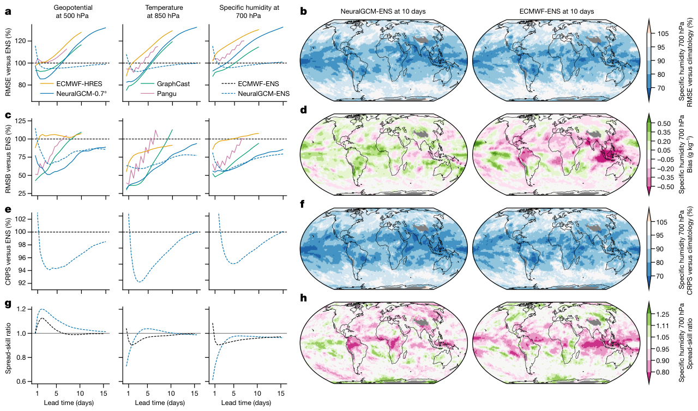

# NeuralGCM · 四种预报指标与全球误差地图

[大图目录](../README.md) · [混合矢量 PDF · 下载单页图版](figure.pdf) · [来源记录](metadata.json)

**Nature 2024 · Fig. 2 · a–h（8 个标记面板）**

## 这张图怎么读

先横读 a、b：随预报时效变化的 RMSE 与第 10 天 700 hPa 比湿的空间分布对应。再按同一顺序读 c、d 的偏差，e、f 的概率预报 CRPS，以及 g、h 的集合离散度与误差之比。

**版式**　四行分别对应四种指标。每行左侧用三幅并列折线比较大气变量，右侧用两张同投影地图比较模型，并在行末放对应色标。

## 出处与文件

*Neural general circulation models for weather and climate*。Dmitrii Kochkov, Janni Yuval, Ian Langmore, Peter Norgaard, Jamie Smith, Griffin Mooers, Milan Klöwer, James Lottes, Stephan Rasp, Peter Düben, Sam Hatfield, Peter Battaglia, Alvaro Sanchez-Gonzalez, Matthew Willson, Michael P. Brenner, Stephan Hoyer。

PDF 同时保留矢量路径与嵌入位图。照片、显微图像或热图等位图部分保留原分辨率。部分文字可以选取。 从论文 PDF 提取完整图版，另存为单页 PDF，并等比生成预览。面板沿用原文顺序。

CC BY 4.0（论文及无单独署名例外的图材）。

[原图出处](https://www.nature.com/articles/s41586-024-07744-y/figures/2) · [发布方图像或全文](https://www.nature.com/articles/s41586-024-07744-y.pdf) · [许可条款](https://creativecommons.org/licenses/by/4.0/)

<!-- source extras -->

另有作者在预印本 v3 使用的独立矢量 PDF，位于 TeX 源包的 `images/fig2-specific-humidity.pdf`。其 a–h 曲线与地图和期刊版对应，字体、括号略有差异。仓库中的单页图版取自正式发表的 CC BY 4.0 版。 [作者源包](https://arxiv.org/src/2311.07222v3) · [版本与传播许可](https://arxiv.org/abs/2311.07222v3)
