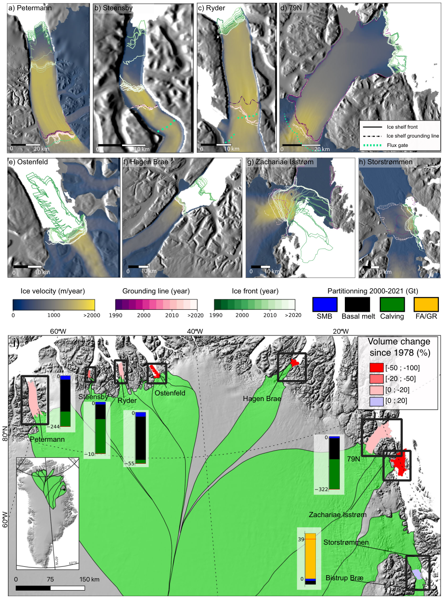

# 把八座冰架的退缩放回同一幅区域地图

[大图目录](../README.md) · [混合矢量 PDF · 下载单页图版](figure.pdf) · [来源记录](metadata.json)

**Nature Communications 2023 · Fig. 1 · a–i（9 个标记面板）**

## 这张图怎么读

a–d 依次是 Petermann、Steensby、Ryder、79N。e–h 对应 Ostenfeld、Hagen Bræ、Zachariæ Isstrøm、Storstrømmen。每一格用相同图例区分冰流速度、冰前缘、接地线。i 把这些冰架放回北格陵兰，用各处的柱图拆解表面质量平衡、底部融化与崩解贡献。

**版式**　上方两排八个局部地图按冰架分格，共用其下方一整行色标。下方一幅区域图标出其位置、体积变化以及各处的质量收支柱状图。

## 出处与文件

*Rapid disintegration and weakening of ice shelves in North Greenland*。R. Millan, E. Jager, J. Mouginot, et al.。

PDF 同时保留矢量路径与嵌入位图。照片、显微图像或热图等位图部分保留原分辨率。部分文字可以选取。 从论文 PDF 提取完整图版，另存为单页 PDF，并等比生成预览。面板沿用原文顺序。

CC BY 4.0。图注注明冰流速度取自 Mouginot 等（参考文献 4），底图据 Morlighem 等的 BedMachine v3（文献 12），通量门据 Wood 等（文献 6）。沿用这些来源署名。

[原图出处](https://www.nature.com/articles/s41467-023-42198-2/figures/1) · [发布方图像或全文](https://www.nature.com/articles/s41467-023-42198-2.pdf) · [许可条款](https://creativecommons.org/licenses/by/4.0/) · [作者公开的数据与绘图代码](https://doi.org/10.5281/zenodo.8354794)
