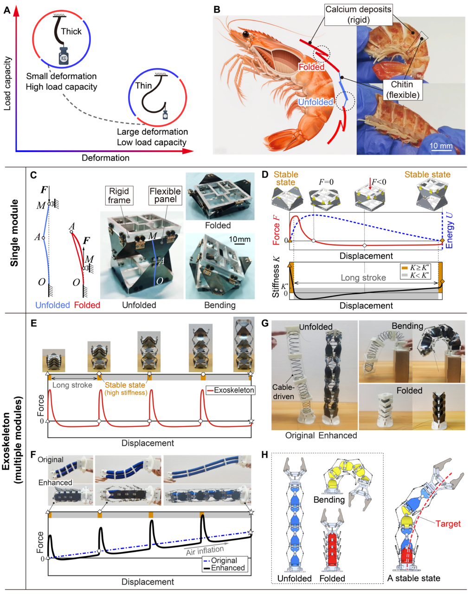

# 从虾壳分节到承力折纸机械臂

[大图目录](../README.md) · [位图参考 · 下载单页图版](figure.pdf) · [来源记录](metadata.json)

**Science Advances 2025 · Fig. 1 · A–H（8 个标记面板）**

## 这张图怎么读

A、B 提出设计取舍与生物原型。沿 C、D 看单元从折叠到展开的稳定态，再看 E 中四个单元依次转换如何产生多个力峰。F、G 对照增强前后的气动臂和索驱臂，H 标出可保持的姿态。

**版式**　首行并列变形与承重的矛盾、虾体硬柔分节。下方以“单模块”和“多模块外骨骼”分区：构型照片贴近力学曲线，右下角用机械臂姿态收束。

## 出处与文件

*Origami exoskeletons for enhanced soft robotic manipulation*。Kangjia Fu, Xuesong Wu, Sunquan Yu, Qi Zhang, Yanjie Yang, Tonglin Xu, Wen Yao, Teng Yi, Hua Li, Yong Chen, Xiang Zhang, Xiaoqian Chen。

出版 PDF 的整图以位图为主，放大或在 Illustrator 中打开时，图内曲线仍是像素。 从论文 PDF 提取完整图版，另存为单页 PDF，并等比生成预览。面板沿用原文顺序。

CC BY-NC 4.0。 Copyright © 2025 The Authors, some rights reserved; exclusive licensee American Association for the Advancement of Science. No claim to original U.S. Government Works. Distributed under a Creative Commons Attribution NonCommercial License 4.0 (CC BY-NC).

[原图出处](https://pmc.ncbi.nlm.nih.gov/articles/PMC12309676/#F1) · [发布方图像或全文](https://pmc-oa-opendata.s3.amazonaws.com/PMC12309676.1/PMC12309676.1.pdf) · [许可条款](https://creativecommons.org/licenses/by-nc/4.0/)

<!-- source extras -->

PDF 中嵌入的整图为 1801 × 2267 像素，可直接查看原分辨率。[下载嵌入图像](embedded.png)
