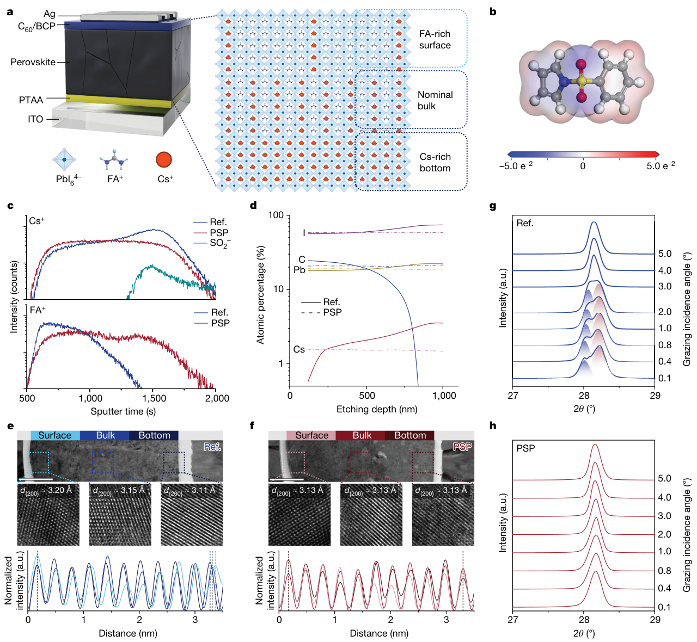

# 沿薄膜深度追踪钙钛矿的成分偏析

[大图目录](../README.md) · [混合矢量 PDF · 下载单页图版](figure.pdf) · [来源记录](metadata.json)

**Nature 2023 · Fig. 1 · a–h（8 个标记面板）**

## 这张图怎么读

a 先标出表面、体相和底部。沿同一方向读 c、d 的成分测量，再横向对读 e、f 三个深度的晶格像，最后比较 g、h 中不同入射角的峰形。

**版式**　上部放器件剖面、晶格示意与处理分子。中左两列排深度剖面，下方并排参考膜与处理膜的三个取样深度。右列上下对齐两组衍射谱。

## 出处与文件

*Homogenizing out-of-plane cation composition in perovskite solar cells*。Zheng Liang, Yong Zhang, Huifen Xu, Wenjing Chen, Boyuan Liu, Jiyao Zhang, Hui Zhang, Zihan Wang, Dong-Ho Kang, Jianrong Zeng, Xingyu Gao, Qisheng Wang, Huijie Hu, Hongmin Zhou, Xiangbin Cai, Xingyou Tian, Peter Reiss, Baomin Xu, Thomas Kirchartz, Zhengguo Xiao, Songyuan Dai, Nam-Gyu Park, Jiajiu Ye, Xu Pan。

PDF 同时保留矢量路径与嵌入位图。照片、显微图像或热图等位图部分保留原分辨率。部分文字可以选取。 从论文 PDF 提取完整图版，另存为单页 PDF，并等比生成预览。面板沿用原文顺序。

CC BY 4.0。 © The Author(s) 2023

[原图出处](https://www.nature.com/articles/s41586-023-06784-0/figures/1) · [发布方图像或全文](https://www.nature.com/articles/s41586-023-06784-0.pdf) · [许可条款](https://creativecommons.org/licenses/by/4.0/)
