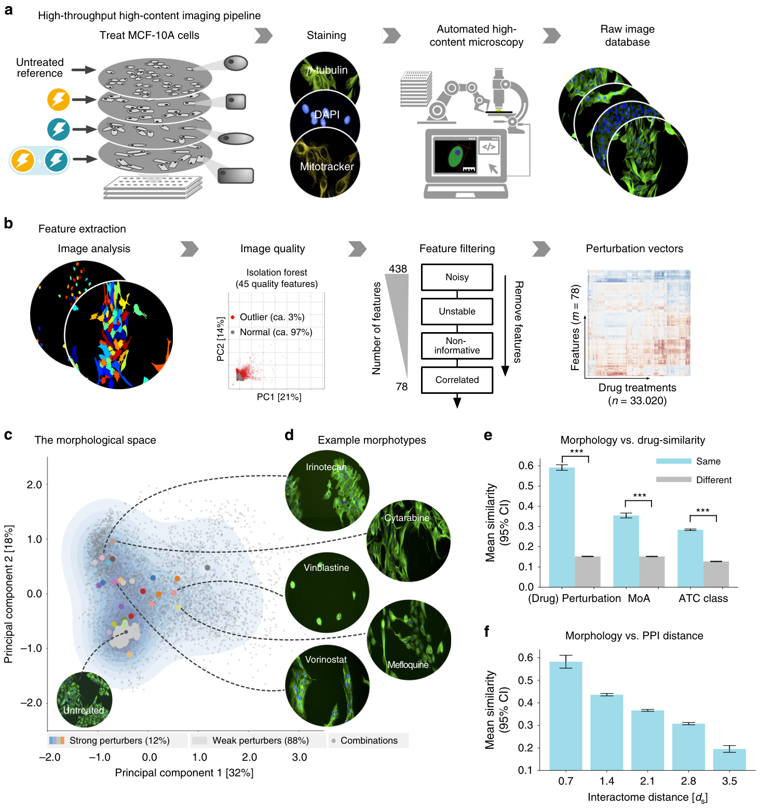

# 细胞形态空间 · 从统计点找到显微图像

[大图目录](../README.md) · [引线与局部展开](../README.md#cross-panel-links) · [单页 PDF](figure.pdf) · [来源记录](metadata.json)

**Nature Communications 2019 · Fig. 3 · a–f**

## 怎样读这张图

a、b 从样品、成像和特征提取读到每个处理条件的表征。再在 c 选一个代表点，顺虚线找到 d 的对应显微图，最后看 e、f 对形态相似性作出的定量比较。

## 出处与原件

*Mapping the perturbome network of cellular perturbations*。Michael Caldera, Felix Müller, Isabel Kaltenbrunner, Marco P. Licciardello, Charles-Hugues Lardeau, Stefan Kubicek, Jörg Menche。

完整 a–f。流程图中的线条、图注文字与部分统计图保留为矢量对象；显微照片与部分形态嵌入图合并为位图。

CC BY 4.0。[论文图版](https://www.nature.com/articles/s41467-019-13058-9/figures/3) · [原始文件](https://pmc-oa-opendata.s3.amazonaws.com/PMC6853941.1/PMC6853941.1.pdf) · [许可条款](https://creativecommons.org/licenses/by/4.0/) · [版权说明](https://www.nature.com/articles/s41467-019-13058-9#rightslink)
