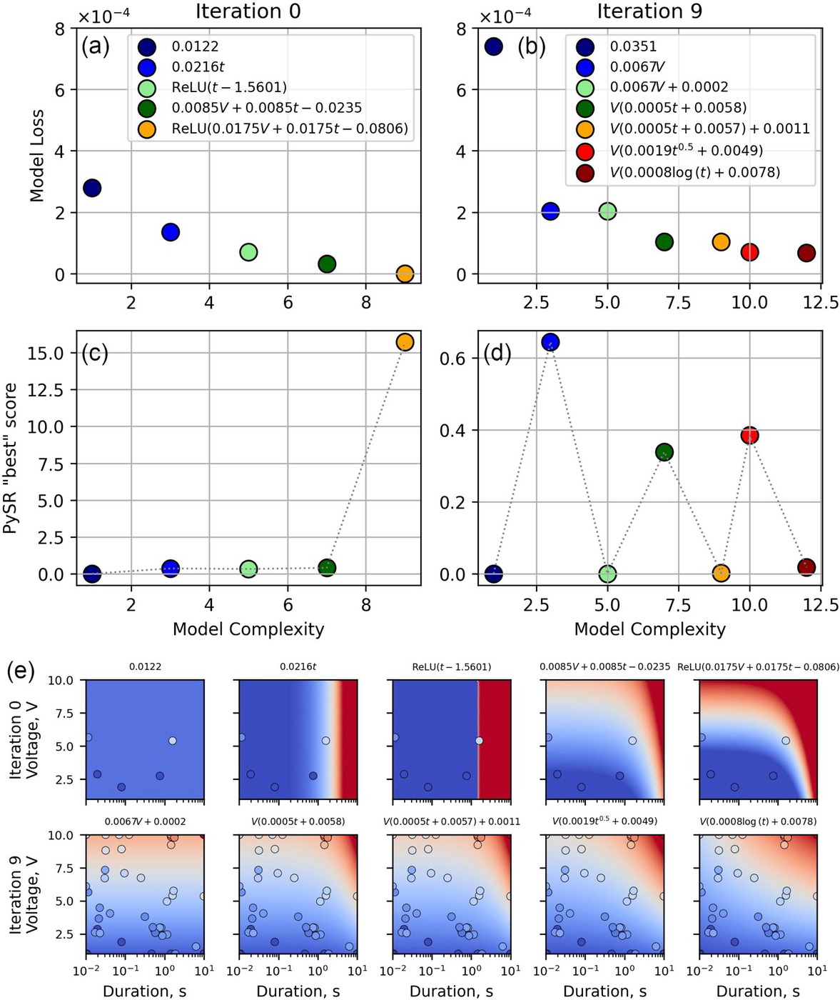

# 铁电畴生长 · 从前沿上的公式追到二维半径预测图

[大图目录](../README.md) · [从模型选择读到输出](../README.md#model-to-output) · [作者整图 PNG](original.png) · [来源记录](metadata.json)

**arXiv（预印本） 2026 · Fig. 4 · a–e（e 含两行共十幅预测图）**

## 沿一个模型读图

a 橙色复杂度 9 的前沿点 → a 图例中的 ReLU 公式 → c 中同色的 PySR 分数 → e 上排最右、同公式为标题的二维输出及实测点。公式界定了模型结构，图中未另画表达式树。

在迭代 0 的 a 中选最右侧橙点，复杂度为 9，图例写作 ReLU(0.0175V + 0.0175t − 0.0806)。c 同一橙点给出这一轮最高的 PySR 分数。e 上排最右小图把同一公式写在标题，横轴为脉冲时长、纵轴为电压，底色是预测有效半径，圆点是实验数据。也可在 b 中选迭代 9 的红点（复杂度 10），沿公式 V(0.0019t⁰·⁵ + 0.0049) 找到 e 下排第四幅，比较另一种生长规律的响应。

## 出处与文件

*LLM-Guided Open Hypothesis Learning from Autonomous Scanning Probe Microscopy Experiments*。Boris Slautin, Utkarsh Pratiush, Yu Liu, Kamyar Barakati, Sergei Kalinin。

作者提交的 PDF 在第 11 页把完整 Fig. 4 嵌为单张 1379 × 1640 位图。这里无损取出为 PNG，保留全部五个面板和十张预测图。

CC BY 4.0。

[原图出处](https://arxiv.org/pdf/2605.06839v1#page=11) · [来源 PDF](https://arxiv.org/pdf/2605.06839v1) · [许可说明](https://creativecommons.org/licenses/by/4.0/)
