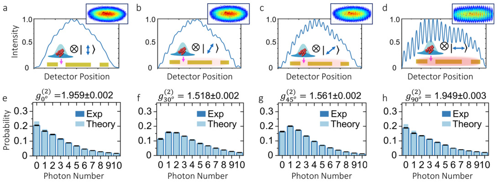

# 用上下两排一一配对干涉图样和光子数统计

[大图目录](../README.md) · [位图参考 · 下载单页图版](figure.pdf) · [来源记录](metadata.json)

**Nature Communications 2021 · Fig. 2 · a–h（8 个标记面板）**

## 这张图怎么读

a/e 是单狭缝透射热光的基准。b/f、c/g 分别对照偏振旋转后的干涉条纹和光子数分布，条纹在 c 更清楚。d/h 显示沿相同方向偏振时的干涉图及重新接近热分布的统计。每一列均可就地对照实验柱和理论值。

**版式**　两行四列以实验条件为列。每个上格放远场空间强度剖面、小幅强度图和偏振／狭缝示意。对应的下格放光子数概率分布和二阶相关值。

## 出处与文件

*Observation of the modification of quantum statistics of plasmonic systems*。Chenglong You, Mingyuan Hong, Narayan Bhusal, et al.。

出版 PDF 的整图以位图为主，放大或在 Illustrator 中打开时，图内曲线仍是像素。 从论文 PDF 提取完整图版，另存为单页 PDF，并等比生成预览。面板沿用原文顺序。

CC BY 4.0。出版社原图注未单独列出第三方素材署名或排除条款。

[原图出处](https://www.nature.com/articles/s41467-021-25489-4/figures/2) · [发布方图像或全文](https://www.nature.com/articles/s41467-021-25489-4.pdf) · [许可条款](https://creativecommons.org/licenses/by/4.0/)

<!-- source extras -->

PDF 中嵌入的整图为 1500 × 542 像素，可直接查看原分辨率。[下载嵌入图像](embedded.png)
