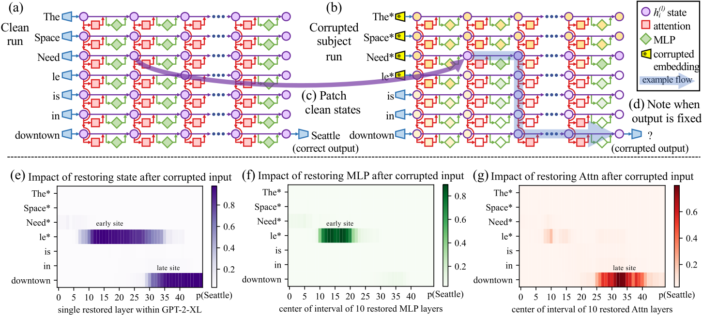

# ROME · 把一次激活恢复实验读成概率热图

[大图目录](../README.md) · [同一输入的干预对照](../README.md#paired-interventions) · [作者独立 PDF](original.pdf) · [SVG · 从 PDF 导出，文字转轮廓](figure.svg) · [来源记录](metadata.json)

**NeurIPS 2022 · Fig. 1 · a–g**

## 怎样读这张图

从 a 的正常输出 Seattle 开始，在 b 给地标名称的词嵌入加噪，再循 c 的紫色箭头把选定位置的正常激活复制回来。d 指出要观察的输出。e–g 固定同一提示和目标词，依次显示恢复隐藏状态、MLP 或注意力后的概率。沿地标末尾的 le* 行，f 在靠前的中间层出现绿色高值；g 的红色高值出现在 downtown 行的较后层。f 和 g 的横坐标标的是连续十层恢复窗口的中心。

## 出处与原件

*Locating and Editing Factual Associations in GPT*。Kevin Meng, David Bau, Alex Andonian, Yonatan Belinkov。

作者投稿源包中的独立 PDF。节点、箭头、大部分文字与热图单元保留矢量对象；三幅热图的色标为嵌入位图。 原件位于作者源包的 `figs/info-flow-maps-crop.pdf`。

作者保留版权，未核实单独开放图形许可。arXiv v5 采用 arXiv 非独占传播许可。 [原图出处](https://proceedings.neurips.cc/paper_files/paper/2022/file/6f1d43d5a82a37e89b0665b33bf3a182-Paper-Conference.pdf#page=2) · [作者源包](https://arxiv.org/src/2202.05262v5) · [作者项目](https://rome.baulab.info/)
