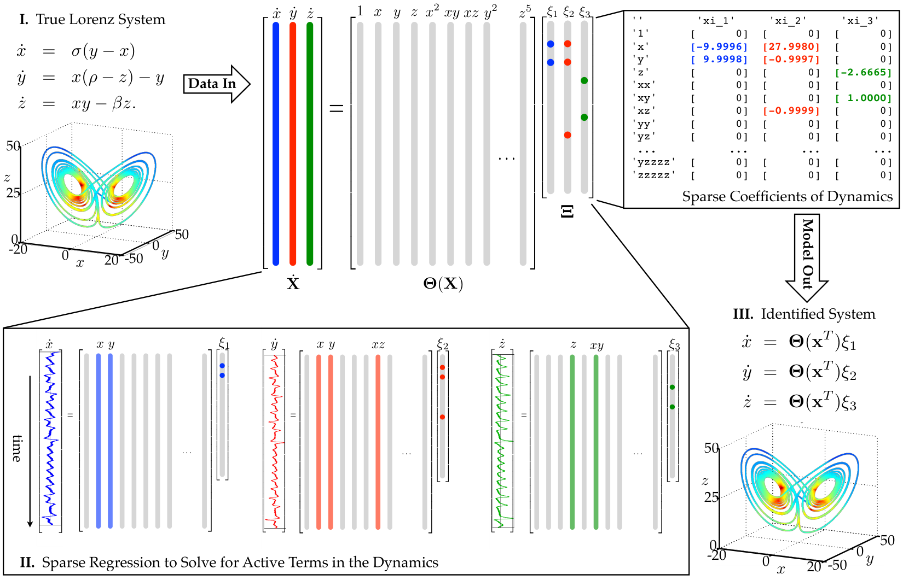

# SINDy · 从稀疏系数读回方程和轨迹

[大图目录](../README.md) · [从模型选择读到输出](../README.md#model-to-output) · [作者独立 PDF](original.pdf) · [来源记录](metadata.json)

**PNAS 2016 · Fig. 1 · I–III（含系数表和分项展开）**

## 怎样读这张图

I 给出作为参照的 Lorenz 方程及其轨迹。选蓝色导数列，沿 II 左边的小图寻找保留的候选项 x、y，再到右上表的第一列核对系数 −9.9996 和 9.9998。它们构成 III 中第一条识别方程。最后比较左右两幅相图中原系统与识别系统的轨迹形状。

## 出处与原件

*Discovering governing equations from data by sparse identification of nonlinear dynamical systems*。Steven L. Brunton, Joshua L. Proctor, J. Nathan Kutz。

作者在预印本 v1 中使用的独立 PDF。矩阵线条、系数表和部分文字可分别选择，图中也有内嵌图像。 原件位于作者源包的 `FIG00_BIG4.pdf`。

作者源包采用 arXiv 非独占传播许可，单图另行复用的许可未核实。 [原图出处](https://doi.org/10.1073/pnas.1517384113) · [作者源包](https://arxiv.org/src/1509.03580v1) · [许可](https://arxiv.org/licenses/nonexclusive-distrib/1.0/)

[同一 Lorenz 系统的模型选择图](../lorenz-pareto-coefficients-and-trajectories/README.md)把三个前沿点对应到各自的预测轨迹，并提供三份作者子图 PDF。
