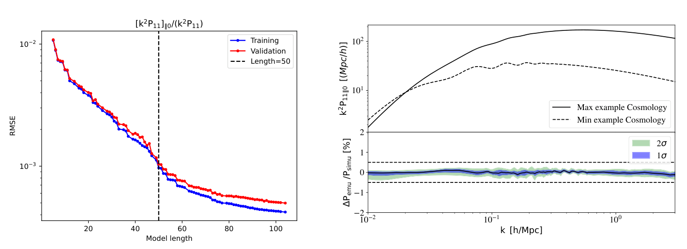

# Sym-EFT · 从长度 50 的候选式检验功率谱分量的模拟误差

[大图目录](../README.md) · [从模型选择读到输出](../README.md#model-to-output) · [单页矢量 PDF](figure.pdf) · [SVG · 从 PDF 导出](figure.svg) · [左栏原稿](panel-left.pdf) · [右栏原稿](panel-right.pdf) · [来源记录](metadata.json)

**Monthly Notices of the Royal Astronomical Society 2026 · Fig. 4 · 左侧误差前沿、右上谱分量、右下误差带**

## 沿一个模型读图

左图 Length=50 竖线 → 正文式（17）及其 20 个系数〔式（18）〕 → 右下 300 个宇宙学参数组合的 1σ、2σ 百分比误差带。

先读左图竖虚线 Length=50，训练和验证集各有一条 RMSE–模型长度曲线。正文式（17）给出这条候选的函数，式（18）列出 20 个数值系数。右上沿波数 k 读两个示例的谱分量，右下在同一 k 位置比较模型相对模拟值的误差带和 ±0.5% 阈值。

右上两条黑线表示两个示例宇宙学模型的目标谱分量。该候选式的预测表现由右下误差带给出；函数和系数见正文。

## 出处与文件

*Sym-EFT: accelerating effective field theory of large-scale structure with symbolic regression*。Despoina Farakou, Constantinos Skordis。

整图按作者稿第 8 页原排版裁出，保留曲线、标记与文字。另附作者 TeX 源包中的左右两份独立矢量 PDF。

CC BY 4.0。

[论文](https://academic.oup.com/mnras/article/552/3/stag1663/8785131) · [原图出处](https://arxiv.org/pdf/2511.05093v2#page=8) · [论文 PDF](https://arxiv.org/pdf/2511.05093v2) · [许可说明](https://creativecommons.org/licenses/by/4.0/) · [子图源包](https://arxiv.org/src/2511.05093v2)
