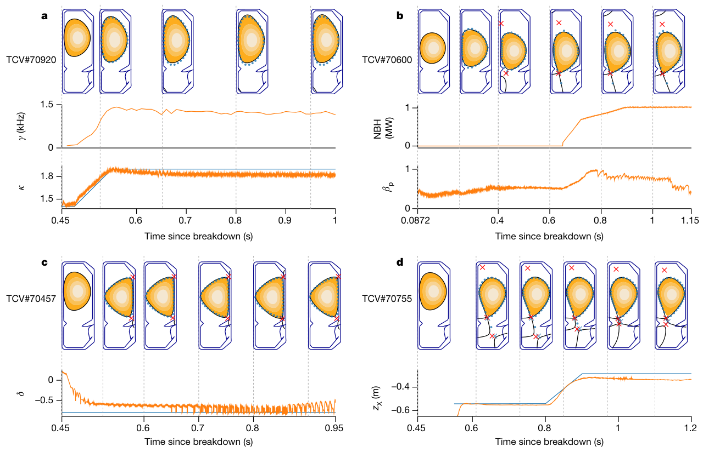

# TCV · 四种等离子体构型的控制轨迹

[大图目录](../README.md) · [矢量 PDF · 下载单页图版](figure.pdf) · [SVG · 文字转轮廓](figure.svg) · [来源记录](metadata.json)

**Nature 2022 · Fig. 3 · a–d（4 个标记面板）**

## 这张图怎么读

a、b 分别展示高伸长比与近似 ITER 形状，c、d 展示负三角形变与雪花构型。先比较每组第一帧的交接状态和后续边界，再沿横轴读下方量测。d 还标出随时间移动的目标 X 点。

**版式**　四组放电实验占据两行两列。每组上方横排等离子体截面的时间快照，下方的测量或目标轨迹共用时间方向，便于在形状和数值之间切换。

## 出处与文件

*Magnetic control of tokamak plasmas through deep reinforcement learning*。Jonas Degrave, Federico Felici, Jonas Buchli, Michael Neunert, Brendan Tracey, Francesco Carpanese, Timo Ewalds, Roland Hafner, Abbas Abdolmaleki, Diego de las Casas, Craig Donner, Leslie Fritz, Cristian Galperti, Andrea Huber, James Keeling, Maria Tsimpoukelli, Jackie Kay, Antoine Merle, Jean-Marc Moret, Seb Noury, Federico Pesamosca, David Pfau, Olivier Sauter, Cristian Sommariva, Stefano Coda, Basil Duval, Ambrogio Fasoli, Pushmeet Kohli, Koray Kavukcuoglu, Demis Hassabis, Martin Riedmiller。

PDF 保留可单独选择的矢量路径。部分文字可以选取。 从论文 PDF 提取完整图版，另存为单页 PDF，并等比生成预览。面板沿用原文顺序。

CC BY 4.0（论文及无单独署名例外的图材）。

[原图出处](https://www.nature.com/articles/s41586-021-04301-9/figures/3) · [发布方图像或全文](https://www.nature.com/articles/s41586-021-04301-9.pdf) · [许可条款](https://creativecommons.org/licenses/by/4.0/)

<!-- source extras -->

从正式图版导出 SVG。曲线保留为路径，文字转成轮廓。
