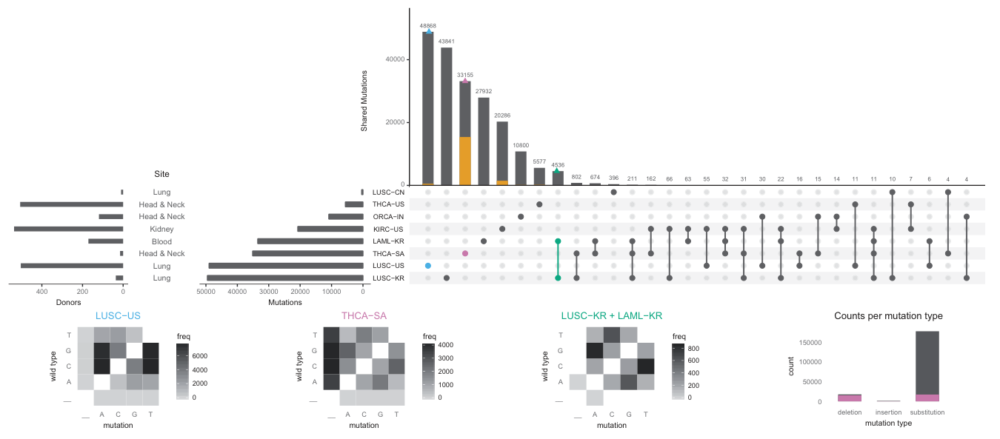

# UpSetR · 同一列连起集合组合、计数与属性

[大图目录](../README.md) · [共用数据与坐标](../README.md#linked-data) · [单页 PDF](figure.pdf) · [SVG · 文字转轮廓](figure.svg) · [来源记录](metadata.json)

**Bioinformatics 2017 · Fig. 1 · 原图无字母 · 按五个功能区阅读**

## 怎样读这张图

先读左侧各研究的信息和集合大小。再找交集矩阵中连着两个绿点的列，行名为 LAML-KR 和 LUSC-KR。柱顶的 4,536 是仅出现于这两项研究的变异数；下方第三张灰阶热图用绿色标题标明这批变异的替换类型。

## 出处与原件

*UpSetR: an R package for the visualization of intersecting sets and their properties*。Jake R. Conway, Alexander Lex, Nils Gehlenborg。

柱、点阵、连线及热图方格保留为矢量路径。图中带有三小块位图色带。

CC BY 4.0。[论文图版](https://rcastoragev2.blob.core.windows.net/b174f12dcdda32768fa4ea0d9a675722/PMC5870712.pdf#page=2) · [原始文件](https://rcastoragev2.blob.core.windows.net/b174f12dcdda32768fa4ea0d9a675722/PMC5870712.pdf) · [许可条款](https://creativecommons.org/licenses/by/4.0/) · [版权说明](https://doi.org/10.1093/bioinformatics/btx364)
