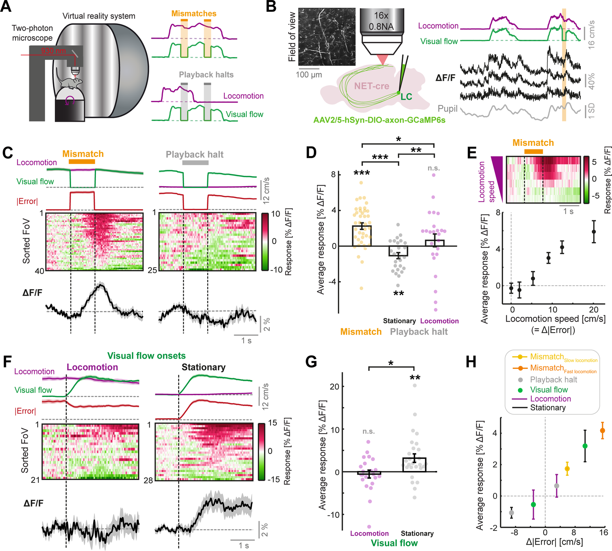

# 同一段视觉刺激在闭环和回放中对照

[大图目录](../README.md) · [同一输入的干预对照](../README.md#paired-interventions) · [期刊原图](original.png) · [来源记录](metadata.json)

**eLife 2023 · Fig. 1 · A–H**

## 怎样读这张图

A 右上绿色曲线在动物奔跑时停住 1 秒。右下回放同一段绿色视流，此时小鼠的运动不再控制画面。C 左右两列分别对齐闭环停顿和静止时的回放停顿，每列从速度与误差、各视场热图读到平均钙响应；D 把静止和运动时的回放分别列出。F、G 对视流启动作相应比较，H 最后将各条件的平均响应用同一条误差变化横轴表示。

## 出处与原件

*The locus coeruleus broadcasts prediction errors across the cortex to promote sensorimotor plasticity*。Rebecca Jordan, Georg B Keller。

eLife 图像服务提供 4651 × 4196 像素完整 PNG。出版 PDF 第 3 页将整幅图作为 2192 × 1978 像素位图嵌入。

CC BY 4.0。 [原图出处](https://elifesciences.org/articles/85111/figures#fig1) · [图像来源](https://iiif.elifesciences.org/lax:85111%2Felife-85111-fig1-v1.tif/full/full/0/default.png) · [许可](https://creativecommons.org/licenses/by/4.0/) · [配套数据与代码](https://zenodo.org/records/8006972)
