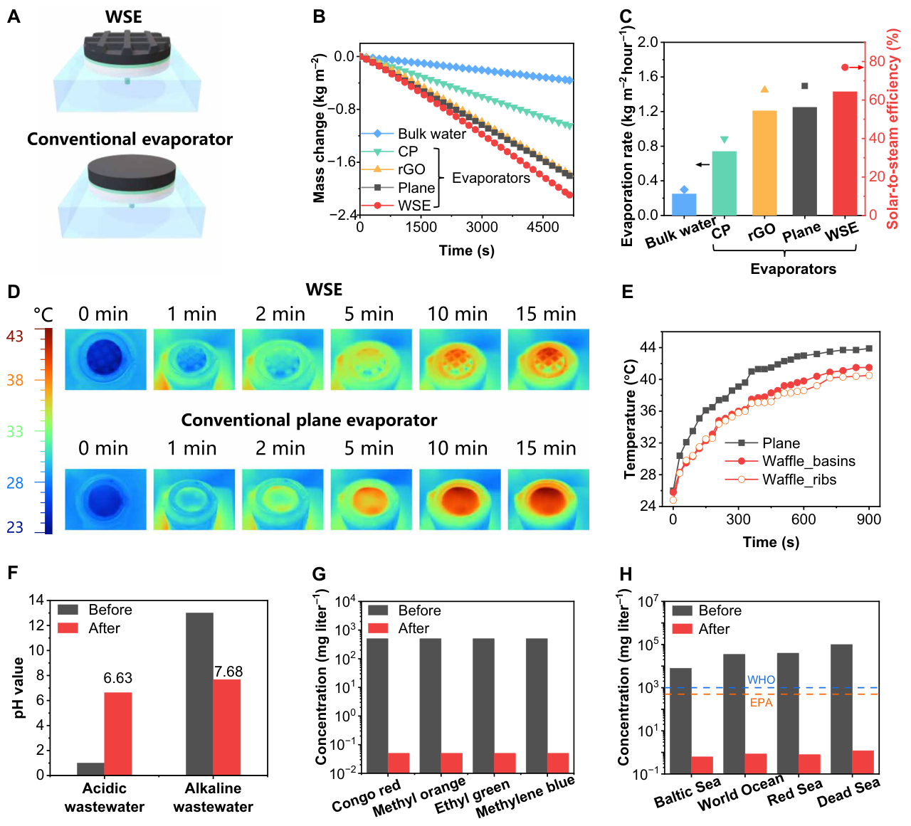

# 同一束光下比较两种海水蒸发器

[大图目录](../README.md) · [混合矢量 PDF · 下载单页图版](figure.pdf) · [来源记录](metadata.json)

**Science Advances 2024 · Fig. 3 · A–H（8 个标记面板）**

## 这张图怎么读

先用 A 确认结构差异，在 B、C 读蒸发性能。D 对照 0–15 分钟的同刻热像，E 把热像转为温度曲线。F–H 分别给出处理前后的酸碱性、染料浓度与海水盐度。

**版式**　首行并列结构示意、质量变化和效率。中央用两行同刻热像对比华夫形与平面蒸发器，右侧给温升曲线。底部以三种水质读数收尾。

## 出处与文件

*Quasi-waffle solar distiller for durable desalination of seawater*。Yanjun Wang, Tianqi Wei, Yue Wang, Jinjue Zeng, Tao Wang, Qi Wang, Shuo Zhang, Mengyue Zeng, Fengyue Wang, Pengcheng Dai, Xiangfen Jiang, Ming Hu, Jin Zhao, Zheng Hu, Jia Zhu, Xuebin Wang。

PDF 同时保留矢量路径与嵌入位图。照片、显微图像或热图等位图部分保留原分辨率。部分文字可以选取。 从论文 PDF 提取完整图版，另存为单页 PDF，并等比生成预览。面板沿用原文顺序。

CC BY-NC 4.0。 Copyright © 2024 The Authors, some rights reserved; exclusive licensee American Association for the Advancement of Science. No claim to original U.S. Government Works. Distributed under a Creative Commons Attribution NonCommercial License 4.0 (CC BY-NC).

[原图出处](https://pmc.ncbi.nlm.nih.gov/articles/PMC11135395/#F3) · [发布方图像或全文](https://pmc-oa-opendata.s3.amazonaws.com/PMC11135395.1/PMC11135395.1.pdf) · [许可条款](https://creativecommons.org/licenses/by-nc/4.0/)
