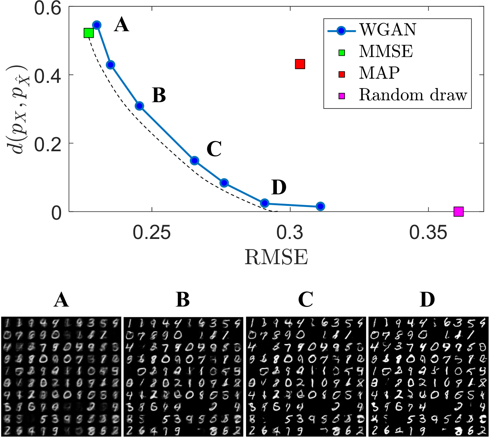

# 手写数字去噪 · 从权衡曲线上的 A–D 读到四组输出

[大图目录](../README.md) · [从模型选择读到输出](../README.md#model-to-output) · [作者独立 PDF](original.pdf) · [来源记录](metadata.json)

**CVPR 2018 · Fig. 6 · 权衡图与 A–D 四组去噪结果**

## 沿一个模型读图

蓝线上的 D → 该训练配置共用的生成器和加权损失 → 下方 D 组实际去噪图像。字母标识具体模型；逐点的损失权重数值没有标在原图中。

上方横轴为像素 RMSE，纵轴为输出与真实数字分布之间的距离。沿蓝线选 D，再看下方 D 组的数字；并排看 A、D 两组，D 的笔画更清楚，像素误差也更大。图注给出生成器损失 ℓ_MSE + λℓ_adv，作者通过改变 λ 得到各工作点。黑虚线表示理论界限，蓝线连接实际训练得到的去噪器。共有的网络层配置列在补充表 S1。

## 出处与文件

*The Perception-Distortion Tradeoff*。Yochai Blau, Tomer Michaeli。

作者 TeX 源包中直接引用的独立 PDF。曲线、圆点和坐标保留矢量，四组手写数字为内嵌图像。

arXiv 非独占传播许可，未核实图版的独立开放复用许可。

[原图出处](https://openaccess.thecvf.com/content_cvpr_2018/papers/Blau_The_Perception-Distortion_Tradeoff_CVPR_2018_paper.pdf#page=6) · [作者源包](https://arxiv.org/src/1711.06077v2) · [许可说明](https://arxiv.org/abs/1711.06077v2) · [网络层配置 · 补充表 S1](https://openaccess.thecvf.com/content_cvpr_2018/Supplemental/2765-supp.pdf)
