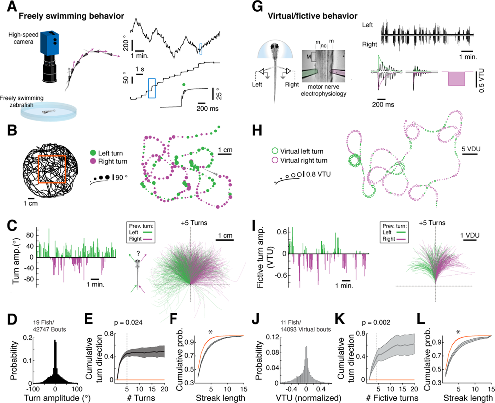

# 斑马鱼转向 · 用上一次转弯对齐后五次游动

[大图目录](../README.md) · [按事件对齐与汇总](../README.md#event-alignment) · [期刊原图](original.png) · [来源记录](metadata.json)

**eLife 2016 · Fig. 1 · A–L**

## 怎样读这张图

A 说明怎样由航向记录识别转弯。B 从红框取出一段实测路线，绿点为左转，品红点为右转，点的大小随转角变化。C 左用同一套颜色按时间排列转角，右将每次转弯后的五次游动移到共同起点、对齐朝向，并用起始转弯方向着色。D–F 从转角分布、转向偏好和同向串长汇总这些事件。G–L 用左右运动神经信号推断虚拟转弯，重复这套分析。

## 出处与原件

*Brain-wide mapping of neural activity controlling zebrafish exploratory locomotion*。Timothy W Dunn, Yu Mu, Sujatha Narayan, Owen Randlett, Eva A Naumann, Chao-Tsung Yang, Alexander F Schier, Jeremy Freeman, Florian Engert, Misha B Ahrens。

期刊图像服务器提供的完整 PNG（2677 × 2180）。正式论文 PDF 第 4 页的图像内容也是一整幅位图（1593 × 1297）。

CC BY 4.0。 [原图出处](https://elifesciences.org/articles/12741/figures#fig1) · [图像来源](https://iiif.elifesciences.org/lax:12741%2Felife-12741-fig1-v2.tif/full/full/0/default.png) · [许可](https://creativecommons.org/licenses/by/4.0/)
