# 机制参考图

[回到总目录](../../CATALOG.md)

## [D2L · 注意力输出](d2l-attention-output/README.md)

**教材或教程范例** · 完整机制示意，保留原标注供参考或拆取图形；这不是单个最小图元，不计入元素数量。

[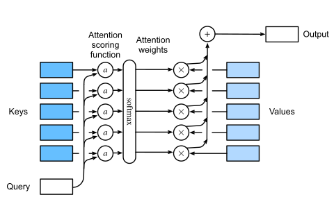](d2l-attention-output/source.svg)

## [D2L · 1×1 卷积](d2l-conv-1x1/README.md)

**教材或教程范例** · 完整机制示意，保留原标注供参考或拆取图形；这不是单个最小图元，不计入元素数量。

[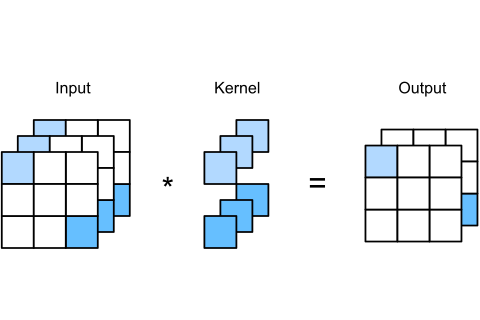](d2l-conv-1x1/source.svg)

## [D2L · 多输入通道卷积](d2l-conv-multi-in/README.md)

**教材或教程范例** · 完整机制示意，保留原标注供参考或拆取图形；这不是单个最小图元，不计入元素数量。

[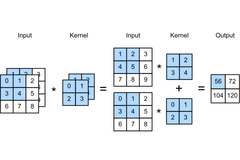](d2l-conv-multi-in/source.svg)

## [D2L · 卷积填充](d2l-conv-pad/README.md)

**教材或教程范例** · 完整机制示意，保留原标注供参考或拆取图形；这不是单个最小图元，不计入元素数量。

[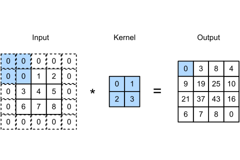](d2l-conv-pad/source.svg)

## [D2L · 卷积步幅](d2l-conv-stride/README.md)

**教材或教程范例** · 完整机制示意，保留原标注供参考或拆取图形；这不是单个最小图元，不计入元素数量。

[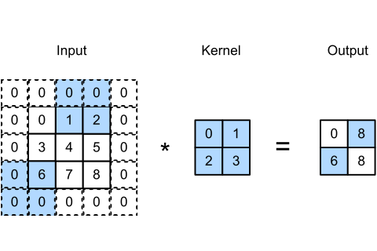](d2l-conv-stride/source.svg)

## [D2L · 一维卷积](d2l-conv1d/README.md)

**教材或教程范例** · 完整机制示意，保留原标注供参考或拆取图形；这不是单个最小图元，不计入元素数量。

[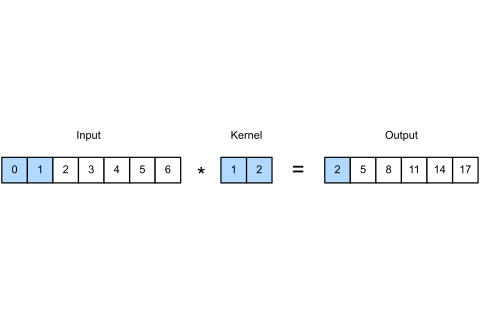](d2l-conv1d/source.svg)

## [D2L · 一维卷积与通道](d2l-conv1d-channel/README.md)

**教材或教程范例** · 完整机制示意，保留原标注供参考或拆取图形；这不是单个最小图元，不计入元素数量。

[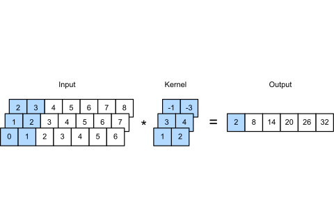](d2l-conv1d-channel/source.svg)

## [D2L · 二维互相关](d2l-correlation/README.md)

**教材或教程范例** · 完整机制示意，保留原标注供参考或拆取图形；这不是单个最小图元，不计入元素数量。

[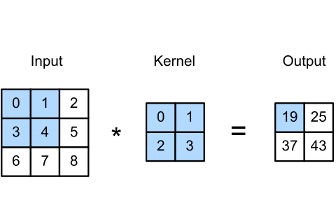](d2l-correlation/source.svg)

## [D2L · 多头注意力](d2l-multi-head-attention/README.md)

**教材或教程范例** · 完整机制示意，保留原标注供参考或拆取图形；这不是单个最小图元，不计入元素数量。

[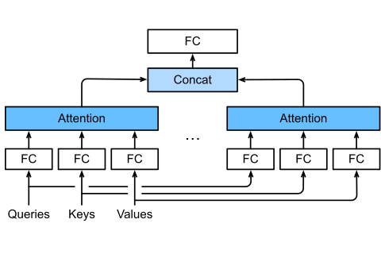](d2l-multi-head-attention/source.svg)

## [D2L · 神经元示意](d2l-neuron/README.md)

**教材或教程范例** · 完整机制示意，保留原标注供参考或拆取图形；这不是单个最小图元，不计入元素数量。

[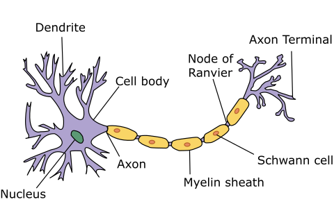](d2l-neuron/source.svg)

## [D2L · 池化](d2l-pooling/README.md)

**教材或教程范例** · 完整机制示意，保留原标注供参考或拆取图形；这不是单个最小图元，不计入元素数量。

[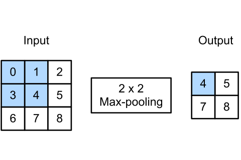](d2l-pooling/source.svg)

## [D2L · 查询、键与值](d2l-qkv/README.md)

**教材或教程范例** · 完整机制示意，保留原标注供参考或拆取图形；这不是单个最小图元，不计入元素数量。

[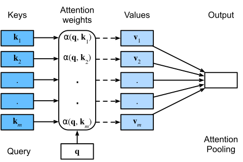](d2l-qkv/source.svg)

## [D2L · 普通块与残差块对比](d2l-residual-block/README.md)

**教材或教程范例** · 完整机制示意，保留原标注供参考或拆取图形；这不是单个最小图元，不计入元素数量。

[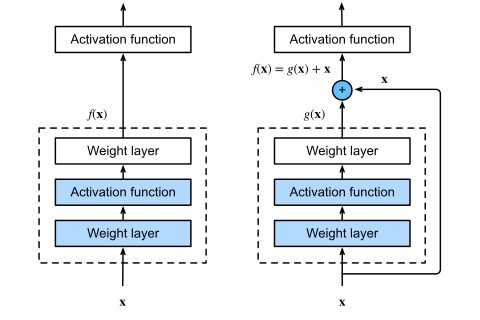](d2l-residual-block/source.svg)

## [D2L · 自注意力对照](d2l-self-attention/README.md)

**教材或教程范例** · 完整机制示意，保留原标注供参考或拆取图形；这不是单个最小图元，不计入元素数量。

[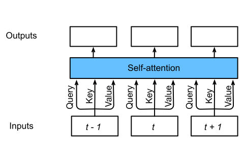](d2l-self-attention/source.svg)

## [D2L · 单神经元](d2l-singleneuron/README.md)

**教材或教程范例** · 完整机制示意，保留原标注供参考或拆取图形；这不是单个最小图元，不计入元素数量。

[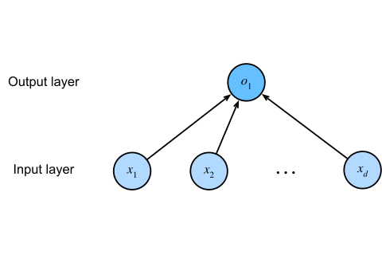](d2l-singleneuron/source.svg)

## [D2L · 转置卷积](d2l-trans-conv/README.md)

**教材或教程范例** · 完整机制示意，保留原标注供参考或拆取图形；这不是单个最小图元，不计入元素数量。

[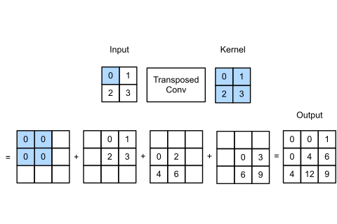](d2l-trans-conv/source.svg)

## [D2L · 带步幅的转置卷积](d2l-trans-conv-stride2/README.md)

**教材或教程范例** · 完整机制示意，保留原标注供参考或拆取图形；这不是单个最小图元，不计入元素数量。

[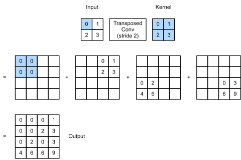](d2l-trans-conv-stride2/source.svg)
