# Teaser 范例

[Teaser](README.md) · [Architecture](../architecture/README.md) · [Element](../element/README.md) · [总目录](../CATALOG.md)

按图的表达用途浏览。会议、期刊、年份及综述类型保留在条目标签中。

| 表达用途 | 数量 | 入口 |
|---|---:|---|
| 方法与范式对照 | 14 | [浏览](#comparison) |
| 多子图主题与应用总览 | 13 | [浏览](#multi-panel) |
| 领域全景、演进与综述路线图 | 26 | [浏览](#landscape) |
| 任务、动机与能力展示 | 8 | [浏览](#capabilities) |
| 控制效果与优化过程 | 3 | [浏览](#control-progress) |
| 速度与精度权衡 | 2 | [浏览](#tradeoff) |

## 方法与范式对照

### [Cortex · 生物系统巩固与模型记忆巩固类比](cortex-memory-consolidation/README.md)

左侧用海马体、睡眠与新皮层说明生物系统巩固；右侧并列展示带上下文的模型与巩固后的模型，以高亮 FFN／MoE 变化解释将上下文收益写入参数的目标。

arXiv 2026 · 预印本

**子图组织：** (a) 生物系统巩固的阶段式叙事；(b) LLM 巩固前后的结构并列。 原论文 Figure 1。

[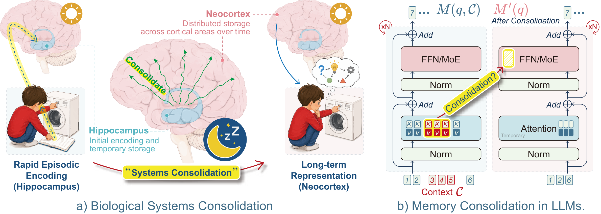](cortex-memory-consolidation/README.md)

[说明与源文件](cortex-memory-consolidation/README.md) · [关联元素](cortex-memory-consolidation/README.md#关联范例与元素)

### [生物医学 PIML · 六面板方法范式总览](survey-biomedical-six-methods/README.md)

同一张图用六个面板解释不同表示模型、物理损失、连续时间建模与算子学习。蓝色表示模型、绿色表示数据或损失，适合借鉴为内容充实的方法范式总览。

arXiv 2025 · 预印本 · 综述

**子图组织：** 2 列 × 3 行，依次对照 NN、KAN、物理约束网络、Neural/KAN ODE、DeepONet、FNO/WNO/LNO。 原论文 Figure 1。

[说明与源文件](survey-biomedical-six-methods/README.md) · [关联元素](survey-biomedical-six-methods/README.md#关联范例与元素)

### [动力学学习 · 物理与数据依赖的四范式对照](survey-dynamics-physics-learning-spectrum/README.md)

四个面板沿用相同的输入、输出和网络视觉语汇，通过物理模块进入网络的方式突出范式区别；下方的连续方向带概括物理先验与学习依赖的变化。

PNAS 2024 · 期刊论文

**子图组织：** 四栏：残差模型、可训练算子、等变学习、解耦表示；下方用物理—学习方向带串联。 原论文 Figure 2。

**整图位图，仅构图参考。**

[说明与源文件](survey-dynamics-physics-learning-spectrum/README.md) · [关联元素](survey-dynamics-physics-learning-spectrum/README.md#关联范例与元素)

### [机器人学习 · 物理先验融入的三路对照](survey-robot-physics-three-routes/README.md)

三栏沿用相同的物理先验主题，分别用机器人观测、网络内部结构和物理损失方程解释三种融入位置。颜色分区和真实方法示意共同承担信息表达，与多方法对照 teaser 的结构接近。

arXiv 2026 · 预印本 · 综述

**子图组织：** 三栏并列：输入／数据／表示、模型架构、训练损失。 原论文 Figure 1。

[说明与源文件](survey-robot-physics-three-routes/README.md) · [同论文：机器人学习 · 物理先验融入架构的六类方法](survey-robot-physics-six-families/README.md) · [关联元素](survey-robot-physics-three-routes/README.md#关联范例与元素)

### [PIML · 数据、模型与优化的完整融合流程](survey-piml-data-model-optimization/README.md)

三个并列区域分别展开数据、模型与优化；底部共享物理先验向三处提供约束，框内保留采样点、物理模块和损失方程。适合借鉴为内容充实的综述概念总览。

Machine Learning for Computational Science and Engineering 2025 · 期刊论文 · 综述

**整图位图，仅构图参考。**

[说明与源文件](survey-piml-data-model-optimization/README.md) · [关联元素](survey-piml-data-model-optimization/README.md#关联范例与元素)

### [PDE 求解综述 · 物理—数据连续谱与两类方法全景](survey-pde-physics-data-continuum/README.md)

共同难题、统一视角和分支方法排成三层。PINNs 与神经算子沿同一物理—数据主线对照，下层用 12 个小型科学／方法图示解释具体研究方向，信息丰富且阅读顺序清楚。

IJCAI 2026 · 会议论文；未核实 Oral · 综述

**子图组织：** 上层 3 个共同问题，中层物理—数据连续谱，下层两类方法各 6 个研究方向。 原论文 Figure 1。

[说明与源文件](survey-pde-physics-data-continuum/README.md) · [关联元素](survey-pde-physics-data-continuum/README.md#关联范例与元素)

### [物理知识融入学习 · 五种方式的统一图元对照](survey-physics-knowledge-five-paradigms/README.md)

五栏使用同一套数据、模型和目标函数图元，通过信息流和明暗编码突出物理知识进入学习过程的位置。读者只需理解一栏的图示规则，就能比较其余四栏。

TMLR 2025 · 期刊论文 · 综述

**子图组织：** 五栏并列：物理模型、物理损失、物理数据增强、多数据集泛化和上下文学习。 原论文 Figure 1。

[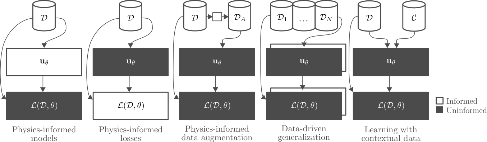](survey-physics-knowledge-five-paradigms/README.md)

[说明与源文件](survey-physics-knowledge-five-paradigms/README.md) · [关联元素](survey-physics-knowledge-five-paradigms/README.md#关联范例与元素)

### [Informed ML · 数据路径与先验知识路径的概念对照](survey-informed-ml-information-flow/README.md)

把传统数据路径和独立先验知识路径画在同一信息流中，通过实线、虚线和内部阶段展开解释融合发生在哪里。简洁的结构承载清楚的方法差异。

arXiv 2019 · 预印本 · 综述

**子图组织：** 问题—数据—学习—解答的主路径，配独立先验知识路径；学习流程内部展开 4 个位置。 原论文 Figure 1。

[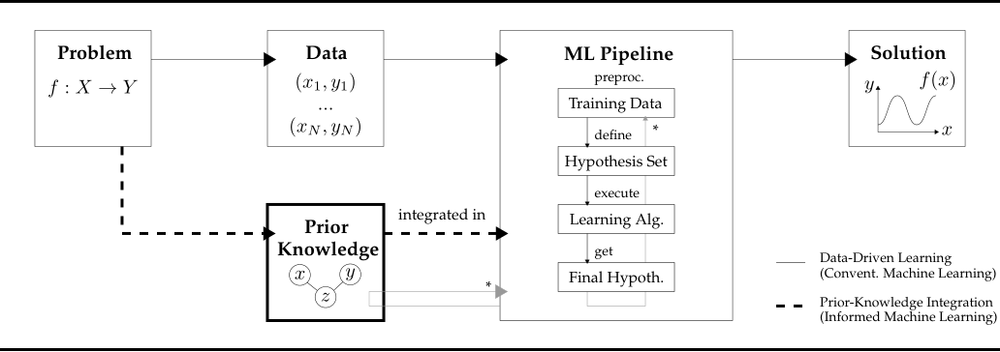](survey-informed-ml-information-flow/README.md)

[说明与源文件](survey-informed-ml-information-flow/README.md) · [同论文：Informed ML · 知识来源—表示—融入位置全景](survey-informed-ml-knowledge-map/README.md) · [关联元素](survey-informed-ml-information-flow/README.md#关联范例与元素)

### [AI for PDEs · 物理与数据条件下的三类方法对照](survey-ai-pde-physics-data-paradigms/README.md)

同一套物理信息／数据条件标记贯穿多个子区，各区给出相应方法的科学示意和求解路径。子图围绕一个共同问题形成对照，能同时说明方法差异、适用条件及相互融合的关系。

arXiv 2024 · 预印本 · 综述

**子图组织：** 3 类方法＋4 种物理／数据条件；上层展示 PINNs 和算子学习，下层展开 PINO 的两种路径。 原论文 Figure 2。

[说明与源文件](survey-ai-pde-physics-data-paradigms/README.md) · [同论文：AI for PDEs · 领域定位、方法与应用全景](survey-ai-pde-scope-map/README.md) · [关联元素](survey-ai-pde-physics-data-paradigms/README.md#关联范例与元素)

### [VAR · 从逐 token 到逐尺度生成的范式对照](var-paradigm/README.md)

同一张图比较语言自回归、图像逐 token 生成和逐尺度生成，核心差异直接表现为生成顺序与尺度变化。

NeurIPS 2024 · Oral

[说明与源文件](var-paradigm/README.md) · [同论文：VAR · 多尺度 VQVAE 与 VAR 两阶段训练](../architecture/var-architecture/README.md) · [关联元素](var-paradigm/README.md#关联范例与元素)

### [DPO · RLHF 与直接偏好优化的流程简化](dpo-comparison/README.md)

左右两块使用同一输入与终点，只改变中间步骤；简化过程本身就是论文的主要观点。

NeurIPS 2023 · Oral

**整图位图，仅构图参考。**

[说明与源文件](dpo-comparison/README.md) · [关联元素](dpo-comparison/README.md#关联范例与元素)

### [K-LoRA：主体风格组合与训练范式比较](k-lora/README.md)

左侧主体与风格组合示例，右侧比较需要训练与免训练的融合方式。

[说明与源文件](k-lora/README.md) · [关联元素](k-lora/README.md#关联范例与元素)

### [RayDer：数据瓶颈与新训练范式](rayder-concept/README.md)

数据金字塔、训练过程、结果与规模变化并列，先说明问题和核心差异。

[说明与源文件](rayder-concept/README.md) · [同论文：RayDer：统一 Transformer 的两个使用阶段](../architecture/rayder/README.md) · [关联元素](rayder-concept/README.md#关联范例与元素)

### [图基础模型范式对照 · 专用学习与共享预训练](survey-graph-foundation-paradigm/README.md)

左右对照专用端到端学习与预训练加适配，复用同样的图节点和模型符号，底部再用示意曲线与能力列表补充两种范式的概念差异；几乎全靠结构和线条传递信息。

arXiv 2023 · 预印本 · 综述

[说明与源文件](survey-graph-foundation-paradigm/README.md) · [关联元素](survey-graph-foundation-paradigm/README.md#关联范例与元素)

## 多子图主题与应用总览

按主题面板、任务组或场景组浏览，组内可包含多张图片。这里同时收录原论文 teaser 首图，以及适合借鉴为 teaser 的任务或应用总览；每项标明原图号和子图计数口径。

### [无线生成式 AI · 城市场景串联四类应用](survey-genai-wireless-four-scenarios/README.md)

四个方法场景围绕中心城市示意组织：信道估计、定位数据增强、雷达去噪、人体感知域适应。每区既有应用对象，也有局部模型或信号流程。

arXiv 2025 · 预印本 · 综述

**子图组织：** 2×2 应用分区＋跨区的城市、道路与室内场景；局部模型与应用位置相互连接。 原论文 Figure 1。

[说明与源文件](survey-genai-wireless-four-scenarios/README.md) · [关联元素](survey-genai-wireless-four-scenarios/README.md#关联范例与元素)

### [AI4Research · 五类科研活动的多区总览](survey-ai4research-five-activities/README.md)

五类科研活动各有独立底色、示意对象和细分任务，中心场景把它们连成一张完整概念图。局部可单独阅读，整体也有明确的视觉中心。

arXiv 2025 · 预印本 · 综述

**子图组织：** 围绕中心科研协作场景布置五个任务区：科学理解、学术综述、科学发现、学术写作、同行评审。 原论文 Figure 1。

[说明与源文件](survey-ai4research-five-activities/README.md) · [同论文：AI4Research · 科学发现的五区流程总览](survey-ai4research-discovery-cycle/README.md) · [同论文：AI4Research · 三大领域、七类应用面板](survey-ai4research-seven-domains/README.md) · [关联元素](survey-ai4research-five-activities/README.md#关联范例与元素)

### [AI4Research · 科学发现的五区流程总览](survey-ai4research-discovery-cycle/README.md)

将想法、评估、理论和实验的局部方法放在同一张总览里，并用闭环说明端到端发现。各区有任务细分和简短图示，适合借鉴为方法家族与研究流程结合的 teaser。

arXiv 2025 · 预印本 · 综述

**子图组织：** 五个功能区：想法挖掘、新颖性与意义评估、理论分析、实验执行、全自动发现。 原论文 Figure 5。

[说明与源文件](survey-ai4research-discovery-cycle/README.md) · [同论文：AI4Research · 五类科研活动的多区总览](survey-ai4research-five-activities/README.md) · [同论文：AI4Research · 三大领域、七类应用面板](survey-ai4research-seven-domains/README.md) · [关联元素](survey-ai4research-discovery-cycle/README.md#关联范例与元素)

### [AI4Research · 三大领域、七类应用面板](survey-ai4research-seven-domains/README.md)

同一视觉语汇覆盖七类学科应用，以三行组织较大的领域分组。各面板不只是学科名称，还列出模拟、发现、控制、开发或实验等具体用途。

arXiv 2025 · 预印本 · 综述

**子图组织：** 三行大分区：自然科学三类、应用科学与工程两类、社会科学两类，共七个学科应用面板。 原论文 Figure 8。

[说明与源文件](survey-ai4research-seven-domains/README.md) · [同论文：AI4Research · 五类科研活动的多区总览](survey-ai4research-five-activities/README.md) · [同论文：AI4Research · 科学发现的五区流程总览](survey-ai4research-discovery-cycle/README.md) · [关联元素](survey-ai4research-seven-domains/README.md#关联范例与元素)

### [科学大模型综述 · 六学科环形问答总览](survey-scillm-six-domain-examples/README.md)

中心概念连接六个学科扇区，外侧用模型名称、问题文本和科学图片补充实际含义。相比单纯的领域圆环，多了一层能够快速读懂的具体任务。

arXiv 2025 · 预印本 · 综述

**子图组织：** 六个环形扇区，分别连接物理、化学、材料、生命科学、地球科学和天文学的模型与问题示例。 原论文 Figure 15。

[说明与源文件](survey-scillm-six-domain-examples/README.md) · [同论文：科学大模型综述 · 数据获取、构建与审查全景](survey-scillm-data-construction/README.md) · [同论文：科学大模型综述 · 五层知识阶梯与发现循环](survey-scillm-knowledge-levels/README.md) · [关联元素](survey-scillm-six-domain-examples/README.md#关联范例与元素)

### [科学大模型综述 · 数据获取、构建与审查全景](survey-scillm-data-construction/README.md)

将数据来源、数据构建的三条路径和质量审查放在统一框架中。多行步骤、来源图标和右侧反馈形成有主次的复杂总览，适合借鉴为“上层来源＋中层处理＋侧边约束”的 teaser。

arXiv 2025 · 预印本 · 综述

**子图组织：** 三个主区：上方多源数据获取、下方三条数据构建路径、右侧质量审查与反馈。 原论文 Figure 28。

[说明与源文件](survey-scillm-data-construction/README.md) · [同论文：科学大模型综述 · 六学科环形问答总览](survey-scillm-six-domain-examples/README.md) · [同论文：科学大模型综述 · 五层知识阶梯与发现循环](survey-scillm-knowledge-levels/README.md) · [关联元素](survey-scillm-data-construction/README.md#关联范例与元素)

### [可微仿真综述 · 十二个场景的双排时间线](survey-diffsim-twelve-scenes/README.md)

软体、刚体、轨迹优化、形态优化和操作等研究场景共同组成一张总览。时间线、节点、标签与十二张独立图像保留为分离对象，适合借鉴为内容丰富的发展脉络 teaser。

arXiv 2024 · 预印本 · 综述

**子图组织：** 十二个研究场景分置时间线上下两排，每排六个；彩色节点连接对应的研究与年份。 原论文 Figure 1。

[说明与源文件](survey-diffsim-twelve-scenes/README.md) · [关联元素](survey-diffsim-twelve-scenes/README.md#关联范例与元素)

### [指令式图像编辑 · 21 种任务的多子图总览](survey-instruction-editing-task-gallery/README.md)

21 个任务子图按五类操作组织，每个小面板保留输入、编辑结果和短标签；颜色只分大类，横排、竖排与底部长条配合，内容密集且层次清楚。

arXiv 2026 · 预印本 · 综述

**子图组织：** 21 个任务子图，按 5 类操作分区；共 44 张输入或结果图。 原论文 Figure 2。

[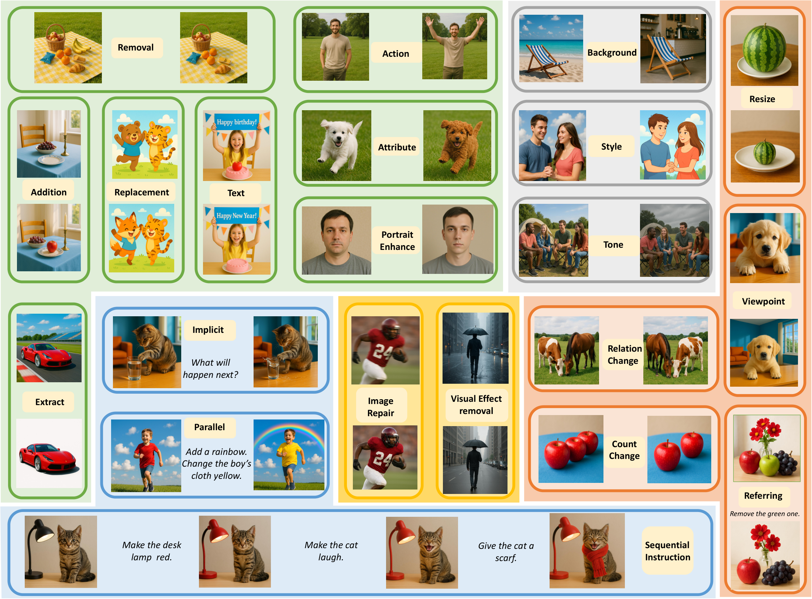](survey-instruction-editing-task-gallery/README.md)

[说明与源文件](survey-instruction-editing-task-gallery/README.md) · [关联元素](survey-instruction-editing-task-gallery/README.md#关联范例与元素)

### [Neural Fields · 5 类技术与 6 类应用的多子图 teaser](survey-neural-fields-multipanel/README.md)

把 5 类通用技术放在上层、6 类应用放在下层，再用一个数据库截图连接到综述资源；每个主题有短标签、不同形态的原论文图例和清楚分区，是完整的综述首图。

EUROGRAPHICS 2022 · STAR 报告 · 综述

**子图组织：** 上层 5 类技术，下层 6 类应用，另有数据库预览。 原论文 Figure 1。

[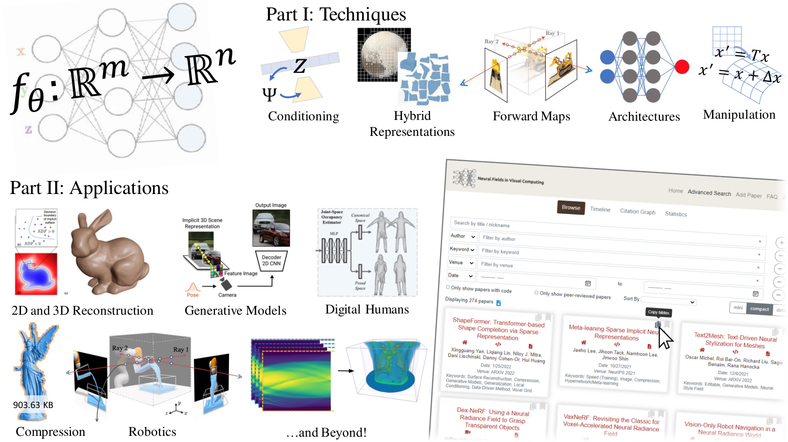](survey-neural-fields-multipanel/README.md)

[说明与源文件](survey-neural-fields-multipanel/README.md) · [关联元素](survey-neural-fields-multipanel/README.md#关联范例与元素)

### [多模态 Agent · 8 类应用与外围场景子图](survey-multimodal-agent-applications/README.md)

8 类应用围绕中心展开，外围场景图分别对应 UI 助手、驾驶、游戏、机器人、音视频和视觉推理等主题；既有领域分类，也有能直接识别的任务实例。

arXiv 2024 · 预印本 · 综述

**子图组织：** 8 个应用主题，外围配置代表性场景或交互截图。 原论文 Figure 4。

[说明与源文件](survey-multimodal-agent-applications/README.md) · [关联元素](survey-multimodal-agent-applications/README.md#关联范例与元素)

### [3DGS 编辑应用 · 5 组子图与上下前后对照](survey-3dgs-editing-operations/README.md)

5 组操作横向排开，上排原视图、下排编辑结果；视频编辑保留连续帧，风格迁移加入参考图，统一对照逻辑又允许各组呈现必要细节。

arXiv 2025 · 预印本 · 综述

**子图组织：** (a)–(e) 5 组操作子图，每组上下对齐原图与编辑结果。 原论文 Figure 4。

[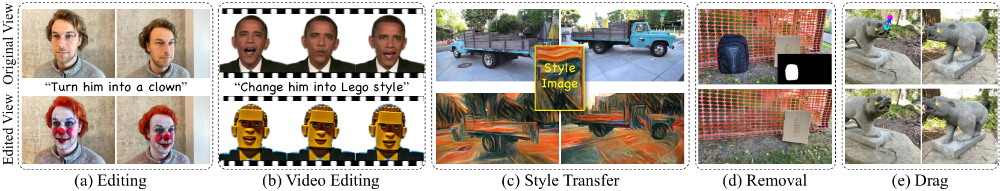](survey-3dgs-editing-operations/README.md)

[说明与源文件](survey-3dgs-editing-operations/README.md) · [关联元素](survey-3dgs-editing-operations/README.md#关联范例与元素)

### [Neural Rendering 2020 · 两排 11 组场景 teaser](survey-neural-rendering-2020-gallery/README.md)

两排 11 组场景覆盖人像、对象、场景、重光照、表情与人体驱动，使用不同宽度的小组安排输入输出对和多视角样例，整张图仍保持平齐的上下边界。

EUROGRAPHICS 2020 · STAR 报告 · 综述

**子图组织：** 两排 11 组场景示例，组内可包含多个视图或输入输出对。 原论文 Figure 1。

**整图位图，仅构图参考。**

[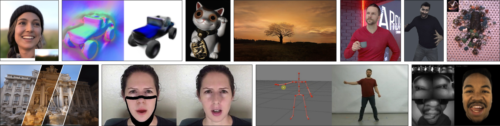](survey-neural-rendering-2020-gallery/README.md)

[说明与源文件](survey-neural-rendering-2020-gallery/README.md) · [关联元素](survey-neural-rendering-2020-gallery/README.md#关联范例与元素)

### [Advances in Neural Rendering · 两排约 10 组主题 teaser](survey-neural-rendering-2022-gallery/README.md)

把自由视角、生成、重光照、场景编辑和动态人物等能力排成两层图群；组内用多个视图或状态形成小叙事，既展示多样性，也让同一能力的变化可见。

EUROGRAPHICS 2022 · STAR 报告 · 综述

**子图组织：** 两排约 10 个主题组，每组用多个视图或状态展示一种能力。 原论文 Figure 1。

**整图位图，仅构图参考。**

[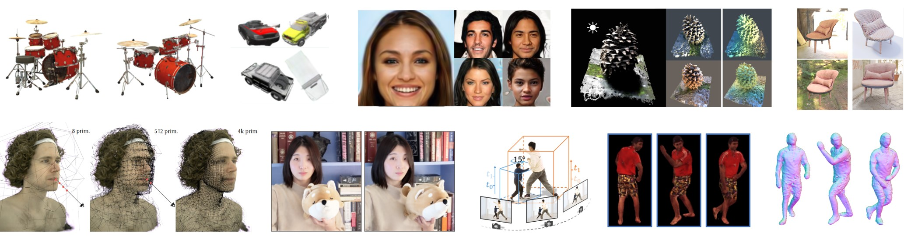](survey-neural-rendering-2022-gallery/README.md)

[说明与源文件](survey-neural-rendering-2022-gallery/README.md) · [关联元素](survey-neural-rendering-2022-gallery/README.md#关联范例与元素)

## 领域全景、演进与综述路线图

条目分别标明场景概念图、能力演进图、谱系图、时间线、应用全景或分类路线图。先看各图的实际表达用途；原图号与所收录版本单独记录。

### [科学大模型综述 · 五层知识阶梯与发现循环](survey-scillm-knowledge-levels/README.md)

用阶梯明确科学知识的层级，每层配简短含义和代表性图标，底部再展示跨层循环。适合表达“原始数据如何逐层走向科学发现”，与多面板平铺提供不同的组织方式。

arXiv 2025 · 预印本 · 综述

**子图组织：** 五级阶梯从事实数据上升到理论、方法、建模与仿真、科学洞见，底部补充四步迭代循环。 原论文 Figure 14。

[说明与源文件](survey-scillm-knowledge-levels/README.md) · [同论文：科学大模型综述 · 六学科环形问答总览](survey-scillm-six-domain-examples/README.md) · [同论文：科学大模型综述 · 数据获取、构建与审查全景](survey-scillm-data-construction/README.md) · [关联元素](survey-scillm-knowledge-levels/README.md#关联范例与元素)

### [流体机器学习综述 · 五阶段与降阶模型总览](survey-fluid-ml-five-stages/README.md)

用流体降阶建模这一具体例子解释通用机器学习流程。图中同时保留流场快照、网络结构、潜在空间动力学和目标函数，适合将一般概念落到一个科学任务上。

arXiv 2021 · 预印本 · 综述

**子图组织：** 五个编号环节：问题、数据、架构、损失、优化；流场快照与编码器—动力学—解码器提供具体例子。 原论文 Figure 1。

[说明与源文件](survey-fluid-ml-five-stages/README.md) · [关联元素](survey-fluid-ml-five-stages/README.md#关联范例与元素)

### [PINN 综述 · 导数、物理方程与残差三栏展开](survey-piml-equations-residuals/README.md)

以导数、物理规律和残差为三条主线，将自动微分、有限差分、不同算子、无量纲化、方程改写与弱形式整合到一个有公式和科学示意的总览里。

arXiv 2024 · 预印本 · 综述

**子图组织：** 三个带 (a)–(c) 标记的主题区：导数求取、物理规律、强形式／弱形式残差。 原论文 Figure 4。

**整图位图，仅构图参考。**

[说明与源文件](survey-piml-equations-residuals/README.md) · [同论文：PINN 综述 · 问题、损失与优化的多子图全景](survey-piml-optimization-landscape/README.md) · [关联元素](survey-piml-equations-residuals/README.md#关联范例与元素)

### [PINN 综述 · 问题、损失与优化的多子图全景](survey-piml-optimization-landscape/README.md)

上方主线串联问题、损失函数和优化器，下面用场分布、区域划分、采样点、梯度几何与 Pareto 前沿展开细节。是一张内容密度高、科学子图丰富的综述总览。

arXiv 2024 · 预印本 · 综述

**子图组织：** 三大区：PIML 问题、损失函数、优化器；各区下面并列多个场分布、区域划分、采样和几何子示意。 原论文 Figure 5。

**整图位图，仅构图参考。**

[说明与源文件](survey-piml-optimization-landscape/README.md) · [同论文：PINN 综述 · 导数、物理方程与残差三栏展开](survey-piml-equations-residuals/README.md) · [关联元素](survey-piml-optimization-landscape/README.md#关联范例与元素)

### [机器人学习 · 物理先验融入架构的六类方法](survey-robot-physics-six-families/README.md)

六个面板使用相同的色块、标题、中心图示和底部说明组织不同方法家族。每个面板包含公式、网络连接或机器人结构，既能独立阅读，也能共同构成有科学内容的方法全景。

arXiv 2026 · 预印本 · 综述

**子图组织：** 2 列 × 3 行：六类方法各配结构示意、公式或机器人例子。 原论文 Figure 5。

[说明与源文件](survey-robot-physics-six-families/README.md) · [同论文：机器人学习 · 物理先验融入的三路对照](survey-robot-physics-three-routes/README.md) · [关联元素](survey-robot-physics-six-families/README.md#关联范例与元素)

### [PBDL · 领域位置与方法空间的概念总览](pbdl-field-method-space/README.md)

左侧用机器学习、数值方法与物理的交集定位领域，右侧展开正反问题以及数据驱动、物理损失和混合方法，形成从领域位置到方法空间的概念总览。

**整图位图，仅构图参考。**

[说明与源文件](pbdl-field-method-space/README.md) · [关联元素](pbdl-field-method-space/README.md#关联范例与元素)

### [Informed ML · 知识来源—表示—融入位置全景](survey-informed-ml-knowledge-map/README.md)

三列分别回答知识来自哪里、如何表示、在哪里进入学习流程。Sankey 连接将分类目录变成关系全景，能够同时展示多个类别以及它们之间的联系。

arXiv 2019 · 预印本 · 综述

**子图组织：** 3 类知识来源 → 8 类知识表示 → 4 个学习流程融入位置。 原论文 Figure 2。

[说明与源文件](survey-informed-ml-knowledge-map/README.md) · [同论文：Informed ML · 数据路径与先验知识路径的概念对照](survey-informed-ml-information-flow/README.md) · [关联元素](survey-informed-ml-knowledge-map/README.md#关联范例与元素)

### [PIML · 物理先验、融入层级与任务的三维全景](survey-piml-three-axis-landscape/README.md)

以物理先验、学习中的融入层级和任务为三个维度，再用两张二维图将代表方法放回同一分类空间。图形结构直接解释领域是如何被组织的。

arXiv 2022 · 预印本 · 综述

**子图组织：** (a) 三维分类示意；(b) 先验类型与融入层级；(c) 先验类型与应用任务。 原论文 Figure 1。

[说明与源文件](survey-piml-three-axis-landscape/README.md) · [关联元素](survey-piml-three-axis-landscape/README.md#关联范例与元素)

### [AI for PDEs · 领域定位、方法与应用全景](survey-ai-pde-scope-map/README.md)

从 AI4Science 中的领域位置出发，将三类 AI4PDE 方法连接到计算力学，再按三个应用领域及正反问题展开。分类、范围和研究对象形成一条完整主线，是内容充实的综述概念总览。

arXiv 2024 · 预印本 · 综述

**子图组织：** 领域定位圆环＋3 类方法＋3 类力学应用；按正问题与反问题展开 18 个任务标签。 原论文 Figure 1。

[说明与源文件](survey-ai-pde-scope-map/README.md) · [同论文：AI for PDEs · 物理与数据条件下的三类方法对照](survey-ai-pde-physics-data-paradigms/README.md) · [关联元素](survey-ai-pde-scope-map/README.md#关联范例与元素)

### [AI4Science 领域圆环 · 从量子到连续系统](survey-ai4science-domain-wheel/README.md)

用三层圆环把量子、原子与连续系统统一起来：外圈是研究对象的视觉实例，中圈是学科和任务，中心是对称性、泛化与不确定性等共同议题。领域覆盖与核心观点同时可见。

arXiv 2023 · 预印本 · 综述

[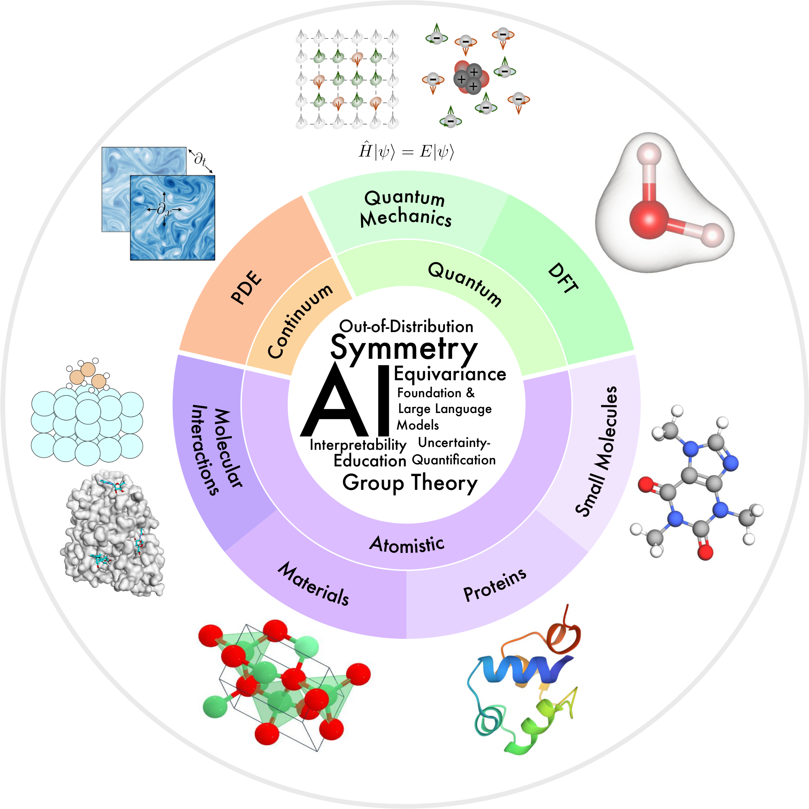](survey-ai4science-domain-wheel/README.md)

[说明与源文件](survey-ai4science-domain-wheel/README.md) · [同论文：AI4Science 时空尺度图 · 研究对象与共同挑战](survey-ai4science-scale-map/README.md) · [关联元素](survey-ai4science-domain-wheel/README.md#关联范例与元素)

### [AI4Science 时空尺度图 · 研究对象与共同挑战](survey-ai4science-scale-map/README.md)

把研究方向放进时间与长度尺度坐标，再用斜向箭头表达跨尺度共性；同一画面包含应用对象、典型任务、对称性和共通研究挑战，信息量足而层级清楚。

arXiv 2023 · 预印本 · 综述

[说明与源文件](survey-ai4science-scale-map/README.md) · [同论文：AI4Science 领域圆环 · 从量子到连续系统](survey-ai4science-domain-wheel/README.md) · [关联元素](survey-ai4science-scale-map/README.md#关联范例与元素)

### [3D／4D 世界模型 · 场景与研究维度全景](survey-3d4d-world-overview/README.md)

左边用可识别的三维街景建立主题，右边用重复的窄栏展开定义、方法、数据与评估、应用和未来方向；VideoGen、OccGen、LiDARGen 的图标贯穿多个维度，视觉与内容都有明确对应。

arXiv 2025 · 预印本 · 综述

[说明与源文件](survey-3d4d-world-overview/README.md) · [同论文：3D／4D 世界模型方法地图 · 三棵功能树](survey-3d4d-method-tree/README.md) · [同论文：世界模型数据集图谱 · 蛇形时间路与模态卡片](survey-3d4d-dataset-roadmap/README.md) · [关联元素](survey-3d4d-world-overview/README.md#关联范例与元素)

### [3D／4D 世界模型方法地图 · 三棵功能树](survey-3d4d-method-tree/README.md)

把 VideoGen、OccGen、LiDARGen 画成三组有主干和侧枝的研究地图，在分支处标出数据引擎、动作解释、场景表征和预测等功能，兼顾密集代表工作与整体方向。

arXiv 2025 · 预印本 · 综述

[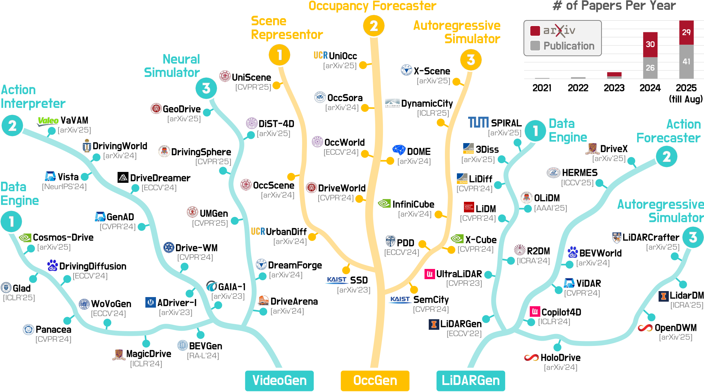](survey-3d4d-method-tree/README.md)

[说明与源文件](survey-3d4d-method-tree/README.md) · [同论文：3D／4D 世界模型 · 场景与研究维度全景](survey-3d4d-world-overview/README.md) · [同论文：世界模型数据集图谱 · 蛇形时间路与模态卡片](survey-3d4d-dataset-roadmap/README.md) · [关联元素](survey-3d4d-method-tree/README.md#关联范例与元素)

### [世界模型数据集图谱 · 蛇形时间路与模态卡片](survey-3d4d-dataset-roadmap/README.md)

沿蛇形路线组织数据集年代，每张卡片复用名称、年份、模态图标和样例图四层信息；时间顺序、视觉差异和模态范围可以一起阅读。

arXiv 2025 · 预印本 · 综述

[说明与源文件](survey-3d4d-dataset-roadmap/README.md) · [同论文：3D／4D 世界模型 · 场景与研究维度全景](survey-3d4d-world-overview/README.md) · [同论文：3D／4D 世界模型方法地图 · 三棵功能树](survey-3d4d-method-tree/README.md) · [关联元素](survey-3d4d-dataset-roadmap/README.md#关联范例与元素)

### [3D 生成概念地图 · 表示、学习目标与生成范式](survey-3d-representation-generators/README.md)

以表示与生成模型的双向关系为中心，左侧用同一兔子示例比较多种 3D 表示，右侧比较 VAE、GAN、扩散和自回归，上下分别列训练目标与采样方式，信息组织完整。

arXiv 2026 · 预印本 · 综述

[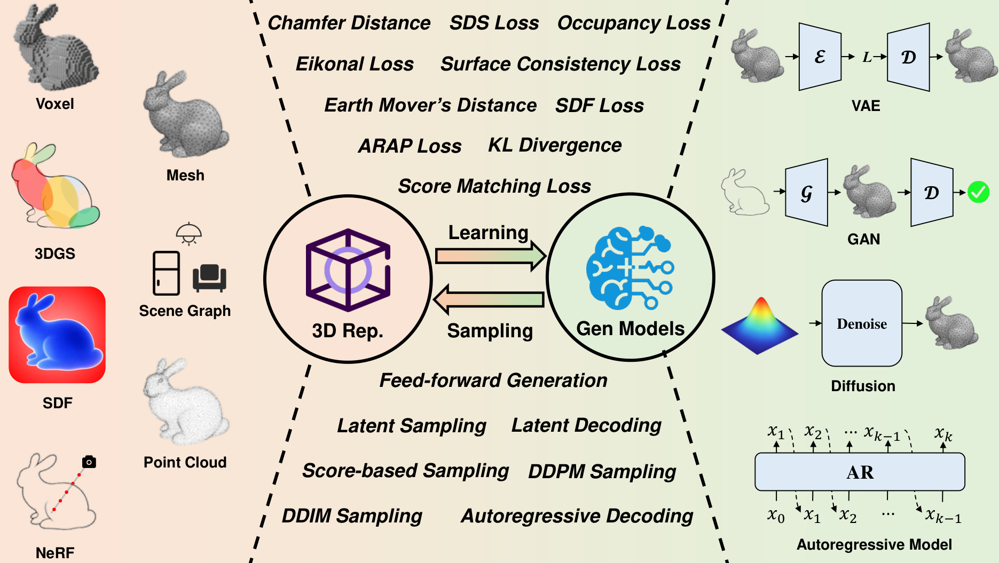](survey-3d-representation-generators/README.md)

[说明与源文件](survey-3d-representation-generators/README.md) · [关联元素](survey-3d-representation-generators/README.md#关联范例与元素)

### [世界模型能力递进 · 可信预测、可控干预与决策收益](survey-world-model-capability-ladder/README.md)

用同一个机器人操作任务贯穿观察、未来预测、不同动作干预和决策执行，最后接入改进闭环；相同场景反复出现，使抽象能力差异变成可以直接对照的图像证据要求。

arXiv 2026 · 预印本 · 综述

[说明与源文件](survey-world-model-capability-ladder/README.md) · [关联元素](survey-world-model-capability-ladder/README.md#关联范例与元素)

### [基础模型概念总览 · 多源数据与多任务适配](survey-foundation-model-adaptation/README.md)

左侧多模态数据汇入一个共享基础，右侧扇出多个下游任务；每个任务用短名称和具象图标表达，能快速讲清共同底座与任务适配的概念。

arXiv 2021 · 预印本 · 综述

[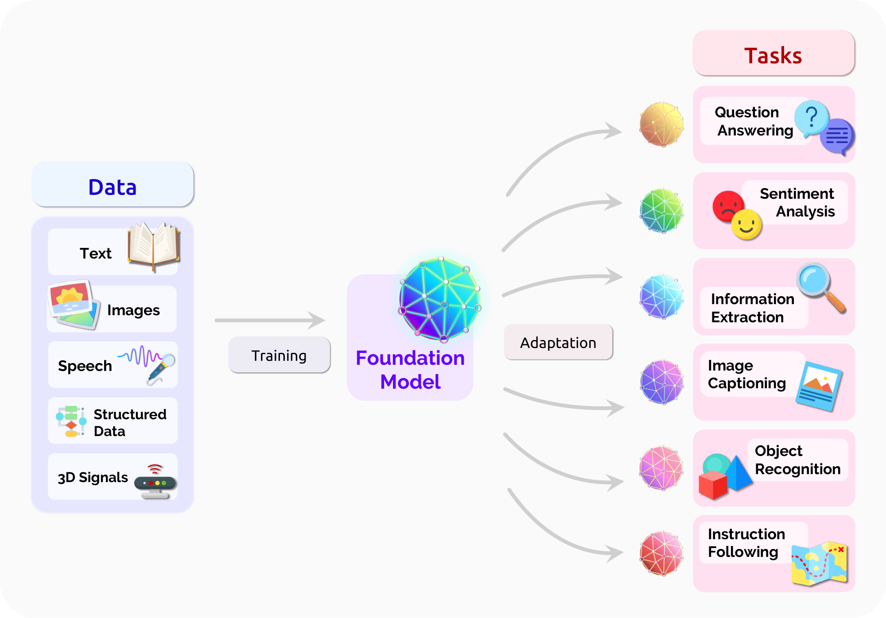](survey-foundation-model-adaptation/README.md)

[说明与源文件](survey-foundation-model-adaptation/README.md) · [同论文：基础模型生态 · 数据、模型与人的完整链条](survey-foundation-model-ecosystem/README.md) · [关联元素](survey-foundation-model-adaptation/README.md#关联范例与元素)

### [基础模型生态 · 数据、模型与人的完整链条](survey-foundation-model-ecosystem/README.md)

用五个连续色带串起数据产生、整理、训练、适配与部署，并在两端放人、在中间放多路数据与模型，提示讨论模型影响时应同时看到上下游生态。

arXiv 2021 · 预印本 · 综述

[说明与源文件](survey-foundation-model-ecosystem/README.md) · [同论文：基础模型概念总览 · 多源数据与多任务适配](survey-foundation-model-adaptation/README.md) · [关联元素](survey-foundation-model-ecosystem/README.md#关联范例与元素)

### [Agent 社会场景 · 综述概念 teaser](survey-agent-society-teaser/README.md)

以一座共同活动的虚拟城市场景承载任务规划、协作和工具使用，再用三个局部场景与对话气泡解释含义；这是本批最接近叙事型 teaser 的一张。

arXiv 2023 · 预印本 · 综述

[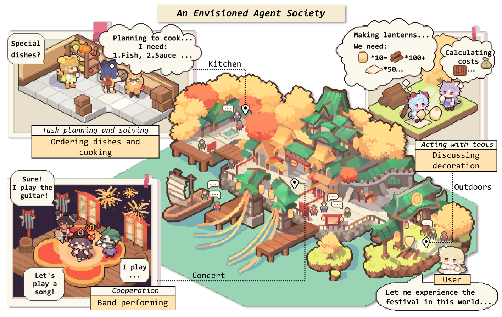](survey-agent-society-teaser/README.md)

[说明与源文件](survey-agent-society-teaser/README.md) · [同论文：Agent 概念框架 · 感知、大脑与行动](../architecture/survey-agent-perception-brain-action/README.md) · [关联元素](survey-agent-society-teaser/README.md#关联范例与元素)

### [语言模型四代能力演进 · 阶梯式概念图](survey-lm-capability-evolution/README.md)

用同一条阶梯和时间轴，把统计语言模型、神经语言模型、预训练语言模型与大语言模型的任务能力变化串起来；一眼先读到观点，再读阶段细节。

Frontiers of Computer Science 2026 · 期刊论文 · 综述

[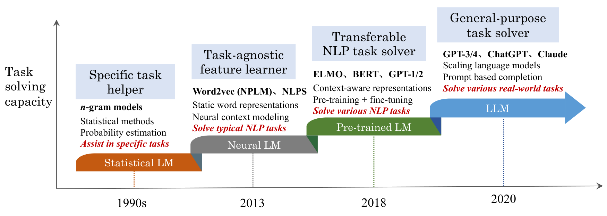](survey-lm-capability-evolution/README.md)

[说明与源文件](survey-lm-capability-evolution/README.md) · [同论文：LLM 发布脉络 · 主轴与时间分支](survey-llm-release-timeline/README.md) · [同论文：LLaMA 家族关系 · 模型与数据继承图](survey-llama-family-map/README.md) · [关联元素](survey-lm-capability-evolution/README.md#关联范例与元素)

### [LLaMA 家族关系 · 模型与数据继承图](survey-llama-family-map/README.md)

把模型继承、数据继承与继续预训练画成不同颜色和线型的关系，从单一根节点展开出任务与领域分支，重点是关系而非枚举。

Frontiers of Computer Science 2026 · 期刊论文 · 综述

[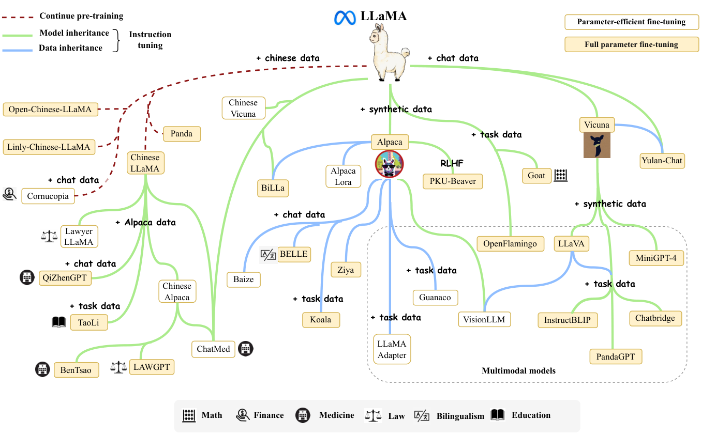](survey-llama-family-map/README.md)

[说明与源文件](survey-llama-family-map/README.md) · [同论文：语言模型四代能力演进 · 阶梯式概念图](survey-lm-capability-evolution/README.md) · [同论文：LLM 发布脉络 · 主轴与时间分支](survey-llm-release-timeline/README.md) · [关联元素](survey-llama-family-map/README.md#关联范例与元素)

### [3DGS 应用全景 · 中心主题与场景分支](survey-3dgs-application-landscape/README.md)

以中心主题连接机器人、动态场景、生成编辑、化身、内窥镜、场景重建和物理等分支，并把少量视觉实例放进分支旁，兼顾分类和直观性。

ACM Computing Surveys 2026 · 期刊论文 · 综述

[说明与源文件](survey-3dgs-application-landscape/README.md) · [同论文：3DGS 综述路线图 · 双侧分类地图](survey-3dgs-review-map/README.md) · [关联元素](survey-3dgs-application-landscape/README.md#关联范例与元素)

### [LLM 发布脉络 · 主轴与时间分支](survey-llm-release-timeline/README.md)

沿弯曲主轴安排不同时间段，分支容纳密集的模型名称，黄色底色再编码检查点是否公开；适合综述开篇交代领域发展范围。

Frontiers of Computer Science 2026 · 期刊论文 · 综述

[说明与源文件](survey-llm-release-timeline/README.md) · [同论文：语言模型四代能力演进 · 阶梯式概念图](survey-lm-capability-evolution/README.md) · [同论文：LLaMA 家族关系 · 模型与数据继承图](survey-llama-family-map/README.md) · [关联元素](survey-llm-release-timeline/README.md#关联范例与元素)

### [多模态大模型发展 · 分段曲线时间线](survey-mllm-timeline/README.md)

弯曲时间轴配合阶段分支和小型图标，在一张横向图内承载多模态模型从 2022 年到 2024 年初的发展；比普通表格更容易看出阶段。

National Science Review 2024 · 期刊论文 · 综述

[说明与源文件](survey-mllm-timeline/README.md) · [同论文：MLLM 统一架构 · 模态接口与连接器对照](../architecture/survey-mllm-connector-framework/README.md) · [关联元素](survey-mllm-timeline/README.md#关联范例与元素)

### [自主 Agent 发展 · 趋势曲线与代表场景](survey-agent-growth-landscape/README.md)

在累计论文增长曲线上排布有类别配色的代表系统缩略图，将领域热度、时间顺序和应用类型合在一个画面里。

Frontiers of Computer Science 2024 · 期刊论文 · 综述

[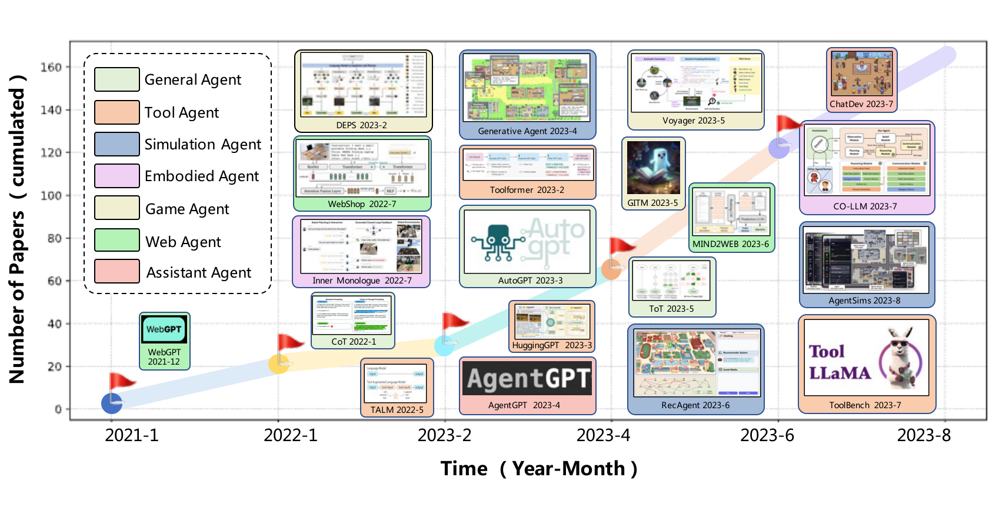](survey-agent-growth-landscape/README.md)

[说明与源文件](survey-agent-growth-landscape/README.md) · [同论文：自主 Agent 统一框架 · 四列模块分解](../architecture/survey-autonomous-agent-modules/README.md) · [关联元素](survey-agent-growth-landscape/README.md#关联范例与元素)

### [3DGS 综述路线图 · 双侧分类地图](survey-3dgs-review-map/README.md)

从中心领域向两侧展开原理、方法方向、应用、比较与研究方向，颜色对应一层主题，形成清晰的综述阅读地图。

ACM Computing Surveys 2026 · 期刊论文 · 综述

[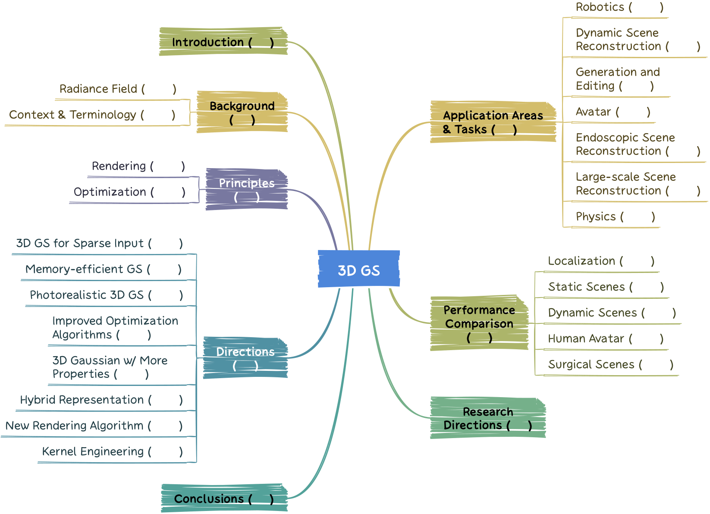](survey-3dgs-review-map/README.md)

[说明与源文件](survey-3dgs-review-map/README.md) · [同论文：3DGS 应用全景 · 中心主题与场景分支](survey-3dgs-application-landscape/README.md) · [关联元素](survey-3dgs-review-map/README.md#关联范例与元素)

## 任务、动机与能力展示

### [MemoryVLA · 人类记忆类比、方法与性能首图](memoryvla-cognition-memory-action/README.md)

以时间混淆问题为动机，对照人类的工作记忆与情景记忆、MemoryVLA 的感知—认知记忆机制，底部再放四组性能对照与机器人任务示例。

ICLR 2026 · 会议论文；未核实 Oral

**子图组织：** (a) 时间混淆任务；(b) 人类认知—记忆—动作；(c) MemoryVLA；(d) 四组性能图与机器人实例。 原论文 Figure 1。

[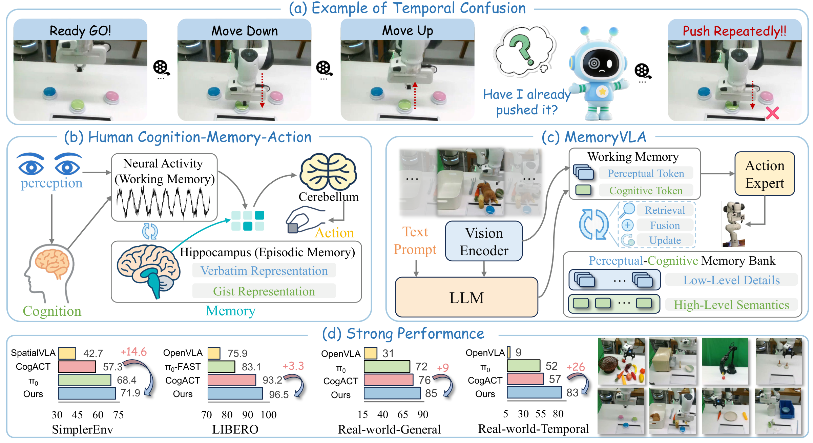](memoryvla-cognition-memory-action/README.md)

[说明与源文件](memoryvla-cognition-memory-action/README.md) · [关联元素](memoryvla-cognition-memory-action/README.md#关联范例与元素)

### [Genie · 不同提示生成可交互世界](genie-interaction/README.md)

左侧三种输入沿统一箭头进入模型，右侧按动作展示连续变化；一张图同时回答输入是什么、输出是什么、为什么可交互。

ICML 2024 · Oral

[说明与源文件](genie-interaction/README.md) · [同论文：Genie · 视频 tokenizer、潜在动作与动力学模型](../architecture/genie-architecture/README.md) · [关联元素](genie-interaction/README.md#关联范例与元素)

### [VGGT · 多视图输入与统一三维感知能力](vggt-capabilities/README.md)

用一个大型三维场景作为视觉中心，两侧安排输入与多种输出，让读者先理解方法能做什么。

CVPR 2025 · Oral

[说明与源文件](vggt-capabilities/README.md) · [同论文：VGGT · 交替注意力主干与多任务输出头](../architecture/vggt-architecture/README.md) · [关联元素](vggt-capabilities/README.md#关联范例与元素)

### [CUT3R · 静态、动态与稀疏照片三类场景](cut3r-capabilities/README.md)

三列分别说明输入场景和重建能力，借助同一版式把连续三维感知的应用范围讲清楚。

CVPR 2025 · Oral

[说明与源文件](cut3r-capabilities/README.md) · [同论文：CUT3R · 持久状态的更新、读取与未见视角推断](../architecture/cut3r-architecture/README.md) · [关联元素](cut3r-capabilities/README.md#关联范例与元素)

### [OrienterNet：用二维地图定位的任务与动机](orienternet/README.md)

展示人类使用二维地图与既有三维点云定位的差别，再给出新方法的输入与输出。

[说明与源文件](orienternet/README.md) · [关联元素](orienternet/README.md#关联范例与元素)

### [Uneven Double Refraction：原型与成像能力展示](birefractive-rgbd/README.md)

相机原型、输入、恢复彩色图和深度图横排，适合硬件或成像方法的 teaser。

[说明与源文件](birefractive-rgbd/README.md) · [关联元素](birefractive-rgbd/README.md#关联范例与元素)

### [SAM 2 · 任务、模型与数据引擎三联概念图](sam2-task-model-data/README.md)

三个并列区域分别回答方法解决什么任务、依靠什么模型、数据如何形成闭环，任务、模型与数据之间还有明确的对应连线。

ICLR 2025 · Oral

[说明与源文件](sam2-task-model-data/README.md) · [同论文：SAM 2 · 流式编码、记忆注意力与记忆库](../architecture/sam2-memory-architecture/README.md) · [关联元素](sam2-task-model-data/README.md#关联范例与元素)

### [3DETR · 输入点云、注意力与检测结果的对应](3detr-attention-teaser/README.md)

每一行沿输入点云、解码器注意力、检测结果排列，直接展示模型如何把空间关注区域与目标实例联系起来。

ICCV 2021 · Oral

[说明与源文件](3detr-attention-teaser/README.md) · [同论文：3DETR · 点云编码器、查询嵌入与集合预测](../architecture/3detr-architecture/README.md) · [关联元素](3detr-attention-teaser/README.md#关联范例与元素)

## 控制效果与优化过程

### [DreamGaussian · 生成能力与优化进程同图展示](dreamgaussian-progress/README.md)

上方多视角结果说明输出能力，下方时间序列展示从模糊到成形的优化过程，让效率与质量成为同一视觉叙事。

ICLR 2024 · Oral

[说明与源文件](dreamgaussian-progress/README.md) · [同论文：DreamGaussian · 高斯生成、网格提取与纹理细化](../architecture/dreamgaussian-architecture/README.md) · [关联元素](dreamgaussian-progress/README.md#关联范例与元素)

### [DECOLLAGE：局部风格控制与三维细化](decollage/README.md)

从粗体素结构出发，用不同示例为局部赋予风格，再展示细化结果。作者的首屏 teaser，包含原始矢量箭头与嵌入渲染图。

[说明与源文件](decollage/README.md) · [关联元素](decollage/README.md#关联范例与元素)

### [ShaDDR：粗形状与示例驱动的成果展示](shaddr/README.md)

上排粗形状与风格示例，下排生成结果与局部放大，以成果直接展示任务和贡献。

[说明与源文件](shaddr/README.md) · [关联元素](shaddr/README.md#关联范例与元素)

## 速度与精度权衡

### [LightGlue：速度与精度权衡](lightglue-tradeoff/README.md)

准确率与吞吐量的权衡作为论文的贡献展示，比较固定深度、动态深度与既有方法。它属于结果型 teaser。

[说明与源文件](lightglue-tradeoff/README.md) · [同论文：LightGlue：注意力、动态剪枝与匹配](../architecture/lightglue/README.md) · [关联元素](lightglue-tradeoff/README.md#关联范例与元素)

### [MVSplat · 重建质量、速度与参数量的并列对照](mvsplat-comparison/README.md)

用同一输入将两种方法的三维外观和深度排在两侧，中央小图直接补充速度与参数量，使定性效果和成本在同一个版式中对齐。

ECCV 2024 · Oral

[说明与源文件](mvsplat-comparison/README.md) · [同论文：MVSplat · 多视图匹配、代价体与三维高斯预测](../architecture/mvsplat-architecture/README.md) · [关联元素](mvsplat-comparison/README.md#关联范例与元素)
