# Teaser 范例

[Teaser](README.md) · [Architecture](../architecture/README.md) · [Element](../element/README.md) · [总目录](../CATALOG.md)

按图的表达用途浏览。会议、年份、Oral 等信息保留在各条目，不另设会议分类。

| 表达用途 | 数量 | 入口 |
|---|---:|---|
| 方法与范式对照 | 4 | [浏览](#comparison) |
| 任务、动机与能力展示 | 7 | [浏览](#capabilities) |
| 控制效果与优化过程 | 3 | [浏览](#control-progress) |
| 速度与精度权衡 | 2 | [浏览](#tradeoff) |

## 方法与范式对照

### [VAR · 从逐 token 到逐尺度生成的范式对照](var-paradigm/README.md)

同一张图比较语言自回归、图像逐 token 生成和逐尺度生成，核心差异直接表现为生成顺序与尺度变化。

NeurIPS 2024 · Oral

[说明与源文件](var-paradigm/README.md) · [同论文：VAR · 多尺度 VQVAE 与 VAR 两阶段训练](../architecture/var-architecture/README.md) · [关联元素](var-paradigm/README.md#关联范例与元素)

### [DPO · RLHF 与直接偏好优化的流程简化](dpo-comparison/README.md)

左右两块使用同一输入与终点，只改变中间步骤；简化过程本身就是论文的主要观点。

NeurIPS 2023 · Oral

**整图位图，仅构图参考。**

[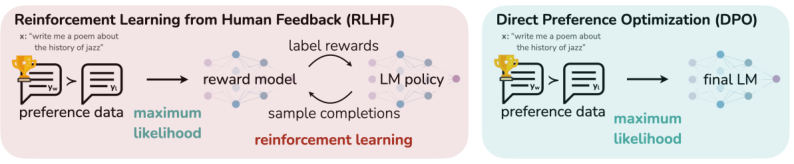](dpo-comparison/README.md)

[说明与源文件](dpo-comparison/README.md) · [关联元素](dpo-comparison/README.md#关联范例与元素)

### [K-LoRA：主体风格组合与训练范式比较](k-lora/README.md)

左侧主体与风格组合示例，右侧比较需要训练与免训练的融合方式。

[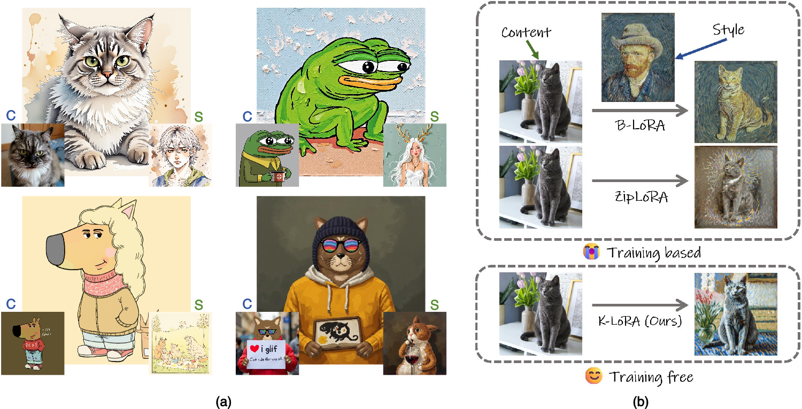](k-lora/README.md)

[说明与源文件](k-lora/README.md) · [关联元素](k-lora/README.md#关联范例与元素)

### [RayDer：数据瓶颈与新训练范式](rayder-concept/README.md)

数据金字塔、训练过程、结果与规模变化并列，先说明问题和核心差异。

[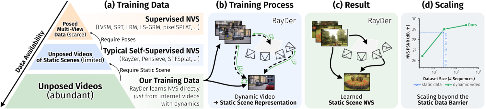](rayder-concept/README.md)

[说明与源文件](rayder-concept/README.md) · [同论文：RayDer：统一 Transformer 的两个使用阶段](../architecture/rayder/README.md) · [关联元素](rayder-concept/README.md#关联范例与元素)

## 任务、动机与能力展示

### [Genie · 不同提示生成可交互世界](genie-interaction/README.md)

左侧三种输入沿统一箭头进入模型，右侧按动作展示连续变化；一张图同时回答输入是什么、输出是什么、为什么可交互。

ICML 2024 · Oral

[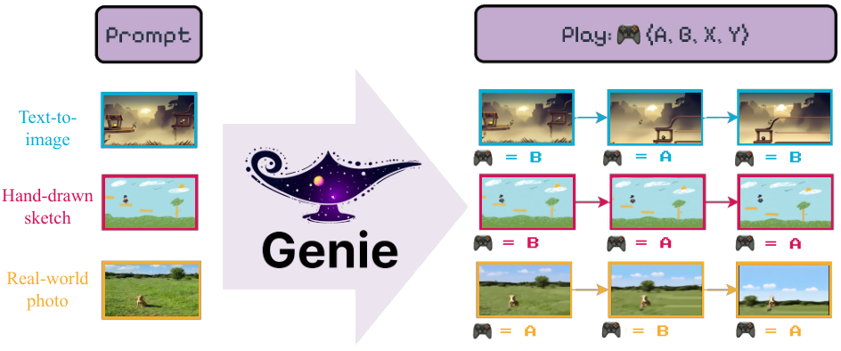](genie-interaction/README.md)

[说明与源文件](genie-interaction/README.md) · [同论文：Genie · 视频 tokenizer、潜在动作与动力学模型](../architecture/genie-architecture/README.md) · [关联元素](genie-interaction/README.md#关联范例与元素)

### [VGGT · 多视图输入与统一三维感知能力](vggt-capabilities/README.md)

用一个大型三维场景作为视觉中心，两侧安排输入与多种输出，让读者先理解方法能做什么。

CVPR 2025 · Oral

[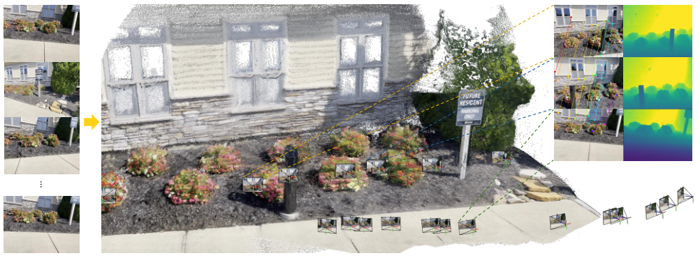](vggt-capabilities/README.md)

[说明与源文件](vggt-capabilities/README.md) · [同论文：VGGT · 交替注意力主干与多任务输出头](../architecture/vggt-architecture/README.md) · [关联元素](vggt-capabilities/README.md#关联范例与元素)

### [CUT3R · 静态、动态与稀疏照片三类场景](cut3r-capabilities/README.md)

三列分别说明输入场景和重建能力，借助同一版式把连续三维感知的应用范围讲清楚。

CVPR 2025 · Oral

[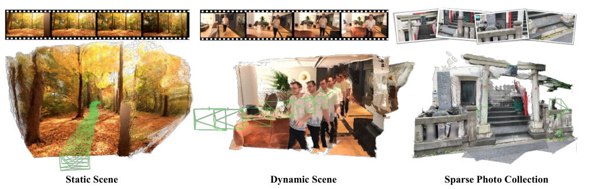](cut3r-capabilities/README.md)

[说明与源文件](cut3r-capabilities/README.md) · [同论文：CUT3R · 持久状态的更新、读取与未见视角推断](../architecture/cut3r-architecture/README.md) · [关联元素](cut3r-capabilities/README.md#关联范例与元素)

### [OrienterNet：用二维地图定位的任务与动机](orienternet/README.md)

展示人类使用二维地图与既有三维点云定位的差别，再给出新方法的输入与输出。

[说明与源文件](orienternet/README.md) · [关联元素](orienternet/README.md#关联范例与元素)

### [Uneven Double Refraction：原型与成像能力展示](birefractive-rgbd/README.md)

相机原型、输入、恢复彩色图和深度图横排，适合硬件或成像方法的 teaser。

[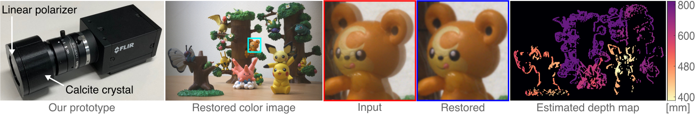](birefractive-rgbd/README.md)

[说明与源文件](birefractive-rgbd/README.md) · [关联元素](birefractive-rgbd/README.md#关联范例与元素)

### [SAM 2 · 任务、模型与数据引擎三联概念图](sam2-task-model-data/README.md)

三个并列区域分别回答方法解决什么任务、依靠什么模型、数据如何形成闭环，任务、模型与数据之间还有明确的对应连线。

ICLR 2025 · Oral

[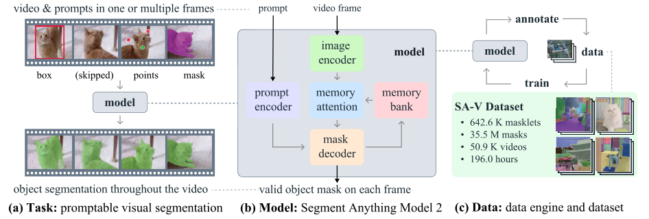](sam2-task-model-data/README.md)

[说明与源文件](sam2-task-model-data/README.md) · [同论文：SAM 2 · 流式编码、记忆注意力与记忆库](../architecture/sam2-memory-architecture/README.md) · [关联元素](sam2-task-model-data/README.md#关联范例与元素)

### [3DETR · 输入点云、注意力与检测结果的对应](3detr-attention-teaser/README.md)

每一行沿输入点云、解码器注意力、检测结果排列，直接展示模型如何把空间关注区域与目标实例联系起来。

ICCV 2021 · Oral

[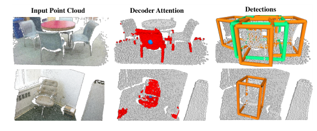](3detr-attention-teaser/README.md)

[说明与源文件](3detr-attention-teaser/README.md) · [同论文：3DETR · 点云编码器、查询嵌入与集合预测](../architecture/3detr-architecture/README.md) · [关联元素](3detr-attention-teaser/README.md#关联范例与元素)

## 控制效果与优化过程

### [DreamGaussian · 生成能力与优化进程同图展示](dreamgaussian-progress/README.md)

上方多视角结果说明输出能力，下方时间序列展示从模糊到成形的优化过程，让效率与质量成为同一视觉叙事。

ICLR 2024 · Oral

[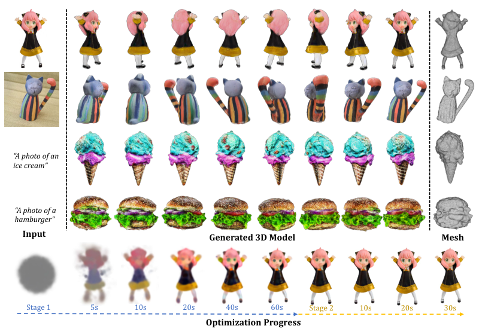](dreamgaussian-progress/README.md)

[说明与源文件](dreamgaussian-progress/README.md) · [同论文：DreamGaussian · 高斯生成、网格提取与纹理细化](../architecture/dreamgaussian-architecture/README.md) · [关联元素](dreamgaussian-progress/README.md#关联范例与元素)

### [DECOLLAGE：局部风格控制与三维细化](decollage/README.md)

从粗体素结构出发，用不同示例为局部赋予风格，再展示细化结果。作者的首屏 teaser，包含原始矢量箭头与嵌入渲染图。

[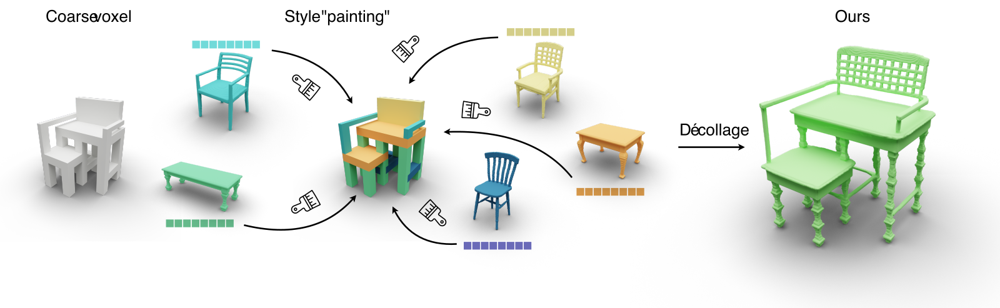](decollage/README.md)

[说明与源文件](decollage/README.md) · [关联元素](decollage/README.md#关联范例与元素)

### [ShaDDR：粗形状与示例驱动的成果展示](shaddr/README.md)

上排粗形状与风格示例，下排生成结果与局部放大，以成果直接展示任务和贡献。

[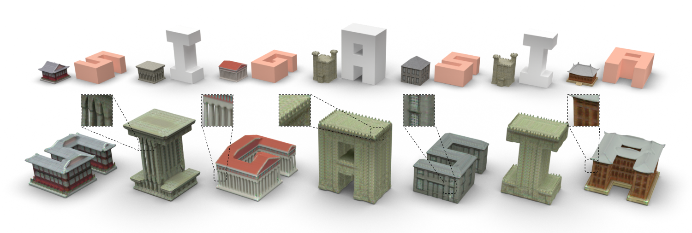](shaddr/README.md)

[说明与源文件](shaddr/README.md) · [关联元素](shaddr/README.md#关联范例与元素)

## 速度与精度权衡

### [LightGlue：速度与精度权衡](lightglue-tradeoff/README.md)

准确率与吞吐量的权衡作为论文的贡献展示，比较固定深度、动态深度与既有方法。它属于结果型 teaser。

[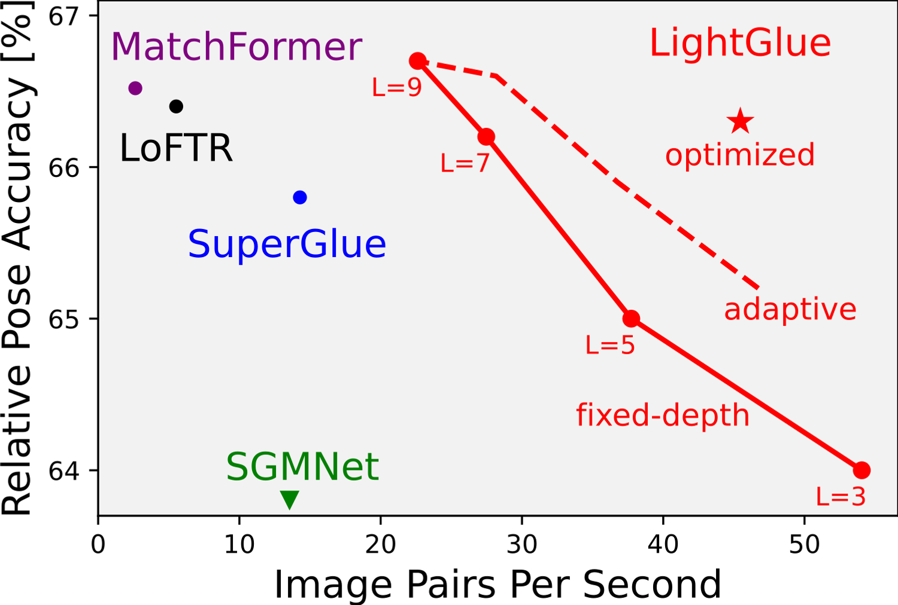](lightglue-tradeoff/README.md)

[说明与源文件](lightglue-tradeoff/README.md) · [同论文：LightGlue：注意力、动态剪枝与匹配](../architecture/lightglue/README.md) · [关联元素](lightglue-tradeoff/README.md#关联范例与元素)

### [MVSplat · 重建质量、速度与参数量的并列对照](mvsplat-comparison/README.md)

用同一输入将两种方法的三维外观和深度排在两侧，中央小图直接补充速度与参数量，使定性效果和成本在同一个版式中对齐。

ECCV 2024 · Oral

[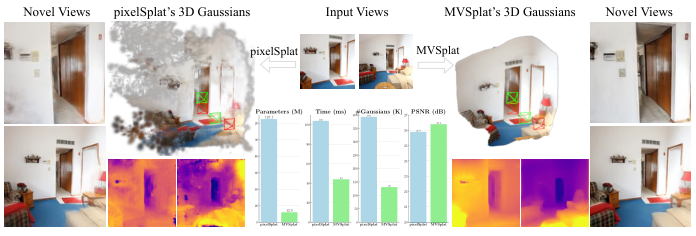](mvsplat-comparison/README.md)

[说明与源文件](mvsplat-comparison/README.md) · [同论文：MVSplat · 多视图匹配、代价体与三维高斯预测](../architecture/mvsplat-architecture/README.md) · [关联元素](mvsplat-comparison/README.md#关联范例与元素)
