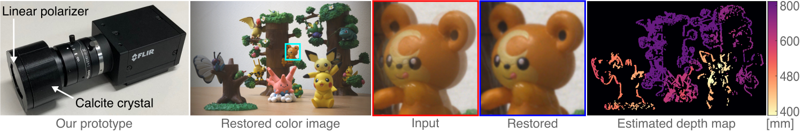

# Uneven Double Refraction：原型与成像能力展示

<!-- CATEGORY NAV -->
[Teaser](../README.md) · [Architecture](../../architecture/README.md) · [Element](../../element/README.md) · [总目录](../../CATALOG.md)
<!-- END CATEGORY NAV -->

相机原型、输入、恢复彩色图和深度图横排，适合硬件或成像方法的 teaser。

[作者原始 SVG](source.svg) · [来源与检查记录](metadata.json) · [原项目](http://vclab.kaist.ac.kr/cvpr2020p2/)

## 来源与可编辑范围

来源：`KAIST-VCLAB/fastbirefstereo` / `teaser.svg`，固定版本 `ed5d9cd8d463`。原 SVG 未重绘、未修改字节。

SVG 对象：76 个 path，12 个 text，6 个 image。有 SVG 容器不代表每个区域都是可编辑矢量；内嵌照片和渲染图保持位图，公式可能为轮廓。

MIT（来源仓库）；照片与实验结果按原来源保留。

已检查预览；桌面 Illustrator 的字体与链接兼容性尚未逐项实测。

<!-- BEGIN FIGURE LINKS -->
## 关联范例与元素

**可搭配的现有元素：** [相机](../../element/svg/tabler-camera.svg) · [图像](../../element/svg/tabler-photo.svg) · [三维坐标物体](../../element/svg/tabler-cube-3d-sphere.svg)

这些元素按表达功能关联，并非从本论文原图拆出；来源和许可仍以各元素记录为准。

[范例与元素对照表](../../element/with-examples.md) · [元素分类目录](../../element/README.md)
<!-- END FIGURE LINKS -->
