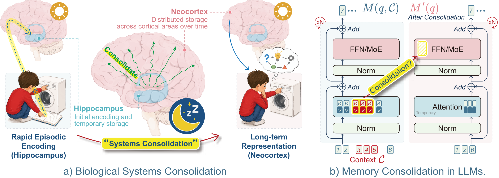

# Cortex · 生物系统巩固与模型记忆巩固类比

<!-- CATEGORY NAV -->
[Teaser](../README.md) · [Architecture](../../architecture/README.md) · [Element](../../element/README.md) · [总目录](../../CATALOG.md)
<!-- END CATEGORY NAV -->

[Teaser](../../teaser/README.md) · [Architecture](../../architecture/README.md) · [Element](../../element/README.md) · [总目录](../../CATALOG.md)

**用户参考图 4 · Figure 1 · Teaser**

## 与用户参考图的对应

用户图 4 对应 arXiv 2610.20399v1 第 1 页 Figure 1；生物类比、儿童场景、睡眠图标、上下文 token 和 FFN／MoE 高亮一致。

[四张图片的出处与版本对照](../../docs/image-provenance-2026-11-04.md)

## 内容与分类

左侧用海马体、睡眠与新皮层说明生物系统巩固；右侧并列展示带上下文的模型与巩固后的模型，以高亮 FFN／MoE 变化解释将上下文收益写入参数的目标。

以生物类比解释研究目标与核心想法，归入 Teaser。右侧是目标示意，不是 Cortex 训练算法的完整架构。

(a) 生物系统巩固的阶段式叙事；(b) LLM 巩固前后的结构并列。

按 (a)、(b) 计两个主面板。左侧包含三个时间阶段，右侧包含两列模型块，均为主面板内部展开。

## 可以借鉴

- 在两个领域间建立同颜色、同角色的视觉对应。
- 通过巩固前后对照突出真正发生变化的位置。
- 把叙事场景、科学标注与结构图放在邻近区域。

## 文件与编辑范围

[作者独立 PDF](original.pdf) · [SVG 转换件](source.svg) · [原始插图定义](figure-inclusion.tex) · [来源与校验记录](metadata.json)

作者独立 PDF 保留矢量结构及原有文字对象或轮廓；SVG 为 PDF 转换件，文字转轮廓。原 PDF 含 6 个嵌入位图对象，可移动或替换，不能按矢量节点编辑。位图对象数不等于子图数。

原 PDF 和 SVG 的框线、箭头、公式或文字结构可按实际对象修改；桌面 Illustrator 尚未逐项实测。

## 原始出处

- 论文：[Cortex: Consolidating Context into Parametric Memory](https://arxiv.org/abs/2610.20399v1)
- 作者：Zhang, Jintian；He, Feng；Liang, Xinnian；Xu, Ziwen；Xu, Haoming；Huang, Haojing；Wu, Shuangzhi；Zhang, Ningyu
- [作者项目或论文页面](https://arxiv.org/abs/2610.20399)
- 所收录版本：`2610.20399v1`；原文 PDF 第 1 页，Figure 1。
- [固定版本作者源码归档](https://arxiv.org/src/2610.20399v1)；成员路径 `figures/intro-v5.pdf`。

## 权利与修改记录

所收录 arXiv 版本采用非独占分发许可，此许可不是第三方图形重用授权；本条用于私有参考。保留作者署名、固定版本与转换记录。图中第三方插画、Logo、照片或引用素材按原始权利声明核对。

[原版本许可](https://arxiv.org/licenses/nonexclusive-distrib/1.0/) · [权利记录](RIGHTS.source.txt)

作者原件按原字节保存；只作格式转换、预览和来源整理。

<!-- BEGIN FIGURE LINKS -->
## 关联范例与元素

**可搭配的现有元素：** [大脑](../../element/svg/tabler-brain.svg) · [数据库](../../element/svg/tabler-database.svg) · [网络](../../element/svg/tabler-network.svg) · [右箭头](../../element/svg/tabler-arrow-right.svg)

这些元素按表达功能关联，并非从本论文原图拆出；来源和许可仍以各元素记录为准。

[范例与元素对照表](../../element/with-examples.md) · [元素分类目录](../../element/README.md)
<!-- END FIGURE LINKS -->
