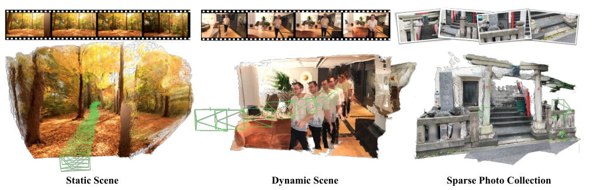

# CUT3R · 静态、动态与稀疏照片三类场景

<!-- CATEGORY NAV -->
[Teaser](../README.md) · [Architecture](../../architecture/README.md) · [Element](../../element/README.md) · [总目录](../../CATALOG.md)
<!-- END CATEGORY NAV -->

**CVPR 2025 · Oral · 原论文 Figure 1**

## 为什么收这张图

三列分别说明输入场景和重建能力，借助同一版式把连续三维感知的应用范围讲清楚。

多场景能力 teaser；与方法内部的状态更新架构分别保存。

## 可以借鉴

- 三类场景使用统一输入与输出关系
- 把动态与静态能力并列呈现
- 用真实场景代替大段动机文字

## 文件与编辑范围

[主文件](source.svg) · [单图 PDF](figure.pdf) · [来源与校验记录](metadata.json)

原 PDF 的几何路径与线条保留，SVG 文字转为轮廓；照片、三维渲染与原有位图部件仍为嵌入图片。

SVG 是原论文图形的提取转换件，未取得作者原生 AI 工程。不同 PDF 阅读器或 Illustrator 对字体、透明度的导入可能有差异。

## 原始出处

- 论文：[Continuous 3D Perception Model with Persistent State](https://arxiv.org/abs/2501.12387)
- 作者：Wang, Qianqian, Zhang, Yifei, Holynski, Aleksander, Efros, Alexei A., Kanazawa, Angjoo
- [作者项目或代码](https://cut3r.github.io/)
- [会议与展示身份依据](https://github.com/CUT3R/CUT3R/blob/main/README.md)
- PDF 第 1 页，Figure 1；截取坐标见 metadata.json。

## 权利与修改记录

arXiv 原文声明 CC BY 4.0；保留作者署名、论文链接和裁剪转换说明。第三方照片与模型若有独立声明，仍按原声明。

原文许可声明：https://creativecommons.org/licenses/by/4.0/

只提取、裁剪与转换原图；没有重新绘制。

<!-- BEGIN FIGURE LINKS -->
## 关联范例与元素

同论文的其他图：[CUT3R · 持久状态的更新、读取与未见视角推断](../../architecture/cut3r-architecture/README.md)

**可搭配的现有元素：** [视频](../../element/svg/tabler-video.svg) · [图像](../../element/svg/tabler-photo.svg) · [相机](../../element/svg/tabler-camera.svg)

这些元素按表达功能关联，并非从本论文原图拆出；来源和许可仍以各元素记录为准。

[范例与元素对照表](../../element/with-examples.md) · [元素分类目录](../../element/README.md)
<!-- END FIGURE LINKS -->
