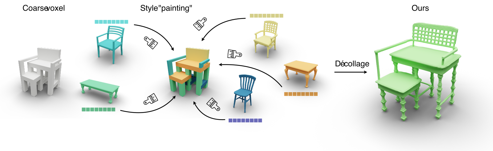

# DECOLLAGE：局部风格控制与三维细化

<!-- CATEGORY NAV -->
[Teaser](../README.md) · [Architecture](../../architecture/README.md) · [Element](../../element/README.md) · [总目录](../../CATALOG.md)
<!-- END CATEGORY NAV -->

从粗体素结构出发，用不同示例为局部赋予风格，再展示细化结果。作者的首屏 teaser，包含原始矢量箭头与嵌入渲染图。

[作者原 SVG](source.svg) · [来源与编辑限制](metadata.json)

<!-- BEGIN FIGURE LINKS -->
## 关联范例与元素

**可搭配的现有元素：** [三维坐标物体](../../element/svg/tabler-cube-3d-sphere.svg) · [图像](../../element/svg/tabler-photo.svg) · [参数设置](../../element/svg/tabler-adjustments.svg)

这些元素按表达功能关联，并非从本论文原图拆出；来源和许可仍以各元素记录为准。

[范例与元素对照表](../../element/with-examples.md) · [元素分类目录](../../element/README.md)
<!-- END FIGURE LINKS -->
