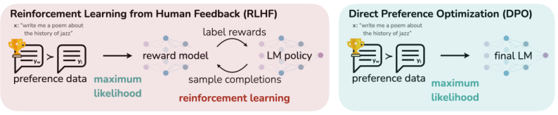

# DPO · RLHF 与直接偏好优化的流程简化

<!-- CATEGORY NAV -->
[Teaser](../README.md) · [Architecture](../../architecture/README.md) · [Element](../../element/README.md) · [总目录](../../CATALOG.md)
<!-- END CATEGORY NAV -->

**NeurIPS 2023 · Oral · 原论文 Figure 1**

## 为什么收这张图

左右两块使用同一输入与终点，只改变中间步骤；简化过程本身就是论文的主要观点。

方法差异 teaser。原论文此图已嵌入为整张位图，只作为构图参考收录。

## 可以借鉴

- 旧方法与新方法用等高容器并列
- 相同输入重复出现以控制比较条件
- 用步骤减少而非额外装饰突出贡献

## 文件与编辑范围

[主文件](source.png) · [单图 PDF](figure.pdf) · [来源与校验记录](metadata.json)

作者 PDF 内该图为整张位图。源 PNG 原样提取，PDF 摘图也不会增加可编辑矢量节点。

此条明确作为位图构图参考；不是可编辑模板。

## 原始出处

- 论文：[Direct Preference Optimization: Your Language Model is Secretly a Reward Model](https://arxiv.org/abs/2305.18290)
- 作者：Rafailov, Rafael, Sharma, Archit, Mitchell, Eric, Ermon, Stefano, Manning, Christopher D., Finn, Chelsea
- [作者项目或代码](https://github.com/eric-mitchell/direct-preference-optimization)
- [会议与展示身份依据](https://media.neurips.cc/Conferences/NeurIPS2023/NeurIPS2023-Press_Release.pdf)
- PDF 第 2 页，Figure 1；截取坐标见 metadata.json。

## 权利与修改记录

arXiv 原文声明 CC BY 4.0；保留作者署名、论文链接和裁剪转换说明。第三方照片与模型若有独立声明，仍按原声明。

原文许可声明：https://creativecommons.org/licenses/by/4.0/

只提取、裁剪与转换原图；没有重新绘制。

<!-- BEGIN FIGURE LINKS -->
## 关联范例与元素

**可搭配的现有元素：** [多用户](../../element/svg/tabler-users.svg) · [对话](../../element/svg/tabler-message.svg) · [浅层神经网络](../../element/svg/towaki-neuralnetwork.svg) · [水平双向箭头](../../element/svg/tabler-arrows-right-left.svg)

这些元素按表达功能关联，并非从本论文原图拆出；来源和许可仍以各元素记录为准。

[范例与元素对照表](../../element/with-examples.md) · [元素分类目录](../../element/README.md)
<!-- END FIGURE LINKS -->
