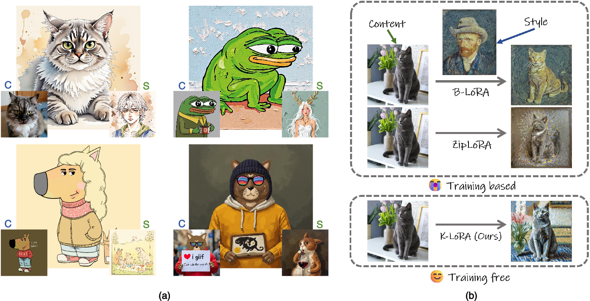

# K-LoRA：主体风格组合与训练范式比较

<!-- CATEGORY NAV -->
[Teaser](../README.md) · [Architecture](../../architecture/README.md) · [Element](../../element/README.md) · [总目录](../../CATALOG.md)
<!-- END CATEGORY NAV -->

左侧主体与风格组合示例，右侧比较需要训练与免训练的融合方式。

[作者原始 SVG](source.svg) · [来源与检查记录](metadata.json) · [原项目](https://arxiv.org/abs/2502.18461)

## 来源与可编辑范围

来源：`HVision-NKU/K-LoRA` / `pictures/teaser.svg`，固定版本 `aef445b61c2c`。原 SVG 未重绘、未修改字节。

SVG 对象：2 个 path，10 个 text，13 个 image。有 SVG 容器不代表每个区域都是可编辑矢量；内嵌照片和渲染图保持位图，公式可能为轮廓。

作者 README 声明 CC BY-NC 4.0；内嵌示例素材保留原出处。

已检查预览；桌面 Illustrator 的字体与链接兼容性尚未逐项实测。

<!-- BEGIN FIGURE LINKS -->
## 关联范例与元素

**可搭配的现有元素：** [图像](../../element/svg/tabler-photo.svg) · [锁定](../../element/svg/tabler-lock.svg) · [解锁](../../element/svg/tabler-lock-open.svg) · [水平双向箭头](../../element/svg/tabler-arrows-right-left.svg)

这些元素按表达功能关联，并非从本论文原图拆出；来源和许可仍以各元素记录为准。

[范例与元素对照表](../../element/with-examples.md) · [元素分类目录](../../element/README.md)
<!-- END FIGURE LINKS -->
