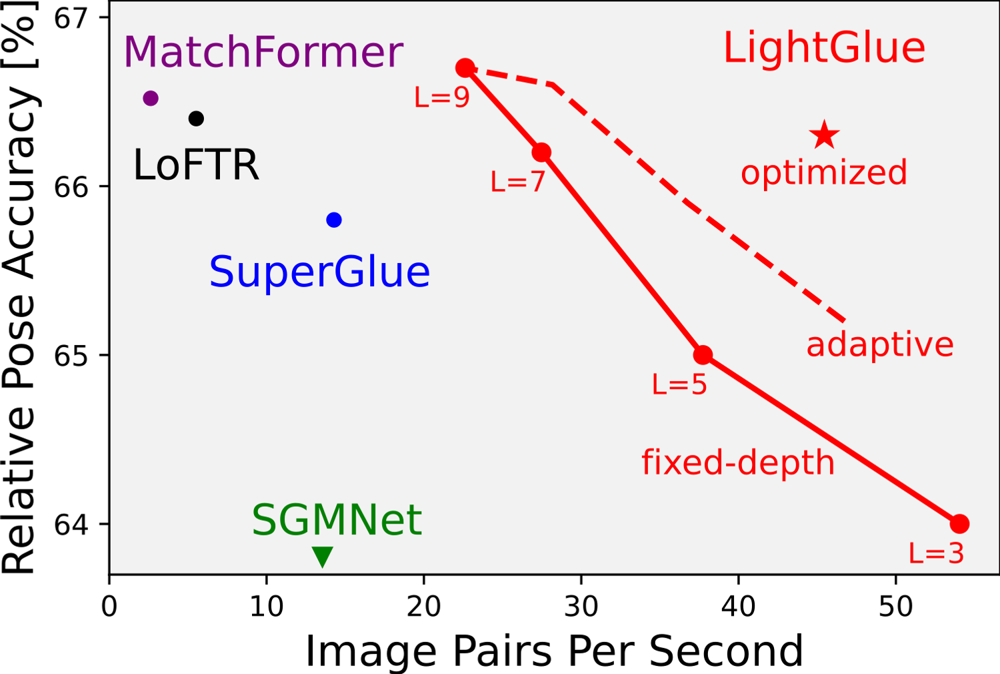

# LightGlue：速度与精度权衡

<!-- CATEGORY NAV -->
[Teaser](../README.md) · [Architecture](../../architecture/README.md) · [Element](../../element/README.md) · [总目录](../../CATALOG.md)
<!-- END CATEGORY NAV -->

准确率与吞吐量的权衡作为论文的贡献展示，比较固定深度、动态深度与既有方法。它属于结果型 teaser。

[作者原 SVG](source.svg) · [来源与编辑限制](metadata.json)

<!-- BEGIN FIGURE LINKS -->
## 关联范例与元素

同论文的其他图：[LightGlue：注意力、动态剪枝与匹配](../../architecture/lightglue/README.md)

**可搭配的现有元素：** [散点图符号](../../element/svg/tabler-chart-scatter.svg) · [时钟](../../element/svg/tabler-clock.svg) · [目标](../../element/svg/tabler-target.svg)

这些元素按表达功能关联，并非从本论文原图拆出；来源和许可仍以各元素记录为准。

[范例与元素对照表](../../element/with-examples.md) · [元素分类目录](../../element/README.md)
<!-- END FIGURE LINKS -->
