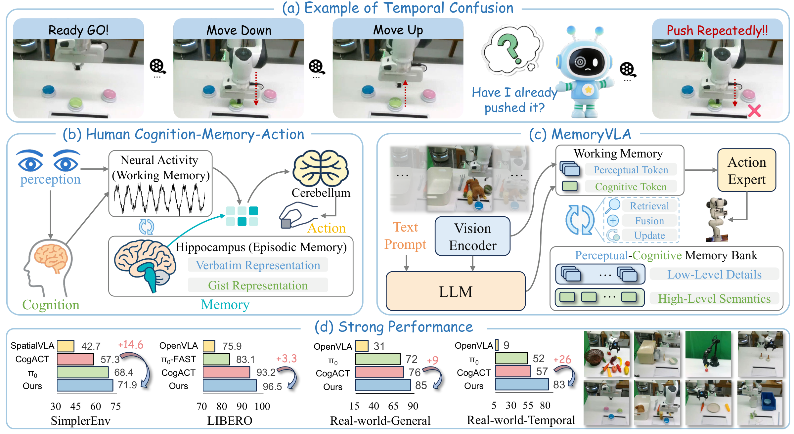

# MemoryVLA · 人类记忆类比、方法与性能首图

<!-- CATEGORY NAV -->
[Teaser](../README.md) · [Architecture](../../architecture/README.md) · [Element](../../element/README.md) · [总目录](../../CATALOG.md)
<!-- END CATEGORY NAV -->

[Teaser](../../teaser/README.md) · [Architecture](../../architecture/README.md) · [Element](../../element/README.md) · [总目录](../../CATALOG.md)

**用户参考图 3 · Figure 1 · Teaser**

## 与用户参考图的对应

用户图 3 对应 arXiv 2508.19236v1 的 Figure 1(b)–(d)。已按 SimplerEnv、LIBERO、Real-world-General、Real-world-Temporal 四组结果及布局核对；收录完整首图并补回 (a)。v2 的首图布局和评测内容有所增加，本条不混用。

[四张图片的出处与版本对照](../../docs/image-provenance-2026-11-04.md)

## 内容与分类

以时间混淆问题为动机，对照人类的工作记忆与情景记忆、MemoryVLA 的感知—认知记忆机制，底部再放四组性能对照与机器人任务示例。

将问题动机、生物类比、方法概念与效果放在同一首图中，归入 Teaser。图中 (c) 是简化结构，但并非本条的唯一内容。

(a) 时间混淆任务；(b) 人类认知—记忆—动作；(c) MemoryVLA；(d) 四组性能图与机器人实例。

按原作者 (a)–(d) 计四个主面板。用户截图截去了顶部 (a)，只保留 (b)、(c)、(d)。性能区内四组柱图和八张场景图不另计为独立主面板。

## 可以借鉴

- 用同一套配色连接生物类比和模型机制。
- 让问题示例、概念对照和结果在同图形成完整论证。
- 用底部紧凑结果区支撑主要观点，同时明确原实验来源。

## 文件与编辑范围

[作者独立 PDF](original.pdf) · [SVG 转换件](source.svg) · [原始插图定义](figure-inclusion.tex) · [来源与校验记录](metadata.json)

作者独立 PDF 保留矢量结构及原有文字对象或轮廓；SVG 为 PDF 转换件，文字转轮廓。原 PDF 含 84 个嵌入位图对象，可移动或替换，不能按矢量节点编辑。位图对象数不等于子图数。

原 PDF 和 SVG 的框线、箭头、公式或文字结构可按实际对象修改；桌面 Illustrator 尚未逐项实测。

## 原始出处

- 论文：[MemoryVLA: Perceptual-Cognitive Memory in Vision-Language-Action Models for Robotic Manipulation](https://arxiv.org/abs/2508.19236v1)
- 作者：Shi, Hao；Xie, Bin；Liu, Yingfei；Sun, Lin；Liu, Fengrong；Wang, Tiancai；Zhou, Erjin；Fan, Haoqiang；Zhang, Xiangyu；Huang, Gao
- [作者项目或论文页面](https://shihao1895.github.io/MemoryVLA/)
- 所收录版本：`2508.19236v1`；原文 PDF 第 2 页，Figure 1。
- [固定版本作者源码归档](https://arxiv.org/src/2508.19236v1)；成员路径 `figures/fig_1_intro.pdf`。
- [ICLR 2026 正式论文记录](https://openreview.net/forum?id=54U3XHf7qq)。当前条目保留匹配用户截图的 v1；不将 v2 新增结果拼入旧图。

## 权利与修改记录

所收录 arXiv 版本采用非独占分发许可，此许可不是第三方图形重用授权；本条用于私有参考。保留作者署名、固定版本与转换记录。图中第三方插画、Logo、照片或引用素材按原始权利声明核对。

[原版本许可](https://arxiv.org/licenses/nonexclusive-distrib/1.0/) · [权利记录](RIGHTS.source.txt)

作者原件按原字节保存；只作格式转换、预览和来源整理。

<!-- BEGIN RELATED FOUR 2026-11-05 -->
## 沿这张图继续找相近构图

本批继续收录的相近参考，仍分别存放在 Teaser 和 Architecture：

| 新增参考 | 用途 | 文件 |
|---|---|---|
| [HippoRAG · 三脑区类比与索引检索框架](../../architecture/hipporag-brain-region-framework/README.md) | Architecture | 作者 PDF + SVG 转换件 |
| [A-MEM · 笔记构建、关联、演化与检索四分区](../../architecture/amem-notes-links-evolution-framework/README.md) | Architecture | 作者 PDF + SVG 转换件 |
| [MemoryOS · 三层记忆、动态更新与回答生成](../../architecture/memoryos-three-tier-memory-framework/README.md) | Architecture | 作者 PDF + SVG 转换件 |
| [MemOS · LLM 记忆、人类类比与可管理记忆三阶段](../../teaser/memos-memory-evolution-three-stages/README.md) | Teaser | 作者 PDF + SVG 转换件 |
| [MemoryVLA · 感知认知记忆库与扩散动作网络](../../architecture/memoryvla-perceptual-cognitive-architecture/README.md) | Architecture | 作者 PDF + SVG 转换件 |
| [LightMem · 原始记忆流水线与主题过滤、睡眠更新对照](../../teaser/lightmem-memory-construction-comparison/README.md) | Teaser | 作者 PNG，仅位图参考 |
| [LightMem · 感觉过滤、主题记忆与睡眠更新三面板](../../architecture/lightmem-sensory-topic-sleep-framework/README.md) | Architecture | 作者 PNG，仅位图参考 |
| [记忆综述 · 表示、六类操作与研究主题总览](../../teaser/survey-memory-representations-operations-map/README.md) | Teaser | 作者 PDF + SVG 转换件 |
| [AI 记忆综述 · 视频对象、动作、问答与生成四面板](../../teaser/survey-ai-memory-video-task-panels/README.md) | Teaser | 作者 PDF + SVG 转换件 |
| [AI 记忆综述 · 感觉、短期、长期记忆与行动闭环](../../architecture/survey-ai-memory-agent-feedback-framework/README.md) | Architecture | 作者 PDF + SVG 转换件 |

[本批 20 张图的来源与分类对照](../../docs/related-four-2026-11-05.md)
<!-- END RELATED FOUR 2026-11-05 -->

<!-- BEGIN FIGURE LINKS -->
## 关联范例与元素

同论文的其他图：[MemoryVLA · 感知认知记忆库与扩散动作网络](../../architecture/memoryvla-perceptual-cognitive-architecture/README.md)

**可搭配的现有元素：** [大脑](../../element/svg/tabler-brain.svg) · [机器人](../../element/svg/tabler-robot.svg) · [数据库](../../element/svg/tabler-database.svg) · [网络](../../element/svg/tabler-network.svg)

这些元素按表达功能关联，并非从本论文原图拆出；来源和许可仍以各元素记录为准。

[范例与元素对照表](../../element/with-examples.md) · [元素分类目录](../../element/README.md)
<!-- END FIGURE LINKS -->
