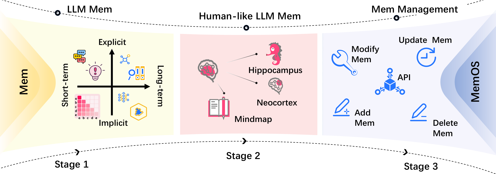

# MemOS · LLM 记忆、人类类比与可管理记忆三阶段

<!-- CATEGORY NAV -->
[Teaser](../README.md) · [Architecture](../../architecture/README.md) · [Element](../../element/README.md) · [总目录](../../CATALOG.md)
<!-- END CATEGORY NAV -->

**Teaser · 原论文 Figure 3 · 2507.03724v4**

## 内容与构图

弧形带状构图依次放入记忆类型坐标、人类脑区类比和记忆管理操作，用统一视线解释从记忆定义到系统管理的转变。

三个连续阶段：LLM Mem、Human-like LLM Mem、Mem Management。

概念、方法差异或能力的总览，按主要表达用途归入 Teaser。

## 与这次四张参考图的关系

沿 [参考图 4 · Cortex](../../teaser/cortex-memory-consolidation/README.md) · [参考图 3 · MemoryVLA](../../teaser/memoryvla-cognition-memory-action/README.md) 的表达方式继续检索。

可借鉴的组织关系：

- 连续带状结构连接不同表达类型的子图。
- 每个阶段采用适合自身关系的图形，不强求重复框图。

## 文件与编辑范围

[作者独立 PDF](original.pdf) · [SVG 转换件](source.svg) · [原始插图定义](figure-inclusion.tex) · [来源与校验记录](metadata.json)

作者独立 PDF 含 120 个绘图对象、37 个文本片段和 14 个嵌入位图对象；保留原有矢量、文字或轮廓。SVG 是 PDF 转换件，文字转轮廓，嵌入图片保持。位图对象数不代表子图数。

PDF 的框线、箭头和原有文字对象或轮廓可按实际对象修改；照片和部分图标仍为位图。桌面 Illustrator 尚未逐项实测。

## 原始出处

- 论文：[MemOS: A Memory OS for AI System](https://arxiv.org/abs/2507.03724v4)
- 作者：Li, Zhiyu；Xi, Chenyang；Li, Chunyu；Chen, Ding；Chen, Boyu；Song, Shichao；Niu, Simin；Wang, Hanyu；Yang, Jiawei；Tang, Chen；Yu, Qingchen；Zhao, Jihao；Wang, Yezhaohui；Liu, Peng；Lin, Zehao；Wang, Pengyuan；Huo, Jiahao；Chen, Tianyi；Chen, Kai；Li, Kehang；Tao, Zhen；Lai, Huayi；Wu, Hao；Tang, Bo；Wang, Zhengren；Fan, Zhaoxin；Zhang, Ningyu；Zhang, Linfeng；Yan, Junchi；Yang, Mingchuan；Xu, Tong；Xu, Wei；Chen, Huajun；Wang, Haofen；Yang, Hongkang；Zhang, Wentao；Xu, Zhi-Qin John；Chen, Siheng；Xiong, Feiyu
- [作者项目或仓库](https://github.com/MemTensor/MemOS)
- 所收录版本：`2507.03724v4`，原文 PDF 第 6 页，Figure 3。
- [固定版本 TeX 源码归档](https://arxiv.org/src/2507.03724v4)；原件路径 `img/HumanVsLLM.pdf`。

## 权利与转换记录

所收录 arXiv 论文版本声明 CC BY 4.0，保留作者署名、版本与转换记录；图中的第三方照片、商标或引用素材仍按原始权利核对。

[原版本许可](https://creativecommons.org/licenses/by/4.0/) · [权利记录](RIGHTS.source.txt)

原始文件按原字节保存，转换件另存。

<!-- BEGIN FIGURE LINKS -->
## 关联范例与元素

同论文的其他图：[MemOS · 文本、激活与参数记忆的双向转化](../memos-three-memory-consolidation-paths/README.md)

**可搭配的现有元素：** [大脑](../../element/svg/tabler-brain.svg) · [数据库](../../element/svg/tabler-database.svg) · [回环箭头](../../element/svg/tabler-arrow-loop-right.svg) · [pencil](../../element/svg/bioicons-pencil.svg)

这些元素按表达功能关联，并非从本论文原图拆出；来源和许可仍以各元素记录为准。

[范例与元素对照表](../../element/with-examples.md) · [元素分类目录](../../element/README.md)
<!-- END FIGURE LINKS -->
