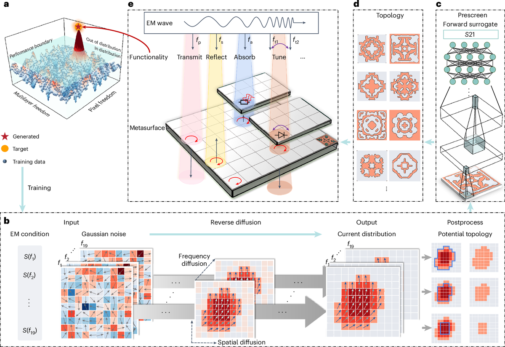

# MetaAI · 从目标电磁响应到可实现的超表面

<!-- CATEGORY NAV -->
[Teaser](../README.md) · [Architecture](../../architecture/README.md) · [Element](../../element/README.md) · [总目录](../../CATALOG.md)
<!-- END CATEGORY NAV -->

[原始 PNG](original.png) · [绘图数据 XLSX](source-data.xlsx) · [分类目录](../README.md#capabilities)

*Nature Machine Intelligence* **8**, 59–69 (2026) · Fig. 1a–e

## 读图

从左上角 a 的目标点出发。沿浅蓝色箭头走到底部 b，19 个频点的响应作为条件，噪声逐步变成有方向的电流分布。沿右侧箭头向上，在 c 看候选如何接受正向预测，再经 d 的拓扑回到中央 e 的器件。e 的各色波束分别标出透射、反射、吸收和调谐功能。

**绘图数据**　8 张表对应 d 中的八个拓扑图案。

**同篇图版**　[Fig. 2 网络结构](../../architecture/metaai-spatial-frequency-transformer/README.md) · [Fig. 3 单层设计](../../multipanel/metaai-single-layer-current-and-spectrum/README.md) · [Fig. 4 可调器件](../../multipanel/metaai-tunable-metasurface-prototype/README.md) · [Fig. 5 多层器件](../../multipanel/metaai-multilayer-transmission-absorption/README.md)

## 出处

Current-diffusion model for metasurface structure discoveries with spatial-frequency dynamics。Erji Li、Yusong Wang 等。2025 年 12 月 31 日在线发表，收入 2026 年卷。

期刊原图为 2166 × 1487 像素的 PNG。期刊标明作者版权并独家授权 Springer Nature Limited。图版作为论文参考留存，发表时复用或改编请查阅期刊的权限说明。

[论文](https://www.nature.com/articles/s42256-025-01162-z) · [期刊原图](https://media.springernature.com/full/springer-static/image/art%3A10.1038%2Fs42256-025-01162-z/MediaObjects/42256_2025_1162_Fig1_HTML.png) · [数据出处](https://static-content.springer.com/esm/art%3A10.1038%2Fs42256-025-01162-z/MediaObjects/42256_2025_1162_MOESM3_ESM.xlsx) · [版权说明](https://www.nature.com/articles/s42256-025-01162-z#rightslink)

<!-- BEGIN FIGURE LINKS -->
## 关联范例与元素

同论文的其他图：[MetaAI · 从电流扩散 Transformer 展开两种注意力](../../architecture/metaai-spatial-frequency-transformer/README.md)

**可搭配的现有元素：** [带噪潜变量块](../../element/svg/dit-noised-latent.svg) · [特征表示堆叠](../../element/svg/rust-feature-stack.svg)

这些元素按表达功能关联，并非从本论文原图拆出；来源和许可仍以各元素记录为准。

[范例与元素对照表](../../element/with-examples.md) · [元素分类目录](../../element/README.md)
<!-- END FIGURE LINKS -->
