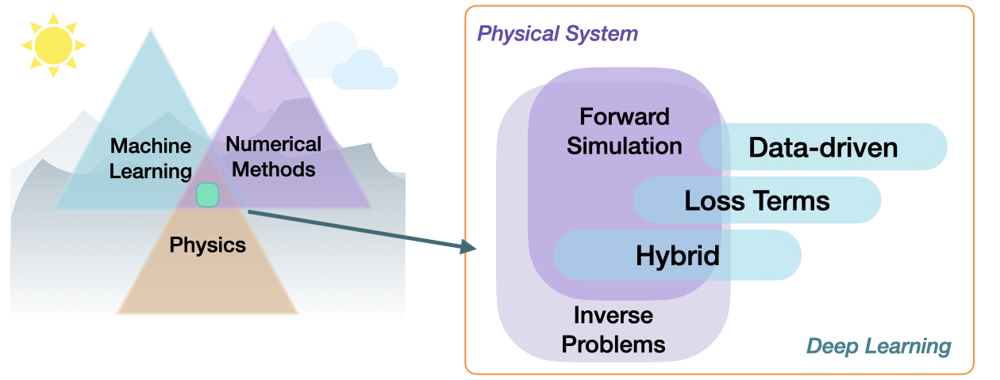

# PBDL · 领域位置与方法空间的概念总览

<!-- CATEGORY NAV -->
[Teaser](../README.md) · [Architecture](../../architecture/README.md) · [Element](../../element/README.md) · [总目录](../../CATALOG.md)
<!-- END CATEGORY NAV -->

[Teaser](../README.md) · [Architecture](../../architecture/README.md) · [Element](../../element/README.md) · [总目录](../../CATALOG.md)

**整图位图，仅构图参考。**

## 内容与构图

左侧用机器学习、数值方法与物理的交集定位领域，右侧展开正反问题以及数据驱动、物理损失和混合方法，形成从领域位置到方法空间的概念总览。

作者教材 Physics-based Deep Learning 的 Overview 页面配图，非论文首图。作为领域定位与方法分类的构图参考。

左侧三类领域交集，右侧正问题／反问题与三种物理融入方式。

## 可以借鉴

- 先交代领域交叉位置，再展开方法空间。
- 用一致颜色连接概念对象，避免将图形重叠误读为定量比例。
- 以箭头串联总览与局部展开。

## 文件与编辑范围

[作者／出版商原始图片](source.jpg) · [来源与校验记录](metadata.json)

所有图元与文字已合并；保留原始 PNG／JPEG，不将其包装成可编辑 SVG。

## 相近表达

[AI4PDE 综述范例](../survey-ai-pde-scope-map/README.md)

## 原始出处

- [作者／出版商来源页面](https://physicsbaseddeeplearning.org/overview.html)
- [固定版本或原图下载](https://raw.githubusercontent.com/tum-pbs/pbdl-book/45d2b6529eff3dacb0bec62c6ebee67ea807db33/resources/physics-based-deep-learning-overview.jpg)
- 作者：Nils Thuerey；Benjamin Holzschuh；Philipp Holl；Georg Kohl；Mario Lino；Qiang Liu；Patrick Schnell；Felix Trost

## 权利与修改记录

作者仓库根许可证为 Apache 2.0；保留原始文件、作者署名、固定版本和许可证副本。

[权利记录](RIGHTS.source.txt)

[作者仓库许可证原件](LICENSE.upstream)

<!-- BEGIN FIGURE LINKS -->
## 关联范例与元素

**可搭配的现有元素：** [原子](../../element/svg/tabler-atom.svg) · [网络](../../element/svg/tabler-network.svg) · [水平双向箭头](../../element/svg/tabler-arrows-right-left.svg) · [层级结构](../../element/svg/tabler-sitemap.svg)

这些元素按表达功能关联，并非从本论文原图拆出；来源和许可仍以各元素记录为准。

[范例与元素对照表](../../element/with-examples.md) · [元素分类目录](../../element/README.md)
<!-- END FIGURE LINKS -->
