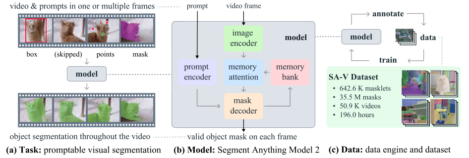

# SAM 2 · 任务、模型与数据引擎三联概念图

<!-- CATEGORY NAV -->
[Teaser](../README.md) · [Architecture](../../architecture/README.md) · [Element](../../element/README.md) · [总目录](../../CATALOG.md)
<!-- END CATEGORY NAV -->

[所属分类](../README.md) · [总目录](../../CATALOG.md)

**ICLR 2025 · Oral · 原论文 Figure 1**

## 为什么收这张图

三个并列区域分别回答方法解决什么任务、依靠什么模型、数据如何形成闭环，任务、模型与数据之间还有明确的对应连线。

任务与核心方案的概念总览 teaser；详细网络结构另列。

## 可以借鉴

- 按任务、模型、数据组织首图
- 局部保留必要结构，其余用大模块概括
- 用闭环说明数据与模型的共同改进

## 文件与编辑范围

[主文件](source.svg) · [单图 PDF](figure.pdf) · [来源与校验记录](metadata.json)

原 PDF 的几何路径与线条保留，SVG 文字转为轮廓；照片、三维渲染与原有位图部件仍为嵌入图片。

SVG 是原论文图形的提取转换件，未取得作者原生 AI 工程。不同 PDF 阅读器或 Illustrator 对字体、透明度的导入可能有差异。

## 原始出处

- 论文：[SAM 2: Segment Anything in Images and Videos](https://arxiv.org/abs/2408.00714)
- 作者：Ravi, Nikhila, Gabeur, Valentin, Hu, Yuan-Ting, Hu, Ronghang, Ryali, Chaitanya, Ma, Tengyu, Khedr, Haitham, Rädle, Roman, Rolland, Chloe, Gustafson, Laura, Mintun, Eric, Pan, Junting, Alwala, Kalyan Vasudev, Carion, Nicolas, Wu, Chao-Yuan, Girshick, Ross, Dollár, Piotr, Feichtenhofer, Christoph
- [作者项目或代码](https://github.com/facebookresearch/sam2)
- [会议与展示身份依据](https://feichtenhofer.github.io/)
- PDF 第 2 页，Figure 1；截取坐标见 metadata.json。

## 权利与修改记录

arXiv 标注的是授予 arXiv 的非独占分发许可，不是第三方图形重用许可。本条用于个人私有参考，改编或公开再用需核对原权利。

原文许可声明：https://arxiv.org/licenses/nonexclusive-distrib/1.0/

只提取、裁剪与转换原图；没有重新绘制。

<!-- BEGIN FIGURE LINKS -->
## 关联范例与元素

同论文的其他图：[SAM 2 · 流式编码、记忆注意力与记忆库](../../architecture/sam2-memory-architecture/README.md)

**可搭配的现有元素：** [视频](../../element/svg/tabler-video.svg) · [开始](../../element/svg/tabler-player-play.svg) · [回环箭头](../../element/svg/tabler-arrow-loop-right.svg) · [ViT 编码器块](../../element/svg/vit-encoder-block.svg)

这些元素按表达功能关联，并非从本论文原图拆出；来源和许可仍以各元素记录为准。

[范例与元素对照表](../../element/with-examples.md) · [元素分类目录](../../element/README.md)
<!-- END FIGURE LINKS -->
