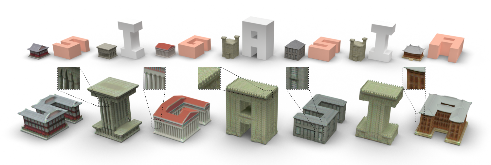

# ShaDDR：粗形状与示例驱动的成果展示

<!-- CATEGORY NAV -->
[Teaser](../README.md) · [Architecture](../../architecture/README.md) · [Element](../../element/README.md) · [总目录](../../CATALOG.md)
<!-- END CATEGORY NAV -->

上排粗形状与风格示例，下排生成结果与局部放大，以成果直接展示任务和贡献。

[作者原始 SVG](source.svg) · [来源与检查记录](metadata.json) · [原项目](https://qiminchen.github.io/shaddr/)

## 来源与可编辑范围

来源：`qiminchen/ShaDDR` / `teaser.svg`，固定版本 `7b42dc1657db`。原 SVG 未重绘、未修改字节。

SVG 对象：49 个 path，0 个 text，6 个 image。有 SVG 容器不代表每个区域都是可编辑矢量；内嵌照片和渲染图保持位图，公式可能为轮廓。

MIT（来源仓库）；渲染素材保留原论文出处。

已检查预览；桌面 Illustrator 的字体与链接兼容性尚未逐项实测。

<!-- BEGIN FIGURE LINKS -->
## 关联范例与元素

**可搭配的现有元素：** [三维坐标物体](../../element/svg/tabler-cube-3d-sphere.svg) · [图像](../../element/svg/tabler-photo.svg) · [参数设置](../../element/svg/tabler-adjustments.svg)

这些元素按表达功能关联，并非从本论文原图拆出；来源和许可仍以各元素记录为准。

[范例与元素对照表](../../element/with-examples.md) · [元素分类目录](../../element/README.md)
<!-- END FIGURE LINKS -->
