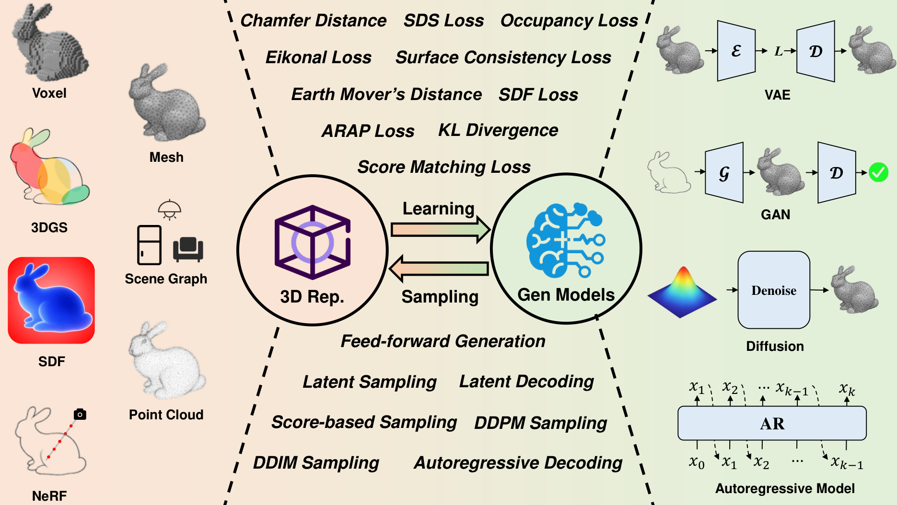

# 3D 生成概念地图 · 表示、学习目标与生成范式

<!-- CATEGORY NAV -->
[Teaser](../README.md) · [Architecture](../../architecture/README.md) · [Element](../../element/README.md) · [总目录](../../CATALOG.md)
<!-- END CATEGORY NAV -->

[所属分类](../README.md) · [总目录](../../CATALOG.md)

**arXiv 2026 · 预印本综述 · 原论文 Figure 3**

## 为什么收这张图

以表示与生成模型的双向关系为中心，左侧用同一兔子示例比较多种 3D 表示，右侧比较 VAE、GAN、扩散和自回归，上下分别列训练目标与采样方式，信息组织完整。

综述中的基础概念全景，原文 Figure 3；局部小结构用于比较生成范式，整体表达的是表示与建模关系。

## 可以借鉴

- 同一视觉对象贯穿体素、网格、点云、SDF 等表示，降低理解成本。
- 左右比较对象与模型，上下补充学习和生成过程，形成稳定的四向构图。
- 不同方法的局部示意保持相似尺度，方便横向比较。

## 文件与编辑范围

[作者原始 PDF](original.pdf) · [SVG 转换件](source.svg) · [原始 LaTeX 插图定义](figure-inclusion.tex) · [来源与校验记录](metadata.json)

作者独立 PDF 中的文字与图形对象保留；SVG 文字转为轮廓。原有照片、标识、人物或渲染仍为嵌入位图，可移动替换，不能按矢量节点编辑。

对照原论文页核实了图号和实际用途；独立 PDF 按作者提交的原文件保存。

原始 PDF 来自作者提交的 TeX 归档，未改字节；SVG 是格式转换件，未取得原生 AI 工程。桌面 Illustrator 尚未逐项实测。

## 原始出处

- 论文：[3D Generation for Embodied AI and Robotic Simulation: A Survey](https://arxiv.org/abs/2604.26509v4)
- 作者：Ye, Tianwei, Mao, Yifan, Liao, Minwen, Liu, Jian, Guo, Chunchao, Du, Dazhao, Shou, Quanxin, Zhu, Fangqi, Guo, Song
- [作者项目或仓库](https://3dgen4robot.github.io/)
- [论文 TeX 原始归档](https://arxiv.org/src/2604.26509v4)，固定版本 `2604.26509v4`。
- 归档内路径：`imgs/3d-rep-genmethod.pdf`；原文 PDF 第 4 页，Figure 3。
- [出版与来源依据](https://arxiv.org/abs/2604.26509v4)；出版年份与所收录 arXiv 修订版时间分别记录。

## 权利与修改记录

该 arXiv 版本的非独占分发许可不是第三方图形重用许可；此条用于个人私有参考，公开改编或再用应核对原权利。

[原文许可声明](https://arxiv.org/licenses/nonexclusive-distrib/1.0/) · [本条权利记录](RIGHTS.source.txt)

只复制作者原件、转换格式和制作预览；没有重绘或新增图形。

<!-- BEGIN FIGURE LINKS -->
## 关联范例与元素

**可搭配的现有元素：** [三维坐标物体](../../element/svg/tabler-cube-3d-sphere.svg) · [立方体](../../element/svg/tabler-cube.svg) · [水平双向箭头](../../element/svg/tabler-arrows-right-left.svg) · [浅层神经网络](../../element/svg/towaki-neuralnetwork.svg)

这些元素按表达功能关联，并非从本论文原图拆出；来源和许可仍以各元素记录为准。

[范例与元素对照表](../../element/with-examples.md) · [元素分类目录](../../element/README.md)
<!-- END FIGURE LINKS -->
