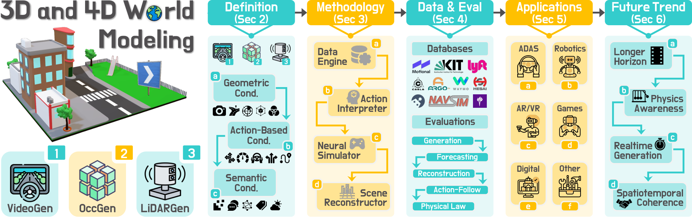

# 3D／4D 世界模型 · 场景与研究维度全景

<!-- CATEGORY NAV -->
[Teaser](../README.md) · [Architecture](../../architecture/README.md) · [Element](../../element/README.md) · [总目录](../../CATALOG.md)
<!-- END CATEGORY NAV -->

[所属分类](../README.md) · [总目录](../../CATALOG.md)

**arXiv 2025 · 预印本综述 · 原论文 Figure 1**

## 为什么收这张图

左边用可识别的三维街景建立主题，右边用重复的窄栏展开定义、方法、数据与评估、应用和未来方向；VideoGen、OccGen、LiDARGen 的图标贯穿多个维度，视觉与内容都有明确对应。

综述原论文首图，兼顾主题识别与研究范围总览；列间箭头表达组织顺序，不能当作一个模型的执行流水线。

## 可以借鉴

- 用一个大的主题场景建立识别点，再让多个研究维度共享同一排版网格。
- 同一组模态图标在不同栏目重复出现，帮助读者保持对应。
- 颜色只分主层级，细节用短标签和图标承载。

## 文件与编辑范围

[作者原始 PDF](original.pdf) · [SVG 转换件](source.svg) · [原始 LaTeX 插图定义](figure-inclusion.tex) · [来源与校验记录](metadata.json)

作者独立 PDF 中的文字与图形对象保留；SVG 文字转为轮廓。原有照片、标识、人物或渲染仍为嵌入位图，可移动替换，不能按矢量节点编辑。

对照原论文页核实了图号和实际用途；独立 PDF 按作者提交的原文件保存。

原始 PDF 来自作者提交的 TeX 归档，未改字节；SVG 是格式转换件，未取得原生 AI 工程。桌面 Illustrator 尚未逐项实测。

## 原始出处

- 论文：[3D and 4D World Modeling: A Survey](https://arxiv.org/abs/2509.07996v4)
- 作者：Kong, Lingdong, Yang, Yu, Mei, Jianbiao 等；完整署名见下方。
- [作者项目或仓库](https://worldbench.github.io/survey)
- [论文 TeX 原始归档](https://arxiv.org/src/2509.07996v4)，固定版本 `2509.07996v4`。
- 归档内路径：`figures/teaser.pdf`；原文 PDF 第 1 页，Figure 1。
- [出版与来源依据](https://arxiv.org/abs/2509.07996v4)；出版年份与所收录 arXiv 修订版时间分别记录。

完整作者署名（23 人）

Kong, Lingdong, Yang, Yu, Mei, Jianbiao, Liu, Youquan, Liang, Ao, Zhu, Dekai, Lu, Dongyue, Yin, Wei, Hu, Xiaotao, Jia, Mingkai, Deng, Junyuan, Zhang, Kaiwen, Wu, Yang, Yan, Tianyi, Gao, Shenyuan, Wang, Song, Li, Linfeng, Pan, Liang, Liu, Yong, Zhu, Jianke, Ooi, Wei Tsang, Hoi, Steven C. H., Liu, Ziwei

## 权利与修改记录

所收录 arXiv 版本声明 CC BY-SA 4.0；保留署名、来源和转换说明，改编件按相同许可分享。原有第三方图片、标识和引用素材的独立权利仍以原声明为准。

[原文许可声明](https://creativecommons.org/licenses/by-sa/4.0/) · [本条权利记录](RIGHTS.source.txt)

只复制作者原件、转换格式和制作预览；没有重绘或新增图形。

<!-- BEGIN FIGURE LINKS -->
## 关联范例与元素

同论文的其他图：[3D／4D 世界模型方法地图 · 三棵功能树](../survey-3d4d-method-tree/README.md) · [世界模型数据集图谱 · 蛇形时间路与模态卡片](../survey-3d4d-dataset-roadmap/README.md)

**可搭配的现有元素：** [三维坐标物体](../../element/svg/tabler-cube-3d-sphere.svg) · [相机](../../element/svg/tabler-camera.svg) · [汽车](../../element/svg/tabler-car.svg) · [层级结构](../../element/svg/tabler-sitemap.svg)

这些元素按表达功能关联，并非从本论文原图拆出；来源和许可仍以各元素记录为准。

[范例与元素对照表](../../element/with-examples.md) · [元素分类目录](../../element/README.md)
<!-- END FIGURE LINKS -->
