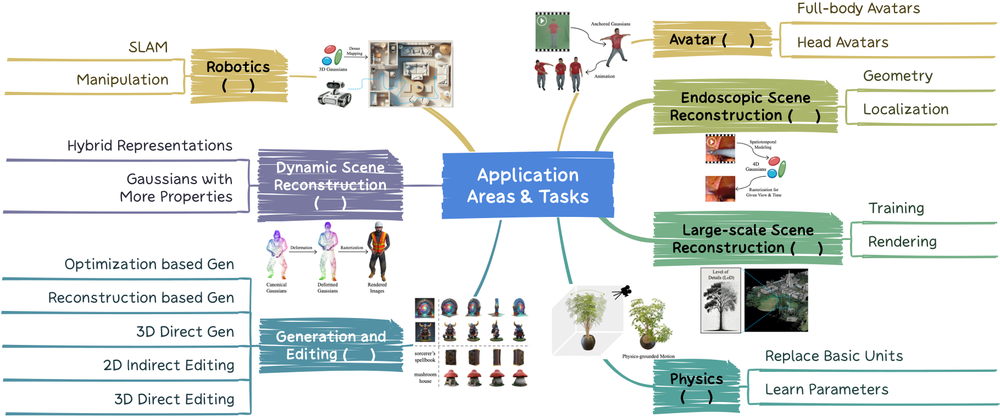

# 3DGS 应用全景 · 中心主题与场景分支

<!-- CATEGORY NAV -->
[Teaser](../README.md) · [Architecture](../../architecture/README.md) · [Element](../../element/README.md) · [总目录](../../CATALOG.md)
<!-- END CATEGORY NAV -->

[所属分类](../README.md) · [总目录](../../CATALOG.md)

**ACM Computing Surveys 2026 · 期刊综述 · 原论文 Figure 3**

## 为什么收这张图

以中心主题连接机器人、动态场景、生成编辑、化身、内窥镜、场景重建和物理等分支，并把少量视觉实例放进分支旁，兼顾分类和直观性。

综述中的应用范围总览，可借鉴为领域全景 teaser；原文为 Figure 3，不能称其为原论文首图。

## 可以借鉴

- 中心只放领域主题，一层分支讲应用，下一层讲子任务。
- 用小型图像例子补足抽象类别，让全景图具有视觉锚点。
- 原作者的章节与引文编号由 LaTeX 叠加；独立 PDF 母图保留对应空槽，附原始叠加定义。

## 文件与编辑范围

[作者原始 PDF](original.pdf) · [SVG 转换件](source.svg) · [原始 LaTeX 插图定义](figure-inclusion.tex) · [来源与校验记录](metadata.json)

作者独立 PDF 中的文字与图形对象保留；SVG 文字转为轮廓。原有照片、标识、人物或渲染仍为嵌入位图，可移动替换，不能按矢量节点编辑。

原作者把章节或引文编号放在 LaTeX 中叠加，独立 PDF 与转换 SVG 保留其编号空槽；配套 figure-inclusion.tex 是原始叠加定义。

原始 PDF 来自作者提交的 TeX 归档，未改字节；SVG 是格式转换件，未取得原生 AI 工程。桌面 Illustrator 尚未逐项实测。

## 原始出处

- 论文：[A Survey on 3D Gaussian Splatting](https://arxiv.org/abs/2401.03890v9)
- 作者：Chen, Guikun, Wang, Wenguan
- [作者项目或仓库](https://github.com/guikunchen/Awesome3DGS)
- [论文 TeX 原始归档](https://arxiv.org/src/2401.03890v9)，固定版本 `2401.03890v9`。
- 归档内路径：`fig/fig_app1.pdf`；原文 PDF 第 14 页，Figure 3。
- [出版与来源依据](https://arxiv.org/abs/2401.03890v9)；出版年份与所收录 arXiv 修订版时间分别记录。

## 权利与修改记录

所收录 arXiv 版本声明 CC BY 4.0；保留作者署名、原文链接和格式转换说明。图中的第三方照片、标识、模型渲染与引用素材仍需按其原权利声明使用。

[原文许可声明](https://creativecommons.org/licenses/by/4.0/) · [本条权利记录](RIGHTS.source.txt)

只复制作者原件、转换格式和制作预览；没有重绘或新增图形。

<!-- BEGIN FIGURE LINKS -->
## 关联范例与元素

同论文的其他图：[3DGS 综述路线图 · 双侧分类地图](../survey-3dgs-review-map/README.md)

**可搭配的现有元素：** [相机](../../element/svg/tabler-camera.svg) · [三维坐标物体](../../element/svg/tabler-cube-3d-sphere.svg) · [地球](../../element/svg/tabler-world.svg) · [层级结构](../../element/svg/tabler-sitemap.svg)

这些元素按表达功能关联，并非从本论文原图拆出；来源和许可仍以各元素记录为准。

[范例与元素对照表](../../element/with-examples.md) · [元素分类目录](../../element/README.md)
<!-- END FIGURE LINKS -->
