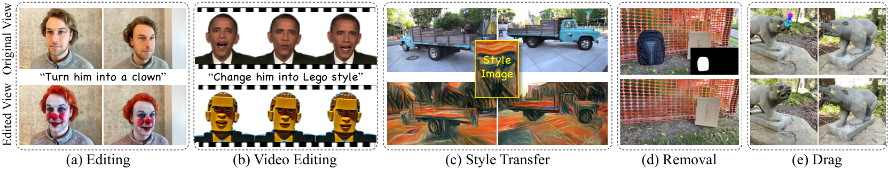

# 3DGS 编辑应用 · 5 组子图与上下前后对照

<!-- CATEGORY NAV -->
[Teaser](../README.md) · [Architecture](../../architecture/README.md) · [Element](../../element/README.md) · [总目录](../../CATALOG.md)
<!-- END CATEGORY NAV -->

[所属分类](../README.md) · [总目录](../../CATALOG.md)

**arXiv 2025 · 综述 · 原论文 Figure 4**

## 子图组织

(a)–(e) 5 组操作子图，每组上下对齐原图与编辑结果。

按原图 (a) Editing、(b) Video Editing、(c) Style Transfer、(d) Removal、(e) Drag 计 5 组；连续视频帧与风格参考图保留在各组内。

## 为什么收这张图

5 组操作横向排开，上排原视图、下排编辑结果；视频编辑保留连续帧，风格迁移加入参考图，统一对照逻辑又允许各组呈现必要细节。

综述 Figure 4 的应用操作概览，原文并非首图。用于借鉴多任务展示的对齐与分组方式。

## 可以借鉴

- 各组共用上下两排的 Original View／Edited View，让读者只需学一次阅读顺序。
- 虚线框和组标签界定不同操作，避免相邻视频帧被误读成不同方法。
- 不强行让每组图片数量相同，保留视频与风格参考所需的额外画面。

## 文件与编辑范围

[作者原始 PDF](original.pdf) · [SVG 转换件](source.svg) · [原始插图定义](figure-inclusion.tex) · [来源与校验记录](metadata.json)

独立 PDF 保留作者原有图形和文本对象；SVG 文字转轮廓。各照片与结果图仍是嵌入位图，可移动或替换，不能按矢量节点编辑。

原件来自作者固定版本源码归档；桌面 Illustrator 尚未逐项实测。

## 原始出处

- 论文：[A Survey on 3D Gaussian Splatting Applications: Segmentation, Editing, and Generation](https://arxiv.org/abs/2508.09977v5)
- 作者：He, Shuting；Ji, Peilin；Yang, Yitong；Wang, Changshuo；Ji, Jiayi；Wang, Yinglin；Ding, Henghui
- [作者项目或原文](https://github.com/heshuting555/Awesome-3DGS-Applications)
- [作者 TeX 源码归档](https://arxiv.org/src/2508.09977v5)；版本 `2508.09977v5`。
- 归档内路径：`figs/3DEditing.pdf`。原文 PDF 第 8 页，Figure 4。

## 权利与修改记录

所收录版本的 arXiv 非独占分发许可不是第三方图形重用许可；此条用于个人私有参考，公开改编或再用需核对原权利。 子图引用的第三方照片、截图、生成结果与原论文图例仍按其原始权利声明使用。

[原文许可声明](https://arxiv.org/licenses/nonexclusive-distrib/1.0/) · [权利记录](RIGHTS.source.txt)

只复制原件、转换格式和制作预览；所有内容沿用作者原图。

<!-- BEGIN FIGURE LINKS -->
## 关联范例与元素

**可搭配的现有元素：** [图像](../../element/svg/tabler-photo.svg) · [视频](../../element/svg/tabler-video.svg) · [三维坐标物体](../../element/svg/tabler-cube-3d-sphere.svg) · [水平双向箭头](../../element/svg/tabler-arrows-right-left.svg)

这些元素按表达功能关联，并非从本论文原图拆出；来源和许可仍以各元素记录为准。

[范例与元素对照表](../../element/with-examples.md) · [元素分类目录](../../element/README.md)
<!-- END FIGURE LINKS -->
