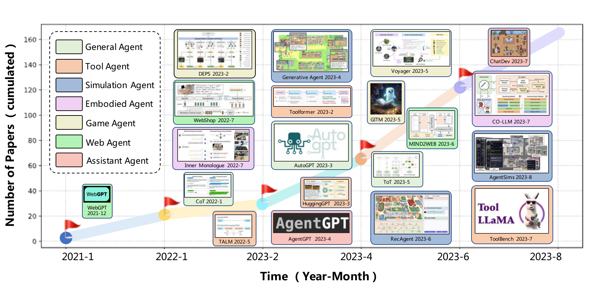

# 自主 Agent 发展 · 趋势曲线与代表场景

<!-- CATEGORY NAV -->
[Teaser](../README.md) · [Architecture](../../architecture/README.md) · [Element](../../element/README.md) · [总目录](../../CATALOG.md)
<!-- END CATEGORY NAV -->

[所属分类](../README.md) · [总目录](../../CATALOG.md)

**Frontiers of Computer Science 2024 · 期刊综述 · 原论文 Figure 1**

## 为什么收这张图

在累计论文增长曲线上排布有类别配色的代表系统缩略图，将领域热度、时间顺序和应用类型合在一个画面里。

综述开篇的发展概览，适合借鉴趋势与实例结合的布局；缩略图是既有系统插图，不是当前系统基准比较。

## 可以借鉴

- 先确定趋势主线，再把代表实例锚定到相应时期。
- 图例颜色只编码类别，时间和累计数量交给坐标轴。
- 原图覆盖 2021 年 1 月至 2023 年 8 月，不能直接作为今天的领域统计。

## 文件与编辑范围

[作者原始 PDF](original.pdf) · [SVG 转换件](source.svg) · [原始 LaTeX 插图定义](figure-inclusion.tex) · [来源与校验记录](metadata.json)

作者独立 PDF 中的文字与图形对象保留；SVG 文字转为轮廓。原有照片、标识、人物或渲染仍为嵌入位图，可移动替换，不能按矢量节点编辑。

对照原论文页核实了图号和实际用途；独立 PDF 按作者提交的原文件保存。

原始 PDF 来自作者提交的 TeX 归档，未改字节；SVG 是格式转换件，未取得原生 AI 工程。桌面 Illustrator 尚未逐项实测。

## 原始出处

- 论文：[A Survey on Large Language Model based Autonomous Agents](https://arxiv.org/abs/2308.11432v7)
- 作者：Wang, Lei, Ma, Chen, Feng, Xueyang, Zhang, Zeyu, Yang, Hao, Zhang, Jingsen, Chen, Zhiyuan, Tang, Jiakai, Chen, Xu, Lin, Yankai, Zhao, Wayne Xin, Wei, Zhewei, Wen, Ji-Rong
- [作者项目或仓库](https://github.com/Paitesanshi/LLM-Agent-Survey)
- [论文 TeX 原始归档](https://arxiv.org/src/2308.11432v7)，固定版本 `2308.11432v7`。
- 归档内路径：`FCS-240231-fig1.pdf`；原文 PDF 第 2 页，Figure 1。
- [出版与来源依据](https://arxiv.org/abs/2308.11432v7)；出版年份与所收录 arXiv 修订版时间分别记录。

## 权利与修改记录

所收录 arXiv 版本声明 CC BY 4.0；保留作者署名、原文链接和格式转换说明。图中的第三方照片、标识、模型渲染与引用素材仍需按其原权利声明使用。

[原文许可声明](https://creativecommons.org/licenses/by/4.0/) · [本条权利记录](RIGHTS.source.txt)

只复制作者原件、转换格式和制作预览；没有重绘或新增图形。

<!-- BEGIN FIGURE LINKS -->
## 关联范例与元素

同论文的其他图：[自主 Agent 统一框架 · 四列模块分解](../../architecture/survey-autonomous-agent-modules/README.md)

**可搭配的现有元素：** [散点图符号](../../element/svg/tabler-chart-scatter.svg) · [时钟](../../element/svg/tabler-clock.svg) · [多用户](../../element/svg/tabler-users.svg)

这些元素按表达功能关联，并非从本论文原图拆出；来源和许可仍以各元素记录为准。

[范例与元素对照表](../../element/with-examples.md) · [元素分类目录](../../element/README.md)
<!-- END FIGURE LINKS -->
