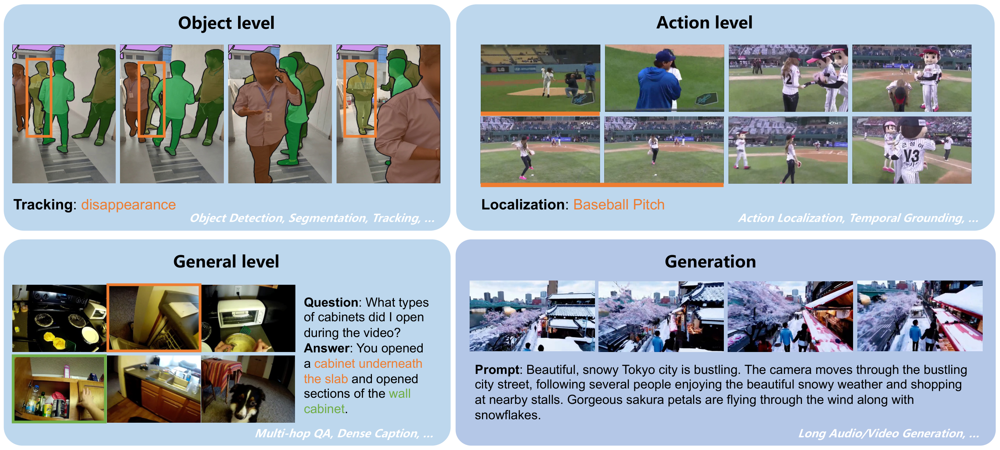

# AI 记忆综述 · 视频对象、动作、问答与生成四面板

<!-- CATEGORY NAV -->
[Teaser](../README.md) · [Architecture](../../architecture/README.md) · [Element](../../element/README.md) · [总目录](../../CATALOG.md)
<!-- END CATEGORY NAV -->

**Teaser · 原论文 Figure 14 · 2601.09113v1**

## 内容与构图

2×2 面板并列对象级跟踪、动作定位、综合视频问答和视频生成。每组使用连续帧、局部高亮或问答示例解释任务所需的时序信息。

2×2：Object level、Action level、General level、Generation；各面板再组合连续帧、问题或提示词。

概念、方法差异或能力的总览，按主要表达用途归入 Teaser。

原文为 Figure 14（不是首图），本库将其作为多任务 teaser 的构图参考；连续帧与生成画面按作者原件保留为位图。

## 与这次四张参考图的关系

沿 [参考图 3 · MemoryVLA](../../teaser/memoryvla-cognition-memory-action/README.md) · [参考图 1 · 无线感知四场景](../../teaser/survey-genai-wireless-four-scenarios/README.md) 的表达方式继续检索。

可借鉴的组织关系：

- 相同浅蓝底将每类任务的帧组与关键问题收在一起。
- 用帧组、边框高亮和局部文字共同表达任务差异。

## 文件与编辑范围

[作者独立 PDF](original.pdf) · [SVG 转换件](source.svg) · [原始插图定义](figure-inclusion.tex) · [来源与校验记录](metadata.json)

作者独立 PDF 含 13 个绘图对象、33 个文本片段和 22 个嵌入位图对象；保留原有矢量、文字或轮廓。SVG 是 PDF 转换件，文字转轮廓，嵌入图片保持。位图对象数不代表子图数。

PDF 的框线、箭头和原有文字对象或轮廓可按实际对象修改；照片和部分图标仍为位图。桌面 Illustrator 尚未逐项实测。

## 原始出处

- 论文：[The AI Hippocampus: How Far are We From Human Memory?](https://arxiv.org/abs/2601.09113v1)
- 作者：Jia, Zixia；Li, Jiaqi；Kang, Yipeng；Wang, Yuxuan；Wu, Tong；Wang, Quansen；Wang, Xiaobo；Zhang, Shuyi；Shen, Junzhe；Li, Qing；Qi, Siyuan；Liang, Yitao；He, Di；Zheng, Zilong；Zhu, Song-Chun
- [作者项目或仓库](https://github.com/bigai-nlco/LLM-Memory-Survey)
- 所收录版本：`2601.09113v1`，原文 PDF 第 38 页，Figure 14。
- [固定版本 TeX 源码归档](https://arxiv.org/src/2601.09113v1)；原件路径 `sections/mllm/memory_downstream.pdf`。

## 权利与转换记录

所收录 arXiv 版本采用非独占分发许可，该许可不等同第三方重用授权。本条用于私有参考，保留署名与来源；图中第三方插图和照片按原始权利核对。

[原版本许可](https://arxiv.org/licenses/nonexclusive-distrib/1.0/) · [权利记录](RIGHTS.source.txt)

原始文件按原字节保存，转换件另存。

<!-- BEGIN FIGURE LINKS -->
## 关联范例与元素

同论文的其他图：[AI 记忆综述 · 感觉、短期、长期记忆与行动闭环](../../architecture/survey-ai-memory-agent-feedback-framework/README.md)

**可搭配的现有元素：** [视频](../../element/svg/tabler-video.svg) · [图像](../../element/svg/tabler-photo.svg) · [目标](../../element/svg/tabler-target.svg) · [时钟](../../element/svg/tabler-clock.svg)

这些元素按表达功能关联，并非从本论文原图拆出；来源和许可仍以各元素记录为准。

[范例与元素对照表](../../element/with-examples.md) · [元素分类目录](../../element/README.md)
<!-- END FIGURE LINKS -->
