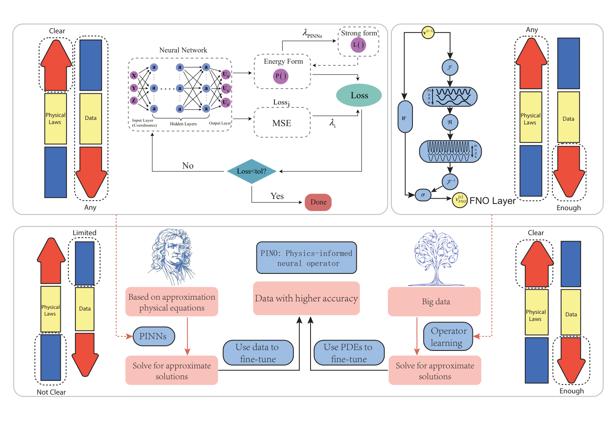

# AI for PDEs · 物理与数据条件下的三类方法对照

<!-- CATEGORY NAV -->
[Teaser](../README.md) · [Architecture](../../architecture/README.md) · [Element](../../element/README.md) · [总目录](../../CATALOG.md)
<!-- END CATEGORY NAV -->

[所属分类](../README.md) · [总目录](../../CATALOG.md)

**arXiv 2024 · 综述 · 原论文 Figure 2**

## 子图组织

3 类方法＋4 种物理／数据条件；上层展示 PINNs 和算子学习，下层展开 PINO 的两种路径。

三类方法是 PINNs、算子学习和 PINO；四种条件来自图中重复使用的 Physical Laws／Data 图示。底层两条路径同属 PINO，不另算第四类方法。

## 为什么收这张图

同一套物理信息／数据条件标记贯穿多个子区，各区给出相应方法的科学示意和求解路径。子图围绕一个共同问题形成对照，能同时说明方法差异、适用条件及相互融合的关系。

原论文 Figure 2。整图用于比较方法范式，含有网络和算子局部示意；按整体表达目的归入 Teaser。

## 可以借鉴

- 复用同一组条件图示，让读者用统一规则理解不同方法。
- 每个子区包含方法内容，使用网络、算子、损失或求解路径解释概念。
- 上下两层分别呈现基础范式和融合范式，连接线说明它们的联系。

## 可美化的方向（尚未改绘）

- 为三类方法加上同级标题，并把物理／数据条件整理成位置一致的角标。
- 在 teaser 版本中适度收起训练循环与网络内部细节，保留约束来源、关键算子和主要关系。
- 统一箭头、字体、边框和留白；同类信息采用一致颜色，减少读者反复辨认。

## 文件与编辑范围

[作者原始 PDF](original.pdf) · [SVG 转换件](source.svg) · [原始插图定义](figure-inclusion.tex) · [来源与校验记录](metadata.json)

独立 PDF 保留作者原有图形和文本对象；SVG 文字转轮廓。原图中的嵌入位图可移动或替换，不能按矢量节点编辑。

原件来自作者固定版本源码归档；桌面 Illustrator 尚未逐项实测。

## 原始出处

- 论文：[Artificial intelligence for partial differential equations in computational mechanics: A review](https://arxiv.org/abs/2410.19843v3)
- 作者：Wang, Yizheng；Bai, Jinshuai；Lin, Zhongya；Wang, Qimin；Anitescu, Cosmin；Sun, Jia；Eshaghi, Mohammad Sadegh；Gu, Yuantong；Feng, Xi-Qiao；Zhuang, Xiaoying；Rabczuk, Timon；Liu, Yinghua
- [作者项目或原文](https://arxiv.org/abs/2410.19843v3)
- [作者 TeX 源码归档](https://arxiv.org/src/2410.19843v3)；版本 `2410.19843v3`。
- 归档内路径：`PINNs_operator_PINO.pdf`。原文 PDF 第 5 页，Figure 2。

## 权利与修改记录

所收录版本的 arXiv 非独占分发许可不是第三方图形重用许可；此条用于个人私有参考，公开改编或再用需核对原权利。 子图引用的第三方照片、截图、生成结果与原论文图例仍按其原始权利声明使用。

[原文许可声明](https://arxiv.org/licenses/nonexclusive-distrib/1.0/) · [权利记录](RIGHTS.source.txt)

只复制原件、转换格式和制作预览；所有内容沿用作者原图。

<!-- BEGIN SIMILAR EXAMPLES -->
## 相近范例

- [PDE 求解综述 · 物理—数据连续谱与两类方法全景](../survey-pde-physics-data-continuum/README.md)：都将物理与数据的关系作为组织主线，再用具体方法内容解释不同分支。
- [物理知识融入学习 · 五种方式的统一图元对照](../survey-physics-knowledge-five-paradigms/README.md)：以相同图元对照物理知识进入学习过程的不同方式。
- [Informed ML · 数据路径与先验知识路径的概念对照](../survey-informed-ml-information-flow/README.md)：明确区分数据与先验知识，并解释两者如何进入学习过程。

<!-- END SIMILAR EXAMPLES -->

<!-- BEGIN FIGURE LINKS -->
## 关联范例与元素

同论文的其他图：[AI for PDEs · 领域定位、方法与应用全景](../survey-ai-pde-scope-map/README.md)

**可搭配的现有元素：** [浅层神经网络](../../element/svg/towaki-neuralnetwork.svg) · [数据库](../../element/svg/tabler-database.svg) · [正弦信号](../../element/svg/tabler-wave-sine.svg) · [水平双向箭头](../../element/svg/tabler-arrows-right-left.svg) · [回环箭头](../../element/svg/tabler-arrow-loop-right.svg)

这些元素按表达功能关联，并非从本论文原图拆出；来源和许可仍以各元素记录为准。

[范例与元素对照表](../../element/with-examples.md) · [元素分类目录](../../element/README.md)
<!-- END FIGURE LINKS -->
