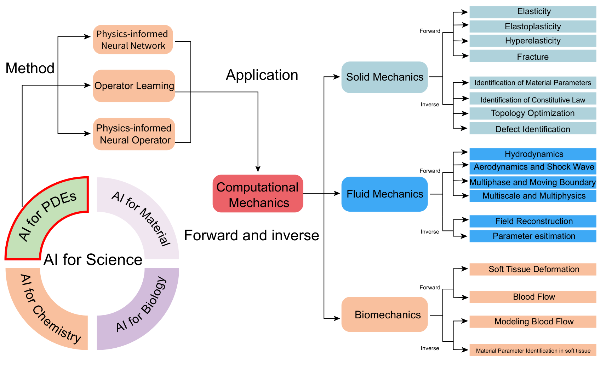

# AI for PDEs · 领域定位、方法与应用全景

<!-- CATEGORY NAV -->
[Teaser](../README.md) · [Architecture](../../architecture/README.md) · [Element](../../element/README.md) · [总目录](../../CATALOG.md)
<!-- END CATEGORY NAV -->

[所属分类](../README.md) · [总目录](../../CATALOG.md)

**arXiv 2024 · 综述 · 原论文 Figure 1**

## 子图组织

领域定位圆环＋3 类方法＋3 类力学应用；按正问题与反问题展开 18 个任务标签。

方法分为 PINNs、算子学习和 PINO；应用分为固体力学、流体力学、生物力学。18 是末端任务标签数，不作为独立场景图片数。

## 为什么收这张图

从 AI4Science 中的领域位置出发，将三类 AI4PDE 方法连接到计算力学，再按三个应用领域及正反问题展开。分类、范围和研究对象形成一条完整主线，是内容充实的综述概念总览。

原论文 Figure 1。重点在领域定位与方法—应用关系；可在保留内容关系的基础上统一视觉设计。

## 可以借鉴

- 先回答研究位于哪个领域，再交代方法类别和应用范围。
- 领域圆环、方法汇合与应用树各承担一种信息层级，共用一个中心对象。
- 三个应用领域沿用正问题／反问题的相同组织规则，便于横向阅读。

## 可美化的方向（尚未改绘）

- 统一领域圆环、方法块和应用分支的字号、线宽与配色层级。
- 压缩二级任务标签的视觉权重，为固体、流体和生物力学各配置有真实来源的代表性科学示意图。
- 调整圆环与树状区域的面积比例，让中心对象和主阅读路径更突出。

## 文件与编辑范围

[作者原始 PDF](original.pdf) · [SVG 转换件](source.svg) · [原始插图定义](figure-inclusion.tex) · [来源与校验记录](metadata.json)

独立 PDF 保留作者原有矢量图形、连线和文本对象；SVG 文字转轮廓。此独立 PDF 未检测到嵌入位图。

原件来自作者固定版本源码归档；桌面 Illustrator 尚未逐项实测。

## 原始出处

- 论文：[Artificial intelligence for partial differential equations in computational mechanics: A review](https://arxiv.org/abs/2410.19843v3)
- 作者：Wang, Yizheng；Bai, Jinshuai；Lin, Zhongya；Wang, Qimin；Anitescu, Cosmin；Sun, Jia；Eshaghi, Mohammad Sadegh；Gu, Yuantong；Feng, Xi-Qiao；Zhuang, Xiaoying；Rabczuk, Timon；Liu, Yinghua
- [作者项目或原文](https://arxiv.org/abs/2410.19843v3)
- [作者 TeX 源码归档](https://arxiv.org/src/2410.19843v3)；版本 `2410.19843v3`。
- 归档内路径：`relationship_AI_ML_DL.pdf`。原文 PDF 第 2 页，Figure 1。

## 权利与修改记录

所收录版本的 arXiv 非独占分发许可不是第三方图形重用许可；此条用于个人私有参考，公开改编或再用需核对原权利。 子图引用的第三方照片、截图、生成结果与原论文图例仍按其原始权利声明使用。

[原文许可声明](https://arxiv.org/licenses/nonexclusive-distrib/1.0/) · [权利记录](RIGHTS.source.txt)

只复制原件、转换格式和制作预览；所有内容沿用作者原图。

<!-- BEGIN SIMILAR EXAMPLES -->
## 相近范例

- [Informed ML · 知识来源—表示—融入位置全景](../survey-informed-ml-knowledge-map/README.md)：将多级分类串成完整的领域关系图，适合表达研究范围与组成。
- [PIML · 物理先验、融入层级与任务的三维全景](../survey-piml-three-axis-landscape/README.md)：在同一全景中组织先验、方法与应用任务，形成有主线的综述概念图。

<!-- END SIMILAR EXAMPLES -->

<!-- BEGIN FIGURE LINKS -->
## 关联范例与元素

同论文的其他图：[AI for PDEs · 物理与数据条件下的三类方法对照](../survey-ai-pde-physics-data-paradigms/README.md)

**可搭配的现有元素：** [层级结构](../../element/svg/tabler-sitemap.svg) · [节点分支](../../element/svg/tabler-affiliate.svg) · [原子](../../element/svg/tabler-atom.svg) · [正弦信号](../../element/svg/tabler-wave-sine.svg) · [分流箭头](../../element/svg/tabler-arrows-split.svg)

这些元素按表达功能关联，并非从本论文原图拆出；来源和许可仍以各元素记录为准。

[范例与元素对照表](../../element/with-examples.md) · [元素分类目录](../../element/README.md)
<!-- END FIGURE LINKS -->
