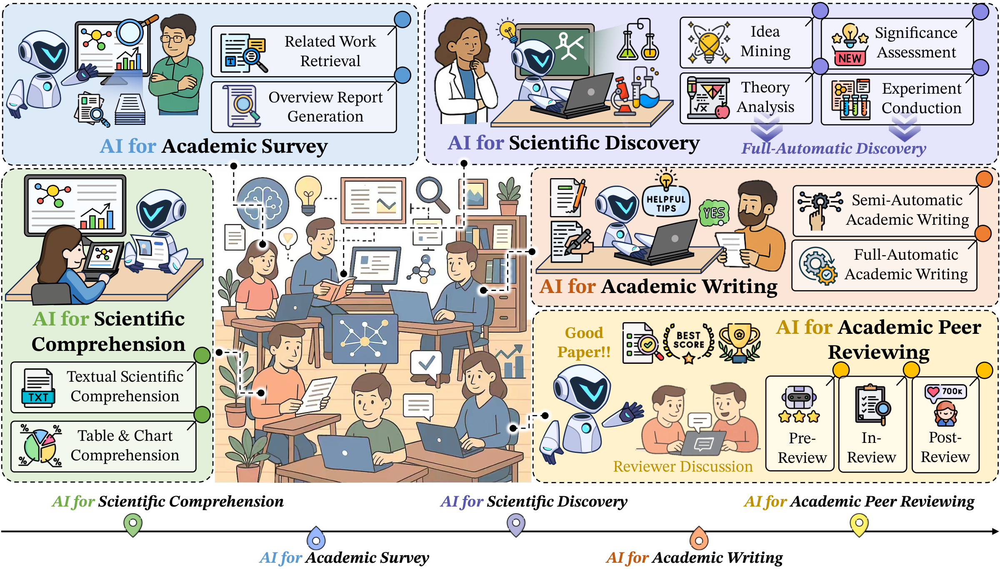

# AI4Research · 五类科研活动的多区总览

<!-- CATEGORY NAV -->
[Teaser](../README.md) · [Architecture](../../architecture/README.md) · [Element](../../element/README.md) · [总目录](../../CATALOG.md)
<!-- END CATEGORY NAV -->

[Teaser](../README.md) · [Architecture](../../architecture/README.md) · [Element](../../element/README.md) · [总目录](../../CATALOG.md)

**作者独立 PDF＋SVG 转换件 · 2507.01903v2 · Figure 1**

## 内容与组织

五类科研活动各有独立底色、示意对象和细分任务，中心场景把它们连成一张完整概念图。局部可单独阅读，整体也有明确的视觉中心。

围绕中心科研协作场景布置五个任务区：科学理解、学术综述、科学发现、学术写作、同行评审。

按作者列出的五类科研活动计任务区；中央人物场景是连接各区的视觉中心，不另外计为第六类。

综述所收录版本的原论文 Figure 1。

## 可以借鉴

- 将任务区围绕一个中心对象组织，而非只画分类树。
- 每个区包含标题、图标和少量细分任务，保证信息层级一致。
- 用底部颜色索引帮助读者对应五个区。

## 文件与编辑范围

[作者原始 PDF](original.pdf) · [SVG 转换件](source.svg) · [作者插图定义](figure-inclusion.tex) · [来源与校验记录](metadata.json)

作者独立 PDF 保留分离的矢量框线、连线、原有文字或文字轮廓；转换 SVG 的文字为轮廓。原图含 56 个嵌入位图对象，这些图片可移动或替换，不能按矢量节点编辑。位图对象数不等于子图数量。

在 Illustrator 中打开 PDF 或 SVG 后，可优先调整外围分区、颜色、标签和连接。嵌入照片、截图或图标保留其原始位图属性；桌面 Illustrator 尚未逐项实测。

## 相近范例

[AI4PDE 综述范例](../survey-ai-pde-scope-map/README.md)

## 原始出处

- 论文：[AI4Research: A Survey of Artificial Intelligence for Scientific Research](https://arxiv.org/abs/2507.01903v2)
- 作者：Chen, Qiguang；Yang, Mingda；Qin, Libo；Liu, Jinhao；Yan, Zheng；Guan, Jiannan 等（完整名单见元数据）
- [作者项目或原文](https://ai-4-research.github.io/)
- 固定版本：`2507.01903v2`；原文 PDF 第 5 页，Figure 1。
- [作者 TeX 源码归档](https://arxiv.org/src/2507.01903v2)；成员路径 `figures/main.pdf`。

## 权利与修改记录

所收录版本声明 CC-BY-SA-4.0，保留作者署名、原文链接与转换记录。 第三方照片、Logo、截图或引用图按其原始声明核对；格式可编辑不代表授权可任意改编。

[原文许可](https://creativecommons.org/licenses/by-sa/4.0/) · [权利记录](RIGHTS.source.txt)

作者原件按原字节保存；仅转换显示格式和生成预览，未改绘。

<!-- BEGIN FIGURE LINKS -->
## 关联范例与元素

同论文的其他图：[AI4Research · 科学发现的五区流程总览](../survey-ai4research-discovery-cycle/README.md) · [AI4Research · 三大领域、七类应用面板](../survey-ai4research-seven-domains/README.md)

**可搭配的现有元素：** [层级结构](../../element/svg/tabler-sitemap.svg) · [网络](../../element/svg/tabler-network.svg) · [文本文件](../../element/svg/tabler-file-text.svg) · [机器人](../../element/svg/tabler-robot.svg)

这些元素按表达功能关联，并非从本论文原图拆出；来源和许可仍以各元素记录为准。

[范例与元素对照表](../../element/with-examples.md) · [元素分类目录](../../element/README.md)
<!-- END FIGURE LINKS -->
