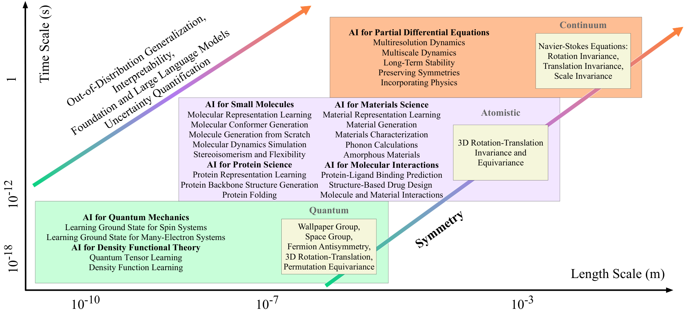

# AI4Science 时空尺度图 · 研究对象与共同挑战

<!-- CATEGORY NAV -->
[Teaser](../README.md) · [Architecture](../../architecture/README.md) · [Element](../../element/README.md) · [总目录](../../CATALOG.md)
<!-- END CATEGORY NAV -->

[所属分类](../README.md) · [总目录](../../CATALOG.md)

**arXiv 2023 · 预印本综述 · 原论文 Figure 3**

## 为什么收这张图

把研究方向放进时间与长度尺度坐标，再用斜向箭头表达跨尺度共性；同一画面包含应用对象、典型任务、对称性和共通研究挑战，信息量足而层级清楚。

综述中的时空尺度概念地图，原文 Figure 3；以尺度和问题关系组织领域，适合作为开篇视角图参考。

## 可以借鉴

- 横纵轴承担有意义的领域坐标，色块承担研究范围，减少纯文字枚举。
- 用量子、原子和连续系统的不同区域建立整体框架。
- 斜向共享挑战与区域内具体任务分开表达；图中尺度布局是概括性示意。

## 文件与编辑范围

[作者原始 PDF](original.pdf) · [SVG 转换件](source.svg) · [原始 LaTeX 插图定义](figure-inclusion.tex) · [来源与校验记录](metadata.json)

作者独立 PDF 中的文字与图形对象保留；SVG 文字转为轮廓。原有照片、标识、人物或渲染仍为嵌入位图，可移动替换，不能按矢量节点编辑。

对照原论文页核实了图号和实际用途；独立 PDF 按作者提交的原文件保存。

原始 PDF 来自作者提交的 TeX 归档，未改字节；SVG 是格式转换件，未取得原生 AI 工程。桌面 Illustrator 尚未逐项实测。

## 原始出处

- 论文：[Artificial Intelligence for Science in Quantum, Atomistic, and Continuum Systems](https://arxiv.org/abs/2307.08423v6)
- 作者：Zhang, Xuan, Wang, Limei, Helwig, Jacob 等；完整署名见下方。
- [作者项目或仓库](https://arxiv.org/abs/2307.08423)
- [论文 TeX 原始归档](https://arxiv.org/src/2307.08423v6)，固定版本 `2307.08423v6`。
- 归档内路径：`figs/AIRS_stair_gram.pdf`；原文 PDF 第 10 页，Figure 3。
- [出版与来源依据](https://arxiv.org/abs/2307.08423v6)；出版年份与所收录 arXiv 修订版时间分别记录。

完整作者署名（63 人）

Zhang, Xuan, Wang, Limei, Helwig, Jacob, Luo, Youzhi, Fu, Cong, Xie, Yaochen, Liu, Meng, Lin, Yuchao, Xu, Zhao, Yan, Keqiang, Adams, Keir, Weiler, Maurice, Li, Xiner, Fu, Tianfan, Wang, Yucheng, Strasser, Alex, Yu, Haiyang, Xie, YuQing, Fu, Xiang, Xu, Shenglong, Liu, Yi, Du, Yuanqi, Saxton, Alexandra, Ling, Hongyi, Lawrence, Hannah, Stärk, Hannes, Gui, Shurui, Edwards, Carl, Gao, Nicholas, Ladera, Adriana, Wu, Tailin, Hofgard, Elyssa F., Tehrani, Aria Mansouri, Wang, Rui, Daigavane, Ameya, Bohde, Montgomery, Kurtin, Jerry, Huang, Qian, Phung, Tuong, Xu, Minkai, Joshi, Chaitanya K., Mathis, Simon V., Azizzadenesheli, Kamyar, Fang, Ada, Aspuru-Guzik, Alán, Bekkers, Erik, Bronstein, Michael, Zitnik, Marinka, Anandkumar, Anima, Ermon, Stefano, Liò, Pietro, Yu, Rose, Günnemann, Stephan, Leskovec, Jure, Ji, Heng, Sun, Jimeng, Barzilay, Regina, Jaakkola, Tommi, Coley, Connor W., Qian, Xiaoning, Qian, Xiaofeng, Smidt, Tess, Ji, Shuiwang

## 权利与修改记录

该 arXiv 版本的非独占分发许可不是第三方图形重用许可；此条用于个人私有参考，公开改编或再用应核对原权利。

[原文许可声明](https://arxiv.org/licenses/nonexclusive-distrib/1.0/) · [本条权利记录](RIGHTS.source.txt)

只复制作者原件、转换格式和制作预览；没有重绘或新增图形。

<!-- BEGIN FIGURE LINKS -->
## 关联范例与元素

同论文的其他图：[AI4Science 领域圆环 · 从量子到连续系统](../survey-ai4science-domain-wheel/README.md)

**可搭配的现有元素：** [散点图符号](../../element/svg/tabler-chart-scatter.svg) · [时钟](../../element/svg/tabler-clock.svg) · [原子](../../element/svg/tabler-atom.svg)

这些元素按表达功能关联，并非从本论文原图拆出；来源和许可仍以各元素记录为准。

[范例与元素对照表](../../element/with-examples.md) · [元素分类目录](../../element/README.md)
<!-- END FIGURE LINKS -->
