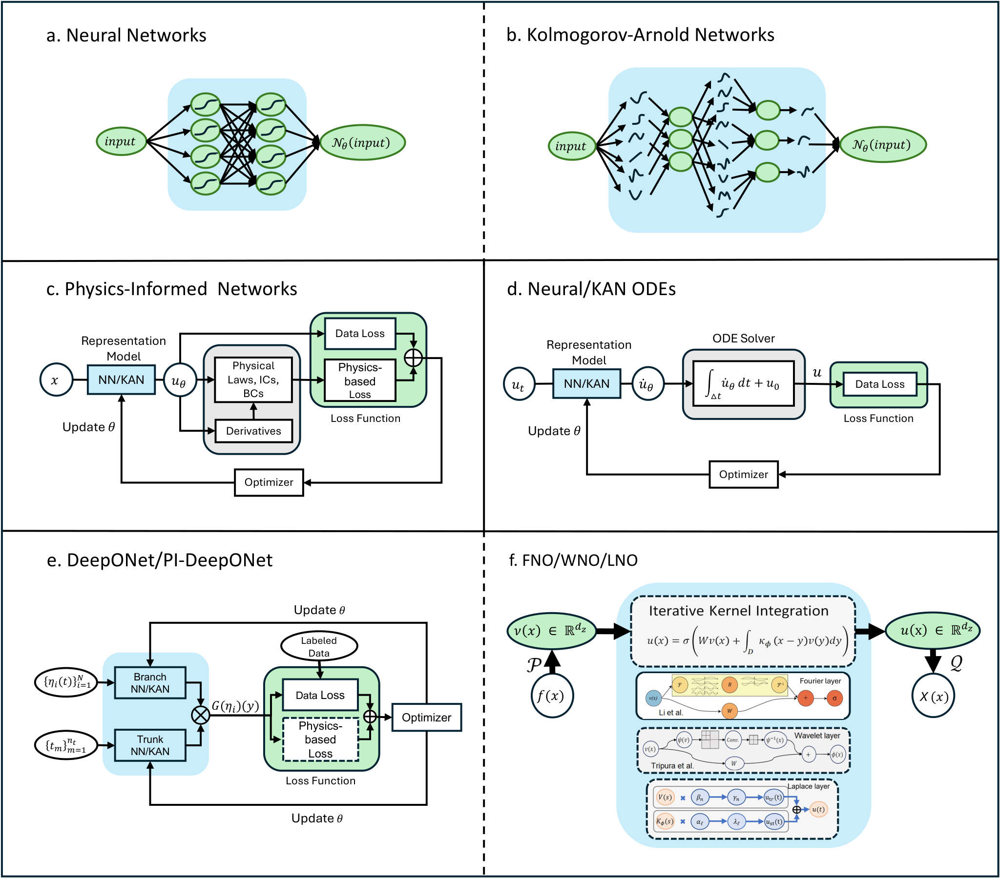

# 生物医学 PIML · 六面板方法范式总览

<!-- CATEGORY NAV -->
[Teaser](../README.md) · [Architecture](../../architecture/README.md) · [Element](../../element/README.md) · [总目录](../../CATALOG.md)
<!-- END CATEGORY NAV -->

[Teaser](../README.md) · [Architecture](../../architecture/README.md) · [Element](../../element/README.md) · [总目录](../../CATALOG.md)

**arXiv 2025 · Figure 1**

## 内容与组织

同一张图用六个面板解释不同表示模型、物理损失、连续时间建模与算子学习。蓝色表示模型、绿色表示数据或损失，适合借鉴为内容充实的方法范式总览。

2 列 × 3 行，依次对照 NN、KAN、物理约束网络、Neural/KAN ODE、DeepONet、FNO/WNO/LNO。

按标注 (a)–(f) 计六个面板；最后一格内部还包含 Fourier、Wavelet、Laplace 三种算子的局部示意。

综述预印本 Figure 1，PDF 第 5 页。虽然内部使用网络结构示意，整图的作用是比较多个方法家族，因此归入 Teaser。

## 可以借鉴

- 统一六个面板的尺寸和阅读顺序，每格保留一个主要科学关系。
- 相同颜色跨面板指向相同功能，便于比较方法差异。
- 用一层局部展开容纳算子变体，避免再增加整图层级。

## 文件与编辑范围

[作者原始 PDF](original.pdf) · [SVG 显示转换件](source.svg) · [来源与校验记录](metadata.json) · [原始插图定义](figure-inclusion.tex)

作者独立 PDF 保留原有矢量图形和文字对象；SVG 转换件文字为轮廓。原图含 6 个嵌入位图对象，可移动或替换，不能按矢量节点编辑。桌面 Illustrator 尚未实测。

## 相近范例

[AI4PDE 综述范例](../survey-ai-pde-physics-data-paradigms/README.md)

## 原始出处

- 文章：[Physics-Informed Machine Learning in Biomedical Science and Engineering](https://arxiv.org/abs/2510.05433v1)
- 作者：Ahmadi, Nazanin；Cao, Qianying；Humphrey, Jay D.；Karniadakis, George Em
- [来源页面](https://arxiv.org/abs/2510.05433)
- 版本：`2510.05433v1`；[作者源码归档](https://arxiv.org/src/2510.05433v1)；原图路径 `Figure/method.pdf`。
- 原文 PDF 第 5 页，Figure 1。
- arXiv 页面注明 2025-10-02 已被 Annual Review of Biomedical Engineering 接收；本条仍标记所收录的预印本版本。

## 权利与修改记录

所收录版本声明 CC-BY-NC-ND-4.0。保留作者署名、固定版本和原许可链接；第三方子图按其原始权利声明。 该版本含 NC、ND 条款；本条保存作者原件和未改图意的显示转换件，作为私有参考。不能将可编辑格式理解为作者已授权任意改编。

[原文许可](https://creativecommons.org/licenses/by-nc-nd/4.0/) · [权利记录](RIGHTS.source.txt)

只复制原件、转换显示格式和制作预览；未重绘。

<!-- BEGIN FIGURE LINKS -->
## 关联范例与元素

**可搭配的现有元素：** [浅层神经网络](../../element/svg/towaki-neuralnetwork.svg) · [网络](../../element/svg/tabler-network.svg) · [正弦信号](../../element/svg/tabler-wave-sine.svg) · [文本文件](../../element/svg/tabler-file-text.svg)

这些元素按表达功能关联，并非从本论文原图拆出；来源和许可仍以各元素记录为准。

[范例与元素对照表](../../element/with-examples.md) · [元素分类目录](../../element/README.md)
<!-- END FIGURE LINKS -->
