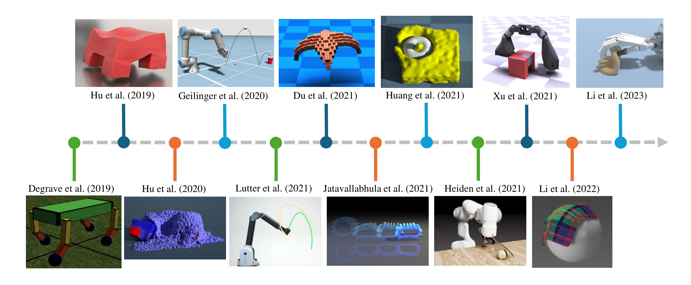

# 可微仿真综述 · 十二个场景的双排时间线

<!-- CATEGORY NAV -->
[Teaser](../README.md) · [Architecture](../../architecture/README.md) · [Element](../../element/README.md) · [总目录](../../CATALOG.md)
<!-- END CATEGORY NAV -->

[Teaser](../README.md) · [Architecture](../../architecture/README.md) · [Element](../../element/README.md) · [总目录](../../CATALOG.md)

**作者独立 PDF＋SVG 转换件 · 2407.05560v1 · Figure 1**

## 内容与组织

软体、刚体、轨迹优化、形态优化和操作等研究场景共同组成一张总览。时间线、节点、标签与十二张独立图像保留为分离对象，适合借鉴为内容丰富的发展脉络 teaser。

十二个研究场景分置时间线上下两排，每排六个；彩色节点连接对应的研究与年份。

按十二张场景图计十二个面板；颜色节点不额外计图。横向位置用于时间线构图，不应直接测量或解释为精确的等间隔年份坐标。

综述所收录版本的原论文 Figure 1。

## 可以借鉴

- 将较多实例交错布置在中轴两侧，保持图文邻近。
- 复用图片尺寸、引用标签和节点，建立稳定阅读节奏。
- 用实际场景呈现研究范围，而非仅列出方向名称。

## 文件与编辑范围

[作者原始 PDF](original.pdf) · [SVG 转换件](source.svg) · [作者插图定义](figure-inclusion.tex) · [来源与校验记录](metadata.json)

作者独立 PDF 保留分离的矢量框线、连线、原有文字或文字轮廓；转换 SVG 的文字为轮廓。原图含 12 个嵌入位图对象，这些图片可移动或替换，不能按矢量节点编辑。位图对象数不等于子图数量。

在 Illustrator 中打开 PDF 或 SVG 后，可优先调整外围分区、颜色、标签和连接。嵌入照片、截图或图标保留其原始位图属性；桌面 Illustrator 尚未逐项实测。

## 相近范例

[AI4PDE 综述范例](../survey-ai-pde-scope-map/README.md)

## 原始出处

- 论文：[A Review of Differentiable Simulators](https://arxiv.org/abs/2407.05560v1)
- 作者：Newbury, Rhys；Collins, Jack；He, Kerry；Pan, Jiahe；Posner, Ingmar；Howard, David 等（完整名单见元数据）
- [作者项目或原文](https://arxiv.org/abs/2407.05560)
- 固定版本：`2407.05560v1`；原文 PDF 第 3 页，Figure 1。
- [作者 TeX 源码归档](https://arxiv.org/src/2407.05560v1)；成员路径 `Images/collage/figure1new.pdf`。

## 权利与修改记录

所收录 arXiv 版本标记非独占分发许可，该许可不等同于第三方图形重用授权；本条作为私有参考。 第三方照片、Logo、截图或引用图按其原始声明核对；格式可编辑不代表授权可任意改编。

[原文许可](https://arxiv.org/licenses/nonexclusive-distrib/1.0/) · [权利记录](RIGHTS.source.txt)

作者原件按原字节保存；仅转换显示格式和生成预览，未改绘。

<!-- BEGIN FIGURE LINKS -->
## 关联范例与元素

**可搭配的现有元素：** [网络](../../element/svg/tabler-network.svg) · [机器人](../../element/svg/tabler-robot.svg) · [右箭头](../../element/svg/tabler-arrow-right.svg) · [台式电脑](../../element/svg/tabler-device-desktop.svg)

这些元素按表达功能关联，并非从本论文原图拆出；来源和许可仍以各元素记录为准。

[范例与元素对照表](../../element/with-examples.md) · [元素分类目录](../../element/README.md)
<!-- END FIGURE LINKS -->
