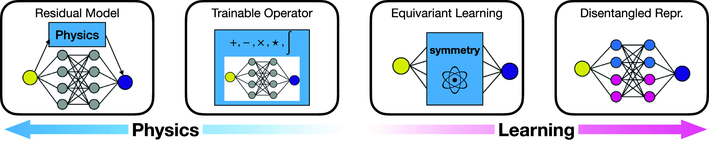

# 动力学学习 · 物理与数据依赖的四范式对照

<!-- CATEGORY NAV -->
[Teaser](../README.md) · [Architecture](../../architecture/README.md) · [Element](../../element/README.md) · [总目录](../../CATALOG.md)
<!-- END CATEGORY NAV -->

[Teaser](../README.md) · [Architecture](../../architecture/README.md) · [Element](../../element/README.md) · [总目录](../../CATALOG.md)

**PNAS 2024 · Figure 2**

## 内容与组织

四个面板沿用相同的输入、输出和网络视觉语汇，通过物理模块进入网络的方式突出范式区别；下方的连续方向带概括物理先验与学习依赖的变化。

四栏：残差模型、可训练算子、等变学习、解耦表示；下方用物理—学习方向带串联。

按四种方法范式计四个面板。方向带表示作者对物理先验与数据依赖的定性排序，不是定量坐标。

PNAS 2024 观点文章 Figure 2，原文并非首图；概括四类物理引导动力学学习方法，适合借鉴为方法范式对照 teaser。

## 可以借鉴

- 对照面板复用相同输入、输出与网络骨架，突出变化部分。
- 用颜色标出物理模块或不同潜在因素。
- 用底部方向带概括定性排序，不把它画成未经验证的定量趋势。

## 文件与编辑范围

[作者原始 JPG](source.jpg) · [来源与校验记录](metadata.json)

作者原件是一张完整 JPG（4209 × 874）；文字与子图已经合并。本条保留原始图片作构图参考，不提供伪矢量 SVG。

## 相近范例

[AI4PDE 综述范例](../survey-ai-pde-physics-data-paradigms/README.md)

## 原始出处

- 文章：[Learning dynamical systems from data: An introduction to physics-guided deep learning](https://www.pnas.org/doi/10.1073/pnas.2311808121)
- 作者：Rose Yu；Rui Wang
- [来源页面](https://pmc.ncbi.nlm.nih.gov/articles/PMC11228478/)
- [PMC 原始 JPEG](https://cdn.ncbi.nlm.nih.gov/pmc/blobs/e3a3/11228478/2eafcbf48e5b/pnas.2311808121fig02.jpg)；原文 Figure 2。

## 权利与修改记录

所收录版本声明 CC-BY-4.0。保留作者署名、固定版本和原许可链接；第三方子图按其原始权利声明。

[原文许可](https://creativecommons.org/licenses/by/4.0/) · [权利记录](RIGHTS.source.txt)

只复制原件、转换显示格式和制作预览；未重绘。

<!-- BEGIN FIGURE LINKS -->
## 关联范例与元素

**可搭配的现有元素：** [浅层神经网络](../../element/svg/towaki-neuralnetwork.svg) · [原子](../../element/svg/tabler-atom.svg) · [右箭头](../../element/svg/tabler-arrow-right.svg) · [水平双向箭头](../../element/svg/tabler-arrows-right-left.svg)

这些元素按表达功能关联，并非从本论文原图拆出；来源和许可仍以各元素记录为准。

[范例与元素对照表](../../element/with-examples.md) · [元素分类目录](../../element/README.md)
<!-- END FIGURE LINKS -->
