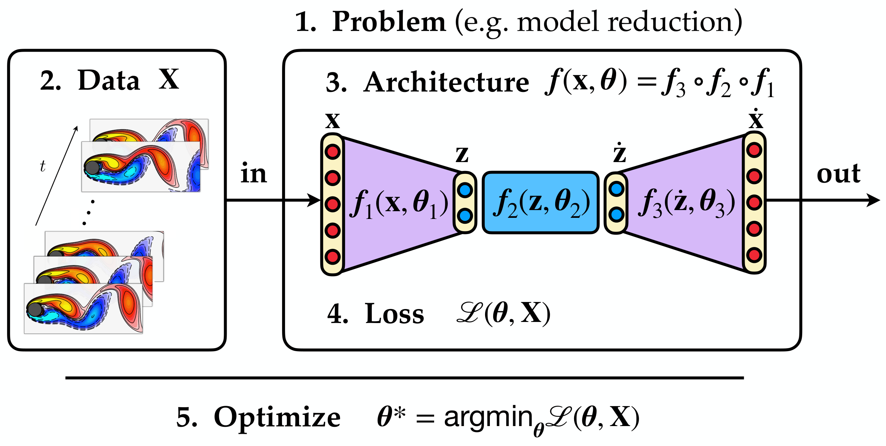

# 流体机器学习综述 · 五阶段与降阶模型总览

<!-- CATEGORY NAV -->
[Teaser](../README.md) · [Architecture](../../architecture/README.md) · [Element](../../element/README.md) · [总目录](../../CATALOG.md)
<!-- END CATEGORY NAV -->

[Teaser](../README.md) · [Architecture](../../architecture/README.md) · [Element](../../element/README.md) · [总目录](../../CATALOG.md)

**作者独立 PDF＋SVG 转换件 · 2110.02083v1 · Figure 1**

## 内容与组织

用流体降阶建模这一具体例子解释通用机器学习流程。图中同时保留流场快照、网络结构、潜在空间动力学和目标函数，适合将一般概念落到一个科学任务上。

五个编号环节：问题、数据、架构、损失、优化；流场快照与编码器—动力学—解码器提供具体例子。

五阶段指机器学习工作中的五个环节，并非五张独立子图；原图主体为数据区与模型区，外部标签补足问题和优化环节。

综述所收录版本的原论文 Figure 1。

## 可以借鉴

- 用具体的科学对象贯穿数据、模型和目标，而不只画步骤框。
- 将大流程与内部模型放在同一画面，区分两种层级。
- 以编号和外层标签补充流程，避免箭头过多。

## 文件与编辑范围

[作者原始 PDF](original.pdf) · [SVG 转换件](source.svg) · [作者插图定义](figure-inclusion.tex) · [来源与校验记录](metadata.json)

作者独立 PDF 保留分离的矢量框线、连线、原有文字或文字轮廓；转换 SVG 的文字为轮廓。原图含 14 个嵌入位图对象，这些图片可移动或替换，不能按矢量节点编辑。位图对象数不等于子图数量。

在 Illustrator 中打开 PDF 或 SVG 后，可优先调整外围分区、颜色、标签和连接。嵌入照片、截图或图标保留其原始位图属性；桌面 Illustrator 尚未逐项实测。

## 相近范例

[AI4PDE 综述范例](../survey-ai-pde-physics-data-paradigms/README.md)

## 原始出处

- 论文：[Applying Machine Learning to Study Fluid Mechanics](https://arxiv.org/abs/2110.02083v1)
- 作者：Brunton, Steven L.
- [作者项目或原文](https://link.springer.com/article/10.1007/s10409-021-01143-6)
- 固定版本：`2110.02083v1`；原文 PDF 第 2 页，Figure 1。
- [作者 TeX 源码归档](https://arxiv.org/src/2110.02083v1)；成员路径 `Figure01.pdf`。

## 权利与修改记录

所收录版本声明 CC-BY-4.0，保留作者署名、原文链接与转换记录。 第三方照片、Logo、截图或引用图按其原始声明核对；格式可编辑不代表授权可任意改编。

[原文许可](https://creativecommons.org/licenses/by/4.0/) · [权利记录](RIGHTS.source.txt)

作者原件按原字节保存；仅转换显示格式和生成预览，未改绘。

[2022 年期刊版本](https://link.springer.com/article/10.1007/s10409-021-01143-6)；本条图号和许可对应 2021 年 arXiv 版本。

<!-- BEGIN FIGURE LINKS -->
## 关联范例与元素

**可搭配的现有元素：** [浅层神经网络](../../element/svg/towaki-neuralnetwork.svg) · [正弦信号](../../element/svg/tabler-wave-sine.svg) · [右箭头](../../element/svg/tabler-arrow-right.svg) · [文本文件](../../element/svg/tabler-file-text.svg)

这些元素按表达功能关联，并非从本论文原图拆出；来源和许可仍以各元素记录为准。

[范例与元素对照表](../../element/with-examples.md) · [元素分类目录](../../element/README.md)
<!-- END FIGURE LINKS -->
