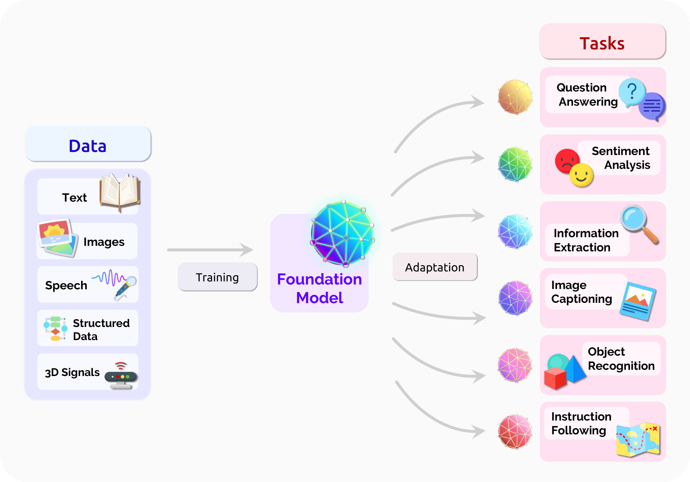

# 基础模型概念总览 · 多源数据与多任务适配

<!-- CATEGORY NAV -->
[Teaser](../README.md) · [Architecture](../../architecture/README.md) · [Element](../../element/README.md) · [总目录](../../CATALOG.md)
<!-- END CATEGORY NAV -->

[所属分类](../README.md) · [总目录](../../CATALOG.md)

**arXiv 2021 · 预印本综述 · 原论文 Figure 2**

## 为什么收这张图

左侧多模态数据汇入一个共享基础，右侧扇出多个下游任务；每个任务用短名称和具象图标表达，能快速讲清共同底座与任务适配的概念。

CRFM 综合报告中的概念图，原文 Figure 2；报告涵盖技术、应用与社会影响，按综述性报告收录。此图表达共同模型与多任务关系，不展开内部网络。

## 可以借鉴

- 汇聚与扇出的非对称布局突出共享底座。
- 同一类模型符号在中心与任务侧复用，颜色说明适配差异。
- 用有限的典型输入和输出说明概念，不把它当作穷尽的任务清单。

## 文件与编辑范围

[作者原始 PDF](original.pdf) · [SVG 转换件](source.svg) · [原始 LaTeX 插图定义](figure-inclusion.tex) · [来源与校验记录](metadata.json)

[论文实际嵌入的 PNG 原件](paper-embedded.png)

作者独立 PDF 中的文字与图形对象保留；SVG 文字转为轮廓。原有照片、标识、人物或渲染仍为嵌入位图，可移动替换，不能按矢量节点编辑。

论文排版引用 intro2.png；同一作者源码归档另含 intro_framework.pdf 矢量配套版本。本条保存该 PDF 原件、由它转换的 SVG，以及论文实际引用的 PNG；两版有细小的排版差异。

原始 PDF 来自作者提交的 TeX 归档，未改字节；SVG 是格式转换件，未取得原生 AI 工程。桌面 Illustrator 尚未逐项实测。

## 原始出处

- 论文：[On the Opportunities and Risks of Foundation Models](https://arxiv.org/abs/2108.07258v3)
- 作者：Bommasani, Rishi, Hudson, Drew A., Adeli, Ehsan 等；完整署名见下方。
- [作者项目或仓库](https://crfm.stanford.edu/report.html)
- [论文 TeX 原始归档](https://arxiv.org/src/2108.07258v3)，固定版本 `2108.07258v3`。
- 归档内路径：`figures/intro_framework.pdf`；原文 PDF 第 6 页，Figure 2。
- [出版与来源依据](https://arxiv.org/abs/2108.07258v3)；出版年份与所收录 arXiv 修订版时间分别记录。

完整作者署名（114 人）

Bommasani, Rishi, Hudson, Drew A., Adeli, Ehsan, Altman, Russ, Arora, Simran, von Arx, Sydney, Bernstein, Michael S., Bohg, Jeannette, Bosselut, Antoine, Brunskill, Emma, Brynjolfsson, Erik, Buch, Shyamal, Card, Dallas, Castellon, Rodrigo, Chatterji, Niladri, Chen, Annie, Creel, Kathleen, Davis, Jared Quincy, Demszky, Dora, Donahue, Chris, Doumbouya, Moussa, Durmus, Esin, Ermon, Stefano, Etchemendy, John, Ethayarajh, Kawin, Fei-Fei, Li, Finn, Chelsea, Gale, Trevor, Gillespie, Lauren, Goel, Karan, Goodman, Noah, Grossman, Shelby, Guha, Neel, Hashimoto, Tatsunori, Henderson, Peter, Hewitt, John, Ho, Daniel E., Hong, Jenny, Hsu, Kyle, Huang, Jing, Icard, Thomas, Jain, Saahil, Jurafsky, Dan, Kalluri, Pratyusha, Karamcheti, Siddharth, Keeling, Geoff, Khani, Fereshte, Khattab, Omar, Koh, Pang Wei, Krass, Mark, Krishna, Ranjay, Kuditipudi, Rohith, Kumar, Ananya, Ladhak, Faisal, Lee, Mina, Lee, Tony, Leskovec, Jure, Levent, Isabelle, Li, Xiang Lisa, Li, Xuechen, Ma, Tengyu, Malik, Ali, Manning, Christopher D., Mirchandani, Suvir, Mitchell, Eric, Munyikwa, Zanele, Nair, Suraj, Narayan, Avanika, Narayanan, Deepak, Newman, Ben, Nie, Allen, Niebles, Juan Carlos, Nilforoshan, Hamed, Nyarko, Julian, Ogut, Giray, Orr, Laurel, Papadimitriou, Isabel, Park, Joon Sung, Piech, Chris, Portelance, Eva, Potts, Christopher, Raghunathan, Aditi, Reich, Rob, Ren, Hongyu, Rong, Frieda, Roohani, Yusuf, Ruiz, Camilo, Ryan, Jack, Ré, Christopher, Sadigh, Dorsa, Sagawa, Shiori, Santhanam, Keshav, Shih, Andy, Srinivasan, Krishnan, Tamkin, Alex, Taori, Rohan, Thomas, Armin W., Tramèr, Florian, Wang, Rose E., Wang, William, Wu, Bohan, Wu, Jiajun, Wu, Yuhuai, Xie, Sang Michael, Yasunaga, Michihiro, You, Jiaxuan, Zaharia, Matei, Zhang, Michael, Zhang, Tianyi, Zhang, Xikun, Zhang, Yuhui, Zheng, Lucia, Zhou, Kaitlyn, Liang, Percy

## 权利与修改记录

所收录 arXiv 版本声明 CC BY 4.0；保留作者署名、原文链接和格式转换说明。图中的第三方照片、标识、模型渲染与引用素材仍需按其原权利声明使用。

[原文许可声明](https://creativecommons.org/licenses/by/4.0/) · [本条权利记录](RIGHTS.source.txt)

只复制作者原件、转换格式和制作预览；没有重绘或新增图形。

<!-- BEGIN FIGURE LINKS -->
## 关联范例与元素

同论文的其他图：[基础模型生态 · 数据、模型与人的完整链条](../survey-foundation-model-ecosystem/README.md)

**可搭配的现有元素：** [图像](../../element/svg/tabler-photo.svg) · [文本文件](../../element/svg/tabler-file-text.svg) · [分流箭头](../../element/svg/tabler-arrows-split.svg) · [大脑](../../element/svg/tabler-brain.svg)

这些元素按表达功能关联，并非从本论文原图拆出；来源和许可仍以各元素记录为准。

[范例与元素对照表](../../element/with-examples.md) · [元素分类目录](../../element/README.md)
<!-- END FIGURE LINKS -->
