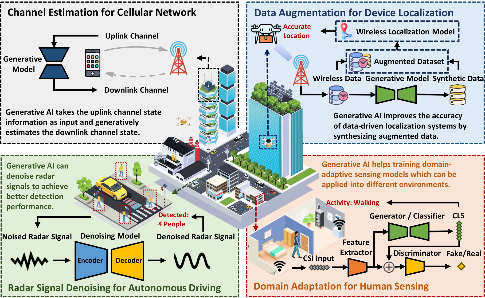

# 无线生成式 AI · 城市场景串联四类应用

<!-- CATEGORY NAV -->
[Teaser](../README.md) · [Architecture](../../architecture/README.md) · [Element](../../element/README.md) · [总目录](../../CATALOG.md)
<!-- END CATEGORY NAV -->

[Teaser](../../teaser/README.md) · [Architecture](../../architecture/README.md) · [Element](../../element/README.md) · [总目录](../../CATALOG.md)

**用户参考图 1 · Figure 1 · Teaser**

## 与用户参考图的对应

用户图 1 对应作者原 Figure 1 的整图；布局、四个场景标题、信号流程和中心城市图一致。

[四张图片的出处与版本对照](../../docs/image-provenance-2026-11-04.md)

## 内容与分类

四个方法场景围绕中心城市示意组织：信道估计、定位数据增强、雷达去噪、人体感知域适应。每区既有应用对象，也有局部模型或信号流程。

综述首图，用场景与局部方法共同解释研究覆盖范围，归入 Teaser。

2×2 应用分区＋跨区的城市、道路与室内场景；局部模型与应用位置相互连接。

按四个明确命名的任务区计四个主面板；城市建筑、车辆、信号波形和网络图是区内或跨区的说明对象。

## 可以借鉴

- 用跨面板场景作为视觉中心，把多个应用放回同一环境。
- 每个任务区同时包含科学对象、简短说明和方法流程。
- 用分区颜色和虚线连接任务与具体应用位置。

## 文件与编辑范围

[作者独立 PDF](original.pdf) · [SVG 转换件](source.svg) · [原始插图定义](figure-inclusion.tex) · [来源与校验记录](metadata.json)

作者独立 PDF 保留矢量结构及原有文字对象或轮廓；SVG 为 PDF 转换件，文字转轮廓。原 PDF 含 21 个嵌入位图对象，可移动或替换，不能按矢量节点编辑。位图对象数不等于子图数。

原 PDF 和 SVG 的框线、箭头、公式或文字结构可按实际对象修改；桌面 Illustrator 尚未逐项实测。

## 原始出处

- 论文：[Generative AI Meets Wireless Sensing: Towards Wireless Foundation Model](https://arxiv.org/abs/2509.15258v1)
- 作者：Yang, Zheng；Chi, Guoxuan；Wu, Chenshu；Liu, Hanyu；Gao, Yuchong；Liu, Yunhao；Xu, Jie；Han, Tony Xiao
- [作者项目或论文页面](https://www.weizmann.ac.il/math/yonina/sites/math.yonina/files/GenAI_Survey_TCOM.pdf)
- 所收录版本：`2509.15258v1`；原文 PDF 第 2 页，Figure 1。
- [固定版本作者源码归档](https://arxiv.org/src/2509.15258v1)；成员路径 `fig/1-Motivation-application.pdf`。
- [后续期刊版记录](https://weizmann.elsevierpure.com/en/publications/generative-ai-for-wireless-communication-and-sensing-toward-unifi/)：2026 年 IEEE Transactions on Communications，标题为 *Generative AI for Wireless Communication and Sensing: Toward Unified Foundation Models*；本条原图来自上述 2025 年预印本。

## 权利与修改记录

所收录 arXiv 版本采用非独占分发许可，此许可不是第三方图形重用授权；本条用于私有参考。保留作者署名、固定版本与转换记录。图中第三方插画、Logo、照片或引用素材按原始权利声明核对。

[原版本许可](https://arxiv.org/licenses/nonexclusive-distrib/1.0/) · [权利记录](RIGHTS.source.txt)

作者原件按原字节保存；只作格式转换、预览和来源整理。

<!-- BEGIN RELATED FOUR 2026-11-05 -->
## 沿这张图继续找相近构图

本批继续收录的相近参考，仍分别存放在 Teaser 和 Architecture：

| 新增参考 | 用途 | 文件 |
|---|---|---|
| [GenAI × IoT · 分层技术栈与多场景应用](../../teaser/survey-genai-iot-layers-scenes/README.md) | Teaser | 作者 PDF + SVG 转换件 |
| [GenAI 综述 · 演进、生成模型与代表方法拼图](../../teaser/survey-genai-history-model-mosaic/README.md) | Teaser | 作者 PDF + SVG 转换件 |
| [GenAI 网络管理 · 控制面、数据面与切片场景](../../teaser/survey-genai-network-management-scenes/README.md) | Teaser | 作者 PDF + SVG 转换件 |
| [GenAI 无线安全 · 四场景与局部机制并列](../../teaser/survey-genai-wireless-security-four-panels/README.md) | Teaser | 作者 PDF + SVG 转换件 |
| [GenAI 语义通信 · 语义记忆与物理信道双路框架](../../architecture/survey-genai-semantic-memory-framework/README.md) | Architecture | 作者 PDF + SVG 转换件 |
| [AI 记忆综述 · 视频对象、动作、问答与生成四面板](../../teaser/survey-ai-memory-video-task-panels/README.md) | Teaser | 作者 PDF + SVG 转换件 |

[本批 20 张图的来源与分类对照](../../docs/related-four-2026-11-05.md)
<!-- END RELATED FOUR 2026-11-05 -->

<!-- BEGIN FIGURE LINKS -->
## 关联范例与元素

**从本图拆出的部件：** [生成模型双梯形符号](../../element/svg/wireless-generative-bowtie.svg) · [雷达编码器梯形](../../element/svg/wireless-radar-encoder.svg) · [雷达解码器梯形](../../element/svg/wireless-radar-decoder.svg) · [特征提取梯形](../../element/svg/wireless-feature-extractor.svg) · [判别器梯形](../../element/svg/wireless-discriminator.svg) · [CSI 菱形输入序列](../../element/svg/wireless-csi-input.svg)

**可搭配的现有元素：** [正弦信号](../../element/svg/tabler-wave-sine.svg) · [网络](../../element/svg/tabler-network.svg) · [手机](../../element/svg/tabler-device-mobile.svg) · [右箭头](../../element/svg/tabler-arrow-right.svg) · [多层特征图堆叠](../../element/svg/security-feature-stack.svg) · [带信号的文档符号](../../element/svg/security-signal-document.svg)

这些元素按表达功能关联，并非从本论文原图拆出；来源和许可仍以各元素记录为准。

[范例与元素对照表](../../element/with-examples.md) · [元素分类目录](../../element/README.md)
<!-- END FIGURE LINKS -->
