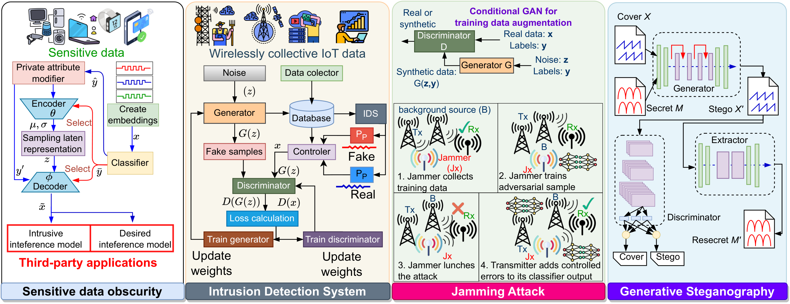

# GenAI 无线安全 · 四场景与局部机制并列

<!-- CATEGORY NAV -->
[Teaser](../README.md) · [Architecture](../../architecture/README.md) · [Element](../../element/README.md) · [总目录](../../CATALOG.md)
<!-- END CATEGORY NAV -->

**Teaser · 原论文 Figure 6 · 2405.20024v2**

## 内容与构图

四栏分别解释敏感数据隐藏、入侵检测、干扰攻击和生成式隐写。每栏都有场景或数据图标、局部网络与关键箭头，最接近参考图 1 的信息密度。

四栏并列：数据隐私、入侵检测、干扰攻击、生成式隐写；第三栏再展开攻击步骤。

概念、方法差异或能力的总览，按主要表达用途归入 Teaser。

## 与这次四张参考图的关系

沿 [参考图 1 · 无线感知四场景](../../teaser/survey-genai-wireless-four-scenarios/README.md) 的表达方式继续检索。

可借鉴的组织关系：

- 每个主题由场景、机制、输入输出共同构成。
- 用栏底色带定位主题，主体内容保留白底与细节。

## 文件与编辑范围

[作者独立 PDF](original.pdf) · [SVG 转换件](source.svg) · [原始插图定义](figure-inclusion.tex) · [来源与校验记录](metadata.json)

作者独立 PDF 含 260 个绘图对象、100 个文本片段和 41 个嵌入位图对象；保留原有矢量、文字或轮廓。SVG 是 PDF 转换件，文字转轮廓，嵌入图片保持。位图对象数不代表子图数。

PDF 的框线、箭头和原有文字对象或轮廓可按实际对象修改；照片和部分图标仍为位图。桌面 Illustrator 尚未逐项实测。

## 原始出处

- 论文：[Applications of Generative AI (GAI) for Mobile and Wireless Networking: A Survey](https://arxiv.org/abs/2405.20024v2)
- 作者：Vu, Thai-Hoc；Jagatheesaperumal, Senthil Kumar；Nguyen, Minh-Duong；Van Huynh, Nguyen；Kim, Sunghwan；Pham, Quoc-Viet
- [作者项目或仓库](https://arxiv.org/abs/2405.20024v2)
- 所收录版本：`2405.20024v2`，原文 PDF 第 11 页，Figure 6。
- [固定版本 TeX 源码归档](https://arxiv.org/src/2405.20024v2)；原件路径 `Photo/GAI_security.pdf`。

## 权利与转换记录

所收录 arXiv 版本采用非独占分发许可，该许可不等同第三方重用授权。本条用于私有参考，保留署名与来源；图中第三方插图和照片按原始权利核对。

[原版本许可](https://arxiv.org/licenses/nonexclusive-distrib/1.0/) · [权利记录](RIGHTS.source.txt)

原始文件按原字节保存，转换件另存。

<!-- BEGIN FIGURE LINKS -->
## 关联范例与元素

同论文的其他图：[GenAI × IoT · 分层技术栈与多场景应用](../survey-genai-iot-layers-scenes/README.md) · [GenAI 综述 · 演进、生成模型与代表方法拼图](../survey-genai-history-model-mosaic/README.md) · [GenAI 网络管理 · 控制面、数据面与切片场景](../survey-genai-network-management-scenes/README.md) · [GenAI 语义通信 · 语义记忆与物理信道双路框架](../../architecture/survey-genai-semantic-memory-framework/README.md)

**从本图拆出的部件：** [带信号的文档符号](../../element/svg/security-signal-document.svg) · [多层特征图堆叠](../../element/svg/security-feature-stack.svg) · [生成器层结构](../../element/svg/security-generator-network.svg) · [损失计算模块](../../element/svg/security-loss-calculation.svg)

**可搭配的现有元素：** [网络](../../element/svg/tabler-network.svg) · [锁定](../../element/svg/tabler-lock.svg) · [浅层神经网络](../../element/svg/towaki-neuralnetwork.svg) · [正弦信号](../../element/svg/tabler-wave-sine.svg)

这些元素按表达功能关联，并非从本论文原图拆出；来源和许可仍以各元素记录为准。

[范例与元素对照表](../../element/with-examples.md) · [元素分类目录](../../element/README.md)
<!-- END FIGURE LINKS -->
