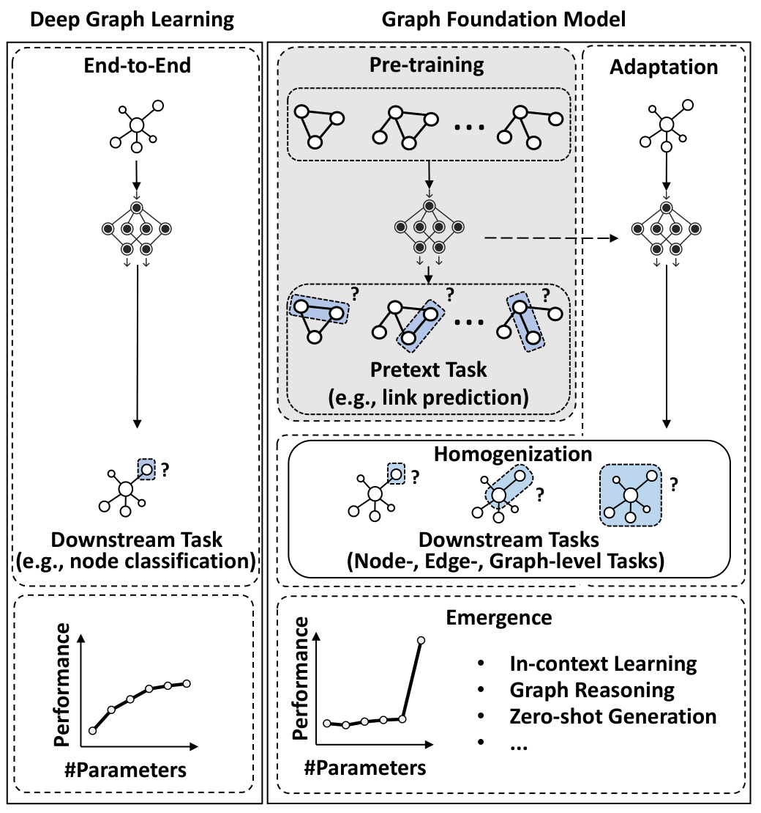

# 图基础模型范式对照 · 专用学习与共享预训练

<!-- CATEGORY NAV -->
[Teaser](../README.md) · [Architecture](../../architecture/README.md) · [Element](../../element/README.md) · [总目录](../../CATALOG.md)
<!-- END CATEGORY NAV -->

[所属分类](../README.md) · [总目录](../../CATALOG.md)

**arXiv 2023 · 预印本综述 · 原论文 Figure 1**

## 为什么收这张图

左右对照专用端到端学习与预训练加适配，复用同样的图节点和模型符号，底部再用示意曲线与能力列表补充两种范式的概念差异；几乎全靠结构和线条传递信息。

综述原文 Figure 1 的范式对照 teaser。底部曲线是概念示意，不是可直接读取数值的实验结果。

## 可以借鉴

- 左右两侧对齐共同要素，让变化集中在中间训练与适配组织。
- 同一组图节点符号从输入到任务反复出现，减少装饰。
- 把核心对照与附加能力分上下两层，保持主结论清楚。

## 文件与编辑范围

[作者原始 PDF](original.pdf) · [SVG 转换件](source.svg) · [原始 LaTeX 插图定义](figure-inclusion.tex) · [来源与校验记录](metadata.json)

作者独立 PDF 中的文字与图形对象保留；SVG 文字转为轮廓。这张独立原图未检出嵌入位图。

对照原论文页核实了图号和实际用途；独立 PDF 按作者提交的原文件保存。

原始 PDF 来自作者提交的 TeX 归档，未改字节；SVG 是格式转换件，未取得原生 AI 工程。桌面 Illustrator 尚未逐项实测。

## 原始出处

- 论文：[Graph Foundation Models: Concepts, Opportunities and Challenges](https://arxiv.org/abs/2310.11829v4)
- 作者：Liu, Jiawei, Yang, Cheng, Lu, Zhiyuan, Chen, Junze, Li, Yibo, Zhang, Mengmei, Bai, Ting, Fang, Yuan, Sun, Lichao, Yu, Philip S., Shi, Chuan
- [作者项目或仓库](https://arxiv.org/abs/2310.11829)
- [论文 TeX 原始归档](https://arxiv.org/src/2310.11829v4)，固定版本 `2310.11829v4`。
- 归档内路径：`images/intro.pdf`；原文 PDF 第 2 页，Figure 1。
- [出版与来源依据](https://arxiv.org/abs/2310.11829v4)；出版年份与所收录 arXiv 修订版时间分别记录。

## 权利与修改记录

该 arXiv 版本的非独占分发许可不是第三方图形重用许可；此条用于个人私有参考，公开改编或再用应核对原权利。

[原文许可声明](https://arxiv.org/licenses/nonexclusive-distrib/1.0/) · [本条权利记录](RIGHTS.source.txt)

只复制作者原件、转换格式和制作预览；没有重绘或新增图形。

<!-- BEGIN FIGURE LINKS -->
## 关联范例与元素

**可搭配的现有元素：** [网络](../../element/svg/tabler-network.svg) · [节点分支](../../element/svg/tabler-affiliate.svg) · [折线图符号](../../element/svg/tabler-chart-line.svg) · [水平双向箭头](../../element/svg/tabler-arrows-right-left.svg)

这些元素按表达功能关联，并非从本论文原图拆出；来源和许可仍以各元素记录为准。

[范例与元素对照表](../../element/with-examples.md) · [元素分类目录](../../element/README.md)
<!-- END FIGURE LINKS -->
